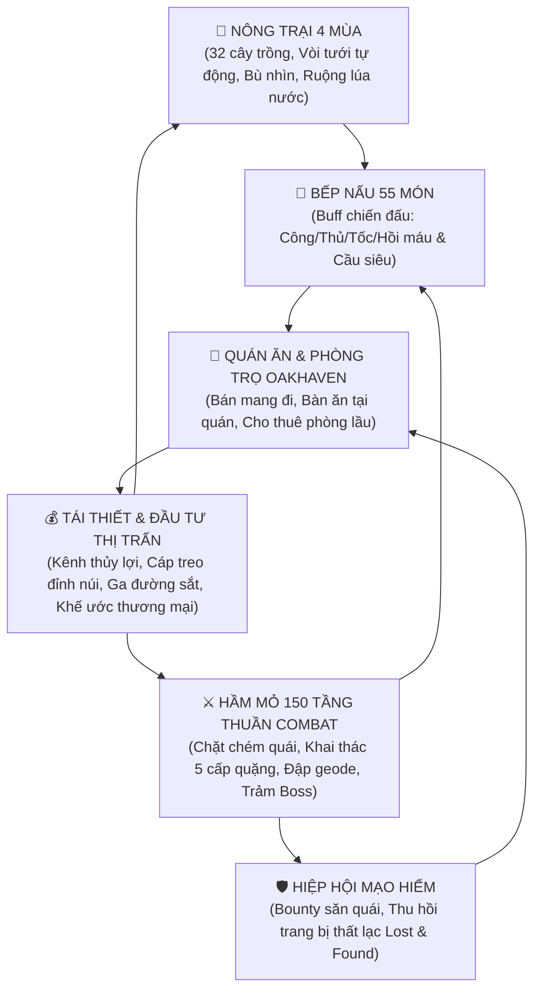

# Oakhaven Design Compendium: Master Specification (Quán Ăn, Nông Trại & Thám Hiểm)

> **Dự án:** Rowan of Oakhaven  
> **Thể loại:** Dark Pixel Action RPG + Farming & Tavern/Eatery Life-Sim  
> **Engine:** Godot 4.7.2  

---

## 1. Tổng Quan Kiến Trúc Vòng Lặp Trò Chơi (Core Loop)

---

## 2. Hệ Thống HP, Stamina & Cơ Chế Phạt Ngất Xỉu

### 2.1. Thanh Chỉ Số Sinh Mệnh
- **Thanh Thể Lực (Stamina Bar - Khởi điểm 270):** 
  - Mọi thao tác cuốc đất, gieo hạt, tưới nước, đập đá, chặt cây, câu cá tiêu hao Stamina (từ 1 đến 4 điểm tùy cấp công cụ).
  - Khi Stamina chạm 0: Kích hoạt trạng thái **Kiệt Sức (Exhausted)** — tốc độ di chuyển giảm 50%, nhân vật thở dốc, màn hình tối góc.
  - Tiếp tục dùng công cụ khi đang kiệt sức $\rightarrow$ Ngất xỉu ngay lập tức.
- **Thanh Máu (HP Bar - Khởi điểm 100):**
  - Máu giảm khi trúng đòn tấn công của quái vật hoặc bẫy hầm ngục. Chạm 0 $\rightarrow$ Gục ngã tại trận.

### 2.2. Cơ Chế Rơi Đồ Khi Ngất Xỉu & Dịch Vụ Thu Hồi Tại Hiệp Hội Mạo Hiểm (Lost & Found)
- **Khi Rowan ngất xỉu (cạn HP trong hầm mỏ hoặc cạn Stamina lúc 2:00 AM):**
  - Đội tuần tra cứu nạn của **Hiệp Hội Mạo Hiểm Oakhaven** (dưới quyền Hội Trưởng Thorne) sẽ đưa Rowan về giường hoặc Trạm y tế của Dược sĩ Maeve.
  - Bị trừ 10% tiền mặt hiện có (tối đa 1,000g viện phí và phí cứu nạn).
  - **Mất đồ ngẫu nhiên:** Rơi mất từ 1 đến 4 món đồ đang chứa trong Balo (stack quặng, vật liệu, hoặc vũ khí chưa cất rương).
- **Dịch Vụ Thu Hồi Đồ Thất Lạc Tại Hiệp Hội Mạo Hiểm (Adventurer's Guild Counter):**
  - Người chơi ghé bàn trực của Hội Trưởng Thorne hoặc Điều phối viên Valerie để xem biên bản giải cứu và danh sách đồ vật đánh rơi.
  - Có 2 cách để chuộc lại đồ:
    1. **Trả Vàng:** Chi trả khoản tiền tương ứng với giá trị món đồ để mạo hiểm giả đi gom về.
    2. **Đổi Bằng Đồ Ăn Tiếp Tế (Cơm Hộp Viễn Chinh):** Nấu các phần thức ăn dã chiến theo yêu cầu của Hiệp Hội để nhận **Huy Hiệu Cứu Viện** đổi lại trang bị thất lạc miễn phí.

---

## 3. Không Gian Riêng & Tùy Biến Nhà Của Rowan (Private Quarters)

Rowan sở hữu không gian sống hoàn toàn riêng biệt nằm trên tầng gác mái của quán ăn (hoặc khuôn viên nhà riêng ven suối), tách bạch với khu kinh doanh phục vụ thực khách:

### 3.1. Các Khu Vực Chức Năng Riêng Biệt
1. **Giường Ngủ Cá Nhân (Personal Bed):**
   - Đi ngủ để kết thúc ngày, hồi phục chỉ số và lưu game.
   - Nâng cấp: Giường Rơm $\rightarrow$ Giường Gỗ Sồi $\rightarrow$ Giường Nệm Lông Ngỗng (hồi phục 100% Stamina ngay cả khi hôm trước bị kiệt sức).
2. **Bàn Thử Nghiệm Ẩm Thực R&D (Rowan's Secret Lab Counter):**
   - Nơi Rowan tự do ghép 2 đến 4 nguyên liệu bất kỳ để tự mò ra công thức nấu ăn mới mà không lo làm hỏng nguyên liệu trước mặt khách.
3. **Tủ Đồ Thời Trang & Gương Soi (Wardrobe & Mirror):**
   - Quản lý và thay đổi trang phục: Nón, Áo giáp/Trang phục, Quần, Giày với hiệu ứng thị giác hiển thị trực tiếp lên nhân vật.
4. **Kệ Trưng Bày Chiến Tích & Cổ Vật (Trophy & Relic Showcase):**
   - Nơi cắm các cúp vàng Lễ hội ẩm thực Oakhaven, đầu lâu quái vật tinh anh và cổ vật khai quật từ phế tích.
5. **Hầm Ủ Men & Lên Men Riêng (Private Aging Cellar):**
   - Mở khóa khi nâng cấp nhà cấp 2. Chứa các thùng gỗ sồi ủ phô mai, tương đậu, dấm hoa quả và rượu vang mật ong hảo hạng.

---

## 4. Hệ Thống Hầm Ngục Mỏ Cổ Vô Tận & Chiến Đấu (The Infinite Mine-Dungeon & Action RPG Combat)

> **NGUYÊN TẮC CỐT LÕI:** Hầm mỏ và Dungeon **GỘP LÀM 1 THỂ THỐNG NHẤT** mang tên **Hầm Ngục Mỏ Cổ Vô Tận (The Infinite Mine-Dungeon)**. Đây là **chiến trường sinh tử thuần túy**. Quái vật mang tính thù địch (Hostile), cực kỳ hung dữ và tấn công lập tức khi thấy người chơi. **Tuyệt đối không có cơ chế xoa dịu hay dâng đồ ăn cho quái vật trong hầm ngục.** 
> Thức ăn 55 món được sử dụng làm **buff chỉ số chiến đấu cho chính Rowan** (Công, Thủ, Tốc độ, Kháng nguyên tố, Hồi máu tức thì) để tiêu diệt kẻ thù!

### 4.1. Cơ Chế Chinh Phục Hầm Mỏ (Soul-Knight Style Dungeon Flow & Endless Abyss)
- **Cấu Trúc Hầm Ngục Thống Nhất:**
  - **Tầng 1–150 (Chiến Dịch Cốt Truyện):** Chia làm 4 đới địa chất chính nối tiếp nhau. Mỗi tầng bao gồm các phòng hang kết nối qua cửa đá phong ấn.
  - **Tầng 151+ (Vực Thẳm Vô Tận - The Infinite Abyss):** Không giới hạn tầng mỏ (Endless), độ khó tăng tiến liên tục, quái vật đột biến tinh anh mang thuộc tính ngẫu nhiên, tỉ lệ rơi quặng hiếm và ngọc tinh linh tối thượng cao nhất dành cho lối chơi hardcore endgame.
- **Dọn sạch phòng:** Bước vào phòng đá, cửa sau lập tức khóa chặt $\rightarrow$ Tiêu diệt toàn bộ quái vật trong phòng để cửa thông tầng tiếp theo mở ra và nhận rương tài nguyên.
- **Quy Tắc Sinh Tử — "Mất Đồ Là Mất Đồ" (Permanent Loss on Defeat):**
  - Khi Rowan kiệt sức (HP = 0) trong hầm mỏ: Cậu phụ tá Colm dùng cáng kéo Rowan về Trạm Xá để bảo toàn tính mạng (tránh permadeath/xóa file save).
  - Người chơi bị trừ tiền viện phí cấp cứu điều trị chấn thương.
  - **Toàn bộ khoáng sản, vật phẩm và chiến lợi phẩm thu thập trong lượt thám hiểm đó rơi lại dưới lòng đất và MẤT VĨNH VIỄN.**
  - **Tuyệt đối không có cơ chế cứu hộ miễn phí 100%, không giảm giá chuộc đồ, không giữ an toàn hành trang.** Người chơi phải luôn tính toán lượng máu và chủ động dùng Dây Thừng Thoát Hiểm (Escape Rope) hoặc Cửa Dịch Chuyển để rút lui an toàn.
- **Quy Tắc Cư Dân Mặt Đất & Chạm Trán Ngẫu Nhiên Trong Mỏ (Surface-Only NPCs & Mine Encounters):**
  - **100% NPC đều sinh sống cố định tại thị trấn, điền trang hoặc các lán trại trên MẶT ĐẤT.** Không có NPC nào dựng lều định cư lâu dài trong hầm ngục.
  - **Chạm trán ngẫu nhiên:** Trong quá trình đào mỏ, Rowan thỉnh thoảng có thể bắt gặp một số NPC đang làm công việc dã ngoại ngắn hạn (Bram đang gõ mạch quặng sâu, Lão Gomer thử nghiệm mìn phá đá, Thợ lặn Vael khảo sát hồ nước ngầm, Hiệp sĩ Hester tìm nhặt mảnh thép vụn, Hội trưởng Thorne thị sát phong ấn). Đây là các sự kiện chạm trán gia tăng chiều sâu thế giới (flavor encounters), không biến hầm mỏ thành khu dân cư.
- **Chiến Đấu Nhịp Độ Nhanh (Hack & Slash):**
  - Kết hợp vung vũ khí cận chiến (Kiếm chém nhanh 3 nhịp, Liềm quét hình bán nguyệt rộng AoE, Búa tạ đập chấn động vỡ giáp).
  - Tấn công tầm xa bằng Pháp trượng ma thuật hoặc ném Bom lửa.
  - Phím `Space` Lướt né (Dash) có khung bất tử (i-frames) để tránh đòn quét diện rộng của quái vật.
- **Đèn Lồng Bão Đom Đóm (Spirit Lantern):**
  - Chiếu sáng các căn phòng tối đen như mực.
  - Một số quái vật ẩn mình trong bóng đêm chỉ có thể bị phát hiện và dính sát thương khi bước vào quầng sáng của Đèn Lồng.

### 4.2. Danh Mục Quái Vật 4 Đới Địa Chất

| Đới Địa Chất & Tầng | Tên Quái Vật | Kiểu Tấn Công & Pattern | Điểm Yếu & Khắc Chế | Chiến Lợi Phẩm Rơi (Loot) |
|:---|:---|:---|:---|:---|
| **Đới 1: Mỏ Khai Thác Cũ** *(Tầng 1–30)* | **Ấm Trà Quỷ Ám** *(Poltergeist Kettle)* | Bay lơ lửng, phun tia nước sôi cay nồng gây bỏng nhẹ liên tục. | Dễ bị gián đoạn đòn khi ăn chém cận chiến. | Đồng phế liệu, Dầu thực vật cô đặc. |
| | **Bọ Tinh Thể Ám Tối** *(Dark Crystal Scarab)* | Bò nhanh bám tường, phóng mảnh vụn thạch anh nhọn hoắt. | Mai cứng, yếu trước sát thương búa tạ và bom. | Thạch anh đen, Mảnh giáp bọ. |
| | **Slime Thạch Gai** *(Spiky Slime)* | Nhảy cao bổ nhào dập đất làm chậm người chơi, phân tách khi chết. | Vũ khí quét rộng (Liềm AoE). | `Thạch Tinh Thể Đổi Màu` (nguyên liệu nấu ăn). |
| | **Dơi Cắn Trộm** *(Glow-Wing Bat)* | Bay lượn zíc-zắc khó đoán, lao thẳng vào mặt hút máu. | Đứng yên canh chém chuẩn nhịp tiếp cận. | Cánh dơi dạ quang, `Quả Mọng Ánh Trăng`. |
| | **Cua Đá Mai Cứng** *(Crystal Rock Crab)* | Ngụy trang tảng đá, bất ngờ kẹp đôi gây choáng và phản đòn. | Dùng Cuốc chim hoặc Bom lật ngửa mai. | `Muối Biển Tinh Thể`, Mai cua cứng. |
| **Đới 2: Lò Luyện Cổ Khaz-Drakor** *(Tầng 31–70)* | **Người Máy Lò Hơi** *(Furnace Cog-Automaton)* | Bụng đỏ rực phun cột lửa xoay tròn 360 độ và quạt khói độc. | Bị làm chậm bởi đòn tấn công hàn băng. | `Bánh Răng Vàng Ròng`, Than cốc cao cấp. |
| | **Ốc Sên Quặng Dung Nham** *(Magma Magnesnail)* | Vỏ nam châm nóng chảy hút giật vũ khí sắt của người chơi, để lại vệt nham thạch rực lửa trên sàn. | Đánh từ tầm xa bằng Pháp trượng/Cung. | `Thỏi Đồng Nung`, Kim cương đỏ thô. |
| | **Chuột Chũi Thợ Khoan Cơ Khí** *(Steam-Mole Driller)* | Độn thổ dưới lòng đất, trồi lên bất ngờ hất tung đá và gây choáng. | Đặt bom ngay tại vị trí mặt đất rung chuyển. | Linh kiện cơ khí cổ, Mũi khoan hợp kim. |
| **Đới 3: Rừng Sâu Cổ Tích Sylva-Fae** *(Tầng 71–110)* | **Rễ Cây U Uất** *(Gloom-Root Strangler)* | Rễ cây đen ngòm vươn dài từ đất quấn chân Rowan, chóp hoa bắn gai độc làm mờ màn hình. | Rìu chiến hoặc vũ khí chém có khảm ngọc Lửa. | Rễ thảo mộc quý, Tinh chất gỗ sồi. |
| | **Bướm Đêm Nghiện Mật** *(Nectar Phantasm Moth)* | Bay tầm cao, thả bột phấn hoa gây mê ngủ và lao xuống cướp máu. | Đèn Lồng Đom Đóm làm chói mắt rơi xuống đất. | `Phấn Hoa Ánh Kim`, Cánh bướm phát quang. |
| | **Mộc Tinh Tinh Nghịch** *(Bramble Puck)* | Yêu tinh rêu chạy cực nhanh, ném quả nổ bùn lầy làm bẩn và chậm 60% tốc độ. | Áp sát nhanh bằng phím Lướt Dash. | Bùn sao giàu dưỡng chất, Hạt giống quý. |
| **Đới 4: Cung Điện Ánh Sao Solaria** *(Tầng 111–150)* | **Bộ Giáp Kỵ Sĩ Vô Hồn** *(Astral Hollow Knight)* | Bộ giáp cẩm thạch trắng vung đại kiếm chém ra sóng pha lê bay thẳng xuyên phòng. | Lướt ra sau lưng chém đòn chí mạng khi hắn vung kiếm. | Mảnh giáp cẩm thạch, Lõi hộ mệnh cổ. |
| | **Cổ Thư Phản Phệ** *(Grimoire Mimic)* | Sách phép có răng nhọn bay lượn trên không, bắn chùm tia ma thuật tự tìm mục tiêu. | Chém gián đoạn phép thuật lúc sách mở trang. | Mực ma thuật, Trang sách công thức cổ. |
| | **Quạ Gương Thiên Văn** *(Mirror-Glass Raven)* | Quạ cánh gương vỡ phản chiếu ánh sáng làm mù mắt và phản lại 50% sát thương tầm xa. | Bắt buộc phải áp sát đánh cận chiến. | Mảnh gương sao, Lông vũ lấp lánh. |

### 4.3. Đấu Trường Thủ Vệ (Warden Boss Fights)
- Tầng 30: **Golem Máy Hơi Nước Bất Bại (The Steam Colossus)** — Triệu hồi cột khói ngạt và dậm đất rung chuyển cả tầng mỏ.
- Tầng 70: **Hỏa Long Nham Thạch (Magma Behemoth)** — Bơi trong bể dung nham, phun mưa cầu lửa khắp phòng đá.
- Tầng 110: **Đại Thư Viện Trưởng Cổ Đại (Arch-Librarian Phantom)** — Tạo phân thân ma thuật và bẫy sách rực sáng.
- Tầng 150: **Thủ Vệ Tinh Tú Khaz-Drakor (Aether Void Sentinel)** — Boss tối thượng sở hữu 3 giai đoạn chiến đấu, kiểm tra toàn bộ kỹ năng vũ khí và chuẩn bị buff thức ăn của người chơi.

---

## 5. Hệ Thống Khoáng Sản, Quặng & Khảm Ngọc Vĩnh Viễn

### 5.1. 5 Cấp Bậc Quặng & Kim Loại
1. **Quặng Đồng (Copper Ore) & Thỏi Đồng:** Tầng 1–30. Rèn trang bị cấp 1, Nồi nấu, Vòi tưới 4 ô.
2. **Quặng Sắt (Iron Ore) & Thỏi Sắt:** Tầng 31–70. Rèn trang bị cấp 2, Bếp nướng, Vòi tưới 8 ô.
3. **Quặng Vàng (Gold Ore) & Thỏi Vàng:** Tầng 71–110. Chế tạo máy móc tự động, Vòi tưới cao cấp, Đồ trang sức.
4. **Quặng Mithril (Mithril Ore) & Thỏi Mithril:** Tầng 111–140. Kim loại nhẹ sắc bén, kháng phép thuật.
5. **Quặng Bụi Sao (Aetherium / Void Ore) & Thỏi Bụi Sao:** Tầng 141–150+. Rèn vũ khí tối thượng và Vòi tưới 24 ô.

### 5.2. Đá Quý & Trứng Khoáng Thạch (Geodes)
- **Trứng Khoáng Thạch (Geode):** Thu thập khi đập đá hầm mỏ (Geode Thường, Geode Băng, Geode Dung Nham, Geode Tinh Tú). Mang đến Lò rèn Boris để đập mở khóa cổ vật, đá quý và muối khoáng ẩm thực.
- **Đá Quý:** Hồng Ngọc, Lam Ngọc, Ngọc Lục Bảo, Hoàng Ngọc, Thạch Anh Tím, Kim Cương, Mảnh Cầu Vồng (Prismatic Shard).

### 5.3. 5 Loại Ngọc Tinh Linh Khảm Vĩnh Viễn (Soul Essences)
- **Quy tắc tuyệt đối:** **Đã khảm là vĩnh viễn, không thể tháo rời** (để tránh rườm rà tiểu tiết). Muốn dùng ngọc khác cần rèn vũ khí mới!
  - **Hỏa Tinh (Pyre Ember):** Vũ khí gây thiêu đốt 5 giây; Giáp tăng kháng lửa dung nham.
  - **Hàn Tinh (Frost Shard):** Vũ khí làm chậm quái 35%; Giày miễn nhiễm trơn trượt trên băng/bùn.
  - **Lôi Tinh (Volt Spark):** Đòn đánh có 20% giật sét lan sang 3 quái vật lân cận.
  - **Huyết Tinh (Vampiric Leech):** Hồi 3% sát thương gây ra thành máu (HP) khi đánh chí mạng.
  - **Hộ Mệnh Tinh (Aegis Core):** Tạo 1 lớp khiên chắn miễn nhiễm hoàn toàn 1 đòn chí mạng đầu tiên mỗi khi vào phòng mới.

---

## 6. Mở Rộng Bản Đồ Thế Giới: Độc Bản Oakhaven (Không Rập Khuôn Stardew)

Thế giới game mở rộng dựa trên **Khôi Phục Đại Công Trình Thủy Lợi, Giao Thương Xuyên Lục Địa & Đại Lễ Hội Ẩm Thực**:

| Đại Công Trình Oakhaven | Tài Nguyên Tái Thiết | Cơ Chế Mở Khóa Độc Bản & Vùng Đất Mới |
|:---|:---|:---|
| **1. Kênh Thủy Lợi Thượng Nguồn & Bánh Xe Nước** *(Highland Aqueduct)* | 300 Gỗ Sồi, 40 Thỏi Sắt, 10 Bánh Răng Cổ, 3,000g | Khơi thông cống ngầm cổ đại, đưa nước ngọt về thung lũng. Mở khóa **Ruộng Bậc Thang Trồng Lúa Nước (Rice Paddies)** vụ Hè-Thu, hồ thả cá nước ngọt và tuyến chèo thuyền nan xuôi dòng. |
| **2. Cây Thần Ngàn Năm & Đại Lễ Tẩy Trần** *(The Sacred Elder Grove)* | Nấu 5 Món Đại Tiệc Tẩy Trần cho Dân Làng & Bàn Thờ Cổ | Tổ chức Lễ Hội Ẩm Thực tại quảng trường, dâng 5 món đại tiệc thanh lọc khói sương chướng khí tích tụ sau chiến tranh. Xua tan sương mù tím độc, mở ra **Khu Rừng Thần Thảo Mộc** chứa cây giống vĩnh cửu và đàn ong rừng mật sao. |
| **3. Tuyến Cáp Treo Mỏ Khai Nguyên** *(The Ancient Sky-Tram)* | 50 Cáp Thép, 4 Lõi Năng Lượng Cổ, 20 Thỏi Vàng, 8,000g | Kích hoạt buồng cáp treo hơi nước vượt qua Vực Thẳm Không Đáy. Mở khóa **Đỉnh Núi Răng Sói (Wolf-Fang Peak)** — nơi có quặng Bụi Sao lộ thiên, khu suối nước nóng ngâm mình hồi đầy Stamina và thảo mộc băng tuyết. |
| **4. Tuyến Đường Sắt Trung Tâm Oakhaven** *(The Central Rail Line)* | 100 Thanh Ray Thép, 50 Thỏi Vàng, Ký Hợp Đồng Cung Cấp Lương Thực | **Không phải xe dịch chuyển!** Tàu hỏa mang các **Đoàn khách du lịch, Quý tộc đại lục, Đầu bếp quốc tế và Thương gia xa** tới Oakhaven vào mỗi cuối tuần. Làm bùng nổ nhu cầu thuê phòng trọ tầng 2 và ăn uống tại quán. |
| **5. Cổ Đô Cấm Địa Lòng Đất** *(Sunken Necropolis - Hậu Tầng 150)* | 4 Món Ăn Tinh Tế Đặt Lên 4 Bệ Thờ Tứ Nguyên Tố | Phá vỡ phong ấn cổ xưa dưới đáy mỏ. Mở ra **Hầm Ngục Vô Tận Đổi Mới Hàng Tuần**, chứa các căn bếp thất truyền của nền văn minh cổ, boss thần thoại và trang bị truyền thuyết. |

---

## 7. Nông Trại 32 Cây Trồng & Tự Động Hóa

### 7.1. Phân Bổ 32 Cây Trồng Theo Mùa
- **Mùa Xuân (8):** Cải thìa (4 ngày), Khoai tây (6 ngày, tỉ lệ x2), Dâu tuyết (8 ngày, mọc lại sau 4 ngày), Hành hoa (4 ngày), Tỏi dại (4 ngày), Đậu hà lan (10 ngày, mọc giàn), Bắp cải sớm (9 ngày), Trà xanh búp non (12 ngày, hái định kỳ).
- **Mùa Hạ (8):** Ngô ngọt (14 ngày, xuyên 2 mùa Hạ-Thu), Cà chua mọng (11 ngày, mọc lại 4 ngày), Ớt lửa (5 ngày, mọc lại 3 ngày), Dưa lưới tinh vân (12 ngày), Cà tím (5 ngày), Lúa miến hoàng kim (8 ngày, xay làm gạo/bột), Mía đường (7 ngày, ép mật), Việt quất (13 ngày, mọc lại 4 ngày, hái 3 quả/lần).
- **Mùa Thu (8):** Lúa mì vàng (4 ngày), Bí đỏ khổng lồ (14 ngày), Khoai môn tro trấu (10 ngày), Nấm sao tím (7 ngày, cần che mát), Củ dền đỏ (6 ngày), Nho đêm (10 ngày, mọc giàn), Đậu đen (8 ngày), Hạt hướng dương (8 ngày).
- **Mùa Đông (4):** Củ cải mùa đông (6 ngày), Khoai tuyết (7 ngày), Rễ địa y lạnh (8 ngày), Hoa tuyết liên (12 ngày).
- **Cây Lâu Năm (4):** Cây Táo Sồi (Thu), Cây Chanh Vàng (Hạ), Bụi Dâu Rừng (Xuân), Bụi Ớt Ma Thuật (Quanh năm trong nhà kính).

### 7.2. Tự Động Hóa Nông Trại
- **Vòi Phun Tưới Tự Động (Sprinklers):**
  - *Vòi Đồng:* Tưới 4 ô chữ thập lúc 6:00 AM mỗi ngày.
  - *Vòi Sắt:* Tưới 8 ô xung quanh (khung 3x3).
  - *Vòi Bụi Sao:* Tưới 24 ô xung quanh (khung 5x5).
- **Bù Nhìn Đuổi Chim (Scarecrows):**
  - Bù nhìn rơm: Bảo vệ bán kính 8 ô xung quanh khỏi chim ăn hạt.
  - Bù nhìn ma thuật: Bảo vệ toàn nông trại và tự gom nông sản rụng.
- **Nhà Tá Điền Phụ (Farmhands):** Thuê dân làng rảnh việc tự động gặt nông sản vào thùng xuất xưởng.

---

## 8. Bếp Quán Ăn, 55 Món Ăn & Buff Chiến Đấu Toàn Diện

### 8.1. 5 Trạm Bếp Chế Biến Quán Ăn
1. **Nồi Ninh Hầm (Boiling Pot):** Các món canh bổ, súp hầm thịt, trà dược liệu hồi máu/thể lực tức thì.
2. **Chảo Rán & Xào (Frying Pan):** Các món xào lăn, chiên giòn tăng cực mạnh Sát Thương Tấn Công (ATK).
3. **Lò Nướng Đá (Stone Oven):** Các loại bánh nướng, thịt quay tăng Giáp Phòng Ngự (DEF) và Kháng Nguyên Tố.
4. **Nồi Hấp Chân Không (Bamboo/Metal Steamer):** Món hấp thanh đạm, tăng Tốc Độ Di Chuyển (Speed) và Tốc Đánh.
5. **Bếp Nướng Than & Lò Hun Khói (Smoker & Grill):** Thịt cá hun khói, thịt xiên nướng tăng Tỉ Lệ Bạo Kích (Crit Rate) và May Mắn (Luck).

### 8.2. Danh Sách 55 Món Ẩm Thực & Bảng Buff Thực Chiến

*(Chi tiết đầy đủ 55 món ăn với nguyên liệu, trạm chế biến, giá bán và buff chỉ số xem chi tiết tại [cooking-recipes-guide.md](file:///D:/Dev-game/rowan-of-oakhaven-wiki/docs/cooking-recipes-guide.md))*

* **Nhóm Buff Tấn Công (ATK Boost):** Bò bít tết sốt tiêu đen (+25% ATK), Cơm chiên hải sản cay (+15% ATK, +10% Crit), Thịt xiên nướng than hồng (+12% ATK).
* **Nhóm Buff Phòng Ngự (DEF Boost):** Súp nấm rễ cây dày (+10 DEF, Kháng Choáng), Bánh mì thợ mỏ nướng giòn (+8 DEF, +20 Kháng gai nhọn), Khoai tây nghiền bơ tỏi (+5 DEF).
* **Nhóm Buff Cơ Động & Tốc Độ (Speed Boost):** Trà xanh búp non tuyết (+20% Tốc chạy trong 5 phút), Gỏi cuốn tôm suối (+15% Tốc chạy, +10% Tốc đánh), Nước ép việt quất lên men (+15% Tốc chạy).
* **Nhóm Buff Đào Mỏ & Thu Thập (Mining & Luck Boost):** Súp bí đỏ thợ mỏ (+1 Cấp Đào Đá, tăng 20% tỉ lệ rơi quặng), Bánh quy bơ hạt phỉ (+2 May Mắn nhặt Geode hiếm).
* **Nhóm Thanh Tẩy Cầu Siêu (Soul Cleansing):** Dùng để dâng lên các Bàn Thờ Cổ trên mặt đất Chiến Trường Tro Tàn để giải phóng linh hồn và hóa giải đất độc thành đất đen phì nhiêu.

---

## 9. Đại Bản Doanh Điền Trang Oakhaven (The Frontier Homestead), Nhà Trọ Áp Mái & Lối Chơi Tự Do

### 9.1. Tự Do Lối Chơi Tuyệt Đối (Player Freedom Sandbox)
- **Không Gò Bó Giờ Giấc (No Mandatory Shifts):** Rowan không bị xích chân vào ca làm việc chạy bàn (không áp lực Diner Dash). Người chơi hoàn toàn tự do phân bổ thời gian: cày 150 tầng mỏ, canh tác 32 giống cây, câu cá ven sông hồ, hoặc chế tác máy móc.
- **Quyền Làm Chủ Căn Bếp (Master of the Kitchen):** Rowan sở hữu và làm chủ 100% việc sáng tạo 55 món ăn. Thức ăn phục vụ 2 mục đích chính:
  1. **Lương thực dã ngoại & Buff chiến đấu:** Mang theo ba lô để hồi máu, tăng công, tăng thủ, kháng độc khi khám phá mỏ sâu.
  2. **Bán buôn thụ động (Passive Sales):** Thức ăn thừa được đặt lên **Quầy Tự Phục Vụ (Honor Pantry)** hoặc quẳng vào **Hòm Xuất Khẩu (Shipping Bin)** trước cổng. Tiền tự động cộng vào túi mà người chơi không cần đứng bưng bê.

### 9.2. Dãy Phòng Trọ Áp Mái & Nhân Sự Điền Trang (The Bunkhouse & Staff)
- **Cơ chế Phòng Trọ Áp Mái:** Có 3 đến 5 phòng cho khách thám hiểm vãng lai, thương nhân thuê qua đêm.
- **Bác Quản Gia Barnaby:** Tự động thu tiền trọ (Passive Rent) mỗi sáng Thứ Hai, kê khai sổ sách lời lỗ hòm xuất khẩu, đàm phán giảm chi phí nâng cấp công trình.
- **Cậu Phụ Tá Colm:** Chẻ củi đầy hộc bếp, xay lúa mì thành bột mịn, gom trứng sữa vào kho lạnh, vót sẵn đuốc dã ngoại. Khi Rowan kiệt sức trong hầm mỏ, Colm dùng cáng khiêng về Trạm Xá/giường ngủ để cứu mạng (nhưng toàn bộ vật phẩm thu thập trong lượt đi mỏ rơi mất vĩnh viễn theo nguyên tắc "mất đồ là mất đồ").

### 9.3. Đầu Tư Thương Mại & Tái Thiết Thị Trấn
- Bảng Nhiệm Vụ Hiệp Hội & Bảng Tái Thiết Thị Trấn: Đóng góp vật liệu sửa Cối Xay Gió, Đèn Đường, Trạm Xá.
- Ký hợp đồng cung cấp lương thực số lượng lớn cho đoàn buôn đường sắt.
- Đầu tư cổ phần tàu thám hiểm của Thuyền Trưởng Garrick để nhận hải sản và gia vị ngoại quốc độc quyền.

---

## 10. Hồ Sơ Tâm Lý, Chiều Sâu 51 Nhân Vật & Tuyến Nhiệm Vụ Trái Tim (NPC Narrative Lore & Heart Events)

### 10.1. Triết Lý Xây Dựng: "Vết Nứt Đời Thực & Sự Ấm Áp Mộc Mạc"
Mỗi cư dân Oakhaven không phải NPC rập khuôn vô hồn, mà mang một **vết nứt đời thực mộc mạc**: gánh nặng mưu sinh sau chiến tranh, chuột cắn mùa màng, đau khớp khi trời lạnh, nợ tiền quán rượu hay nỗi hoang mang của kẻ tha hương. Mâm cơm nóng và ổ bánh nướng giòn rụm của Rowan là cầu nối gắn kết, giải quyết những khó khăn cơm áo gạo tiền rất cụ thể.

### 10.2. Mạng Lưới 51 Nhân Vật Tiêu Biểu & Vết Thương Đời Thực
1. **Rowan (Chủ Điền Trang, Master Cook & Thợ Săn Mỏ):** Người trẻ kiệt quệ (burnout) trốn chạy cuộc sống vô cảm kinh đô, mang hội chứng kẻ giả mạo (Imposter Syndrome). Tự tay làm chủ 100% căn bếp 55 món, vừa cuốc đất khai hoang vừa săn quặng trong Hầm Ngục Mỏ Cổ Vô Tận.
2. **Bác Quản Gia Barnaby (Quản Gia Sổ Sách & Dãy Phòng Trọ):** Cựu thủ kho quân nhu giải ngũ nghèo túng, sợ mình thành gánh nặng thừa thãi; quản lý phòng trọ áp mái, thu tiền trọ tự động, dự báo thị trường sốt giá và quản lý két sắt điền trang sinh lãi 3%/tuần.
3. **Cậu Phụ Tá Colm (Hậu Cần, Sơ Chế & Chuyển Cứu Khẩn Cấp):** Trẻ mồ côi làm thuê bị quịt lương, được Rowan cứu ở Tầng 15 mỏ; chẻ củi, xay bột mì, gom sữa trứng tự động; phụ trách cáng cứu hộ đưa Rowan về giường khi kiệt sức (mất đồ nhặt trong chuyến đi, không có cứu đồ free).
4. **Bà Ngoại Amalia (Di sản & Linh hồn dẫn lối):** Biểu tượng người phụ nữ gom yêu thương vào mâm cơm. Từng ở lại cứu thị trấn trong nạn đói. Lời dặn: *"Nấu ăn là để người ta có sức sống sót và tiếp tục vững vàng ngày mai."*
5. **Cặp Anh Em Nhà Lùn Boris & Bram Barnaby (Mâu Thuẫn Anh Em Ruột):**
   - *Boris (Thợ rèn):* Dằn vặt 10 năm sau vụ sập mỏ khiến em trai Bram tàn tật; bao bọc thái quá vì sợ mất em.
   - *Bram (Thợ mỏ tầng sâu):* Tự ái vì bị xem là kẻ phế nhân thương hại; liều mạng xuống mỏ sâu chứng minh giá trị (thỉnh thoảng Rowan bắt gặp Bram đang đào quặng ở các tầng mỏ).
   - *Hàn gắn (8 Tim):* Nồi súp bò củ dền *Dwarf Ironforge Goulash* và bức thư di sản của người mẹ mở khóa **Trạm Tinh Luyện Cao Cấp** (rút ngắn thời gian đúc quặng, tăng tỷ lệ ngọc quý).
6. **Bà Cụ Maeve & Cậu Bé Bán Diêm Kael (Tình Thân Không Cùng Máu Mủ):**
   - *Bà Maeve:* Người làm vườn già thoái hóa khớp nặng, nén đau chắt chiu từng đồng tiền thuốc để dành cho tương lai của Kael.
   - *Kael:* Trẻ mồ côi từng bán diêm co ro trong bão tuyết, sợ bị bỏ rơi lần nữa nên làm việc kiệt sức để chứng minh bản thân hữu ích.
   - *Hàn gắn (8 Tim):* *Súp Bí Đỏ Hạt Sen* và bánh sinh nhật bảy màu; Kael tiếp quản và mở khóa **Vườn Ươm Cây Giống Bốn Mùa**.
7. **Hiệp Hội Mạo Hiểm: Hội Trưởng Thorne & Điều Phối Viên Valerie:**
   - *Thorne:* Cựu chỉ huy cấm vệ quân mang chân giả, mất 18 đồng đội dưới hầm sâu; quản lý Bảng Treo Thưởng Săn Quái (Bounties) & Giấy Phép/Ấn Triện Thông Hành Đới Mỏ (Clearance Seals).
   - *Valerie:* Cung thủ bắn tỉa giải ngũ vì mất thính lực một bên tai và chứng sợ tiếng nổ lớn (PTSD); quản lý Quầy Tiếp Tân và Quầy Mua Lại (Buyback Shop) cho đồ đạc người chơi lỡ tay bán nhầm trong ngày (không phải chuộc đồ mất trong mỏ).
   - *Hàn gắn (8 Tim):* Cơm hộp dã chiến tiếp tế và *Súp Nấm Tuyết Sườn Non*; mở khóa **Bảng Săn Boss Tinh Anh & Hợp Đồng Thưởng Quặng Quý Hiệp Hội**.
8. **Cha Con Đài Thiên Văn: Giáo Sư Orion & Thủ Thư Clara (Chăm Sóc Cha Già Sa Sút Trí Nhớ):**
   - *Giáo sư Orion:* Mắc chứng sa sút trí tuệ (Alzheimer), tuyệt vọng thức trắng đêm tìm vì sao mang tên người vợ quá cố Elise trước khi trí nhớ tan biến.
   - *Clara:* Kiệt sức vì chăm cha già (Caregiver Burnout), xé nát thư trúng tuyển đại học danh giá kinh đô để ở lại Oakhaven phụng dưỡng cha.
   - *Hàn gắn (8 Tim):* *Bánh Tart Việt Quất Tinh Cầu* và Trà Bá Tước Hoa Nhài; Thư viện mở khóa **Kho Lưu Trữ Công Thức Cổ Đại**.
9. **Thuyền Trưởng Garrick & Cậu Bé Finn (Vùng Bến Cảng Ven Biển):** Lão hoa tiêu già mù màu mặc cảm "khúc gỗ mục mắc cạn" và đứa cháu trai ngày đêm câu cá sao gom tiền chuộc lại chiếc la bàn báu vật cho ông.
10. **Lumi (Tinh Linh Cáo Tuyết Kemomimi-Elf):** Sinh linh lai bị cả người thú và tinh linh xa lánh; tìm thấy sự an toàn tuyệt đối bên tách *Trà Sen An Thần* và chiếc bánh bột gạo hấp của Rowan.
11. **Aurelia (Dược Sĩ) & Marlo (Cảnh Vệ Ca Đêm):**
   - *Aurelia:* Dược sĩ trạm xá, gánh nặng y đức trước cảnh bệnh nhân nghèo không đủ tiền mua thuốc giảm đau.
   - *Marlo:* Cảnh vệ ca đêm bảo vệ cổng làng Oakhaven, trung thực và kiệt sức vì thức trắng tuần tra xua đuổi dã thú; chắt chiu 90% lương gửi về quê nuôi đàn em.
12. **Lão Silas & Con Lừa Già (Thương Nhân Du Mục - Khách Trọ The Hearth):** Lái buôn xe lừa bán hạt giống và gia vị hiếm phương xa; ký hợp đồng cung ứng hàng tuần ở 8 Tim.
13. **Võ Sư Valerius (Võ Đường Đèo Núi Mặt Đất):** Cựu Đội trưởng Huấn luyện Vệ binh Hoàng gia bị lưu đày; mở võ đường trên đèo núi mặt đất dạy kỹ thuật Đỡ Đòn Phản Công (Parry) và thế thủ cận chiến; truyền dạy tuyệt kỹ phản đòn ở 8 Tim.
14. **Hiệp Sĩ Hester (Khách Trọ Áp Mái The Hearth):** Cựu kỵ sĩ thuộc cấp của Valerius lưu lạc tha hương; tá túc tại phòng áp mái, làm thợ mài giáp/rèn dã chiến giúp sửa chữa độ bền trang bị và gia cố giáp thô (+DEF).
15. **Valen de Montfort (Quý Tộc Lưu Vong Bệnh Máu Hiếm - Phòng Trọ Lầu 2 The Hearth):** Quý tộc lưu vong từ Solaria mắc chứng bệnh thiếu máu bẩm sinh và sợ ánh nắng mặt trời gay gắt; tá túc tại phòng kín The Hearth; cảm kích các món canh súp bổ máu và thuốc hãm thảo dược của Rowan; tặng bản thảo cổ và công thức chế tác trang sức gia truyền Solaria ở 8 Tim.
16. **Cô Thợ Dệt Mae (Khách Trọ The Hearth):** Nghệ nhân dệt du mục và thợ mộc nội thất; cung cấp giường nệm ấm áp, đồ gỗ thô và nhận hoàn thiện sơn màu nội thất gia dụng trọn gói; tặng Khung Dệt Len Điền Trang tự động ở 8 Tim.
17. **Lão Gomer (Khai Thác Đá & Kho Thuốc Nổ Cửa Hầm Mỏ - Mặt Đất):** Chuyên gia thuốc nổ người lùn điếc đặc; bán thuốc nổ mỏ đá và tặng Máy Khoan Hơi Nước cầm tay ở 8 Tim (thỉnh thoảng Rowan bắt gặp lão tại các tầng đá cứng hầm mỏ để bộc phá).
18. **Thợ Lặn Vael (Trại Lặn Hồ Băng Chân Núi - Mặt Đất):** Thợ lặn khoáng thể và thợ săn thủy quái mỏ; trại lặn ở hồ băng chân núi lộ thiên (Mặt Đất); thỉnh thoảng khảo sát các hồ ngầm trong mỏ; tặng Bộ Đồ Lặn Hơi Nước ở 8 Tim.
19. **Bà Rowena "Tro Than" (Chòi Than Rừng Sâu):** Cung cấp Than Rừng Già cháy x3 thời gian; mở khóa Lò Nung Than Tro Trấu cao cấp ở 8 Tim.
20. **Lão Tad "Bẫy Lươn" (Ngư Dân Đầm Lầy Lau Sậy):** Tặng Đó Tre Bắt Cá Tự Động; tặng Cần Câu Trúc Ngàn Năm tăng 25% tốc độ câu ở 8 Tim.
21. **Cậu Bé Milo (Quậy Phá & Trinh Sát Bìa Rừng):** Hái quả rụng và chỉ điểm bụi dâu rừng bí mật; lập Đội Thám Tử Nhí canh chừng thú hoang phá hoại mùa màng ở 8 Tim.
22. **Bé Hạt Dẻ Cora (Nhặt Sỏi Cuội & Hái Dâu Bờ Suối Đợi Cha):** Bé gái mồ côi mẹ, ngày ngày nhặt sỏi đá cuội ven suối và hái dâu dại ngóng tin cha là người lính viễn chinh; tặng Rowan Vòng Đá Cuội May Mắn (+5% né đòn); ở 8 Tim nhận thư cha bình an xuất ngũ trở về.
23. **Rosemary (Người Giữ Đền Cổ Oakhaven - Bìa Rừng Thầm Thì):** Người phụ nữ trầm mặc chăm sóc Bàn Thờ Cổ Đại; hướng dẫn Rowan nghi thức nấu các món đại tiệc thanh lọc khói độc miasma và tro tàn chiến tranh để giải phóng đất hoang.

### 10.3. Cơ Chế Bữa Ăn Kết Nối Tối (The Nightly Hearthside Service)
- Mỗi tối cư dân ghé Điền trang mang theo tâm trạng và khúc mắc đời thường.
- Nếu Rowan phục vụ đúng món ăn "Ký ức & Đồng điệu" phù hợp tâm trạng của họ:
  - Điểm thân mật tăng gấp 3 lần.
  - Kích hoạt các đoạn độc thoại mộc mạc, giải tỏa gánh nặng tâm lý.
  - Sau sự kiện 8 Tim, nhân vật sẽ tặng Rowan công thức gia truyền hoặc mở khóa tiện ích dịch vụ vĩnh viễn cho thị trấn.

### 10.4. Kiến Trúc Tam Phân Sự Kiện Trái Tim (3-Tier Event Delivery Architecture)
Để giải quyết bài toán khả thi sản xuất (Asset Feasibility) và chống phình to khối lượng công việc (Asset Creep), toàn bộ 168 mốc sự kiện tim của 51 nhân vật được phân định rõ ràng thành 3 cấp độ thể hiện kỹ thuật:
1. **Cấp C (~50% - Thư Tay Sớm Của Cú Pip):**
   - *Áp dụng:* Đa số mốc 2 Tim và các nhân vật Tier 3 ở xa.
   - *Cơ chế:* Sáng sớm, Cú Pip ngậm thư nhét vào hòm thư trước hiên nhà. Thư tay viết mộc mạc, kèm quà tặng (túi hạt giống, mở rộng ô ba lô, công thức sơ chế, giảm giá mua hàng). Chi phí asset = 0, tạo nhịp sinh hoạt mở thư mỗi sớm rất ấm cúng.
2. **Cấp B (~35% - Tâm Sự Bàn Ăn Ca Tối The Hearth):**
   - *Áp dụng:* Đa số mốc 4 Tim và 6 Tim.
   - *Cơ chế:* Tận dụng vòng lặp mở quán tối có sẵn. NPC ghé The Hearth ngồi vào bàn quen thuộc, trên đầu hiện bong bóng `[!]`. Rowan bê món ăn lại phục vụ, mở ra đoạn hội thoại tại chỗ (Dialogue Box) kết hợp Bong bóng biểu cảm 16×16 (Emote Bubbles). Nói xong mở khóa tiện ích (Võ đường, Vườn ươm, Bảng săn quái, Trị an ca đêm...). Chi phí asset = 0.
3. **Cấp A (~15% - Cutscene Hoạt Cảnh Đỉnh Cao):**
   - *Áp dụng:* Chỉ khoảng 15 – 20 sự kiện đỉnh cao trong toàn bộ game (mốc 8 Tim hóa giải bi kịch quá khứ và 10 Tim kết duyên).
   - *Cơ chế:* Diễn ra tại các bối cảnh quen thuộc (quán The Hearth, Lò rèn Boris, Bàn Thờ Cổ Đại), khóa điều khiển tạm thời 30 giây để thoại chạy tự động, tạo khoảnh khắc cảm xúc thăng hoa lắng đọng.

---

## 11. Hệ Thống Thành Tựu Steam, Thử Thách Kỹ Năng & Tab Hồ Sơ In-Game (Steam Achievements, Tactical Trials & Player Profile)

### 11.1. Kiến Trúc Đồng Bộ 1:1 Giữa Steamworks & Sổ Tay Điền Trang
- **Đồng bộ song hành:** Hệ thống thành tựu được thiết kế chuẩn Steamworks API (`steam_api_name: ACH_*`). Khi người chơi thỏa mãn điều kiện, game vừa kích hoạt Toast Popup của Steam, vừa lưu vào file save và hiển thị trong **Tab Hồ Sơ (Player Profile Tab)** trong Sổ Tay Điền Trang (`J` hoặc `Tab`).
- **Chế độ Ngoại Tuyến (Offline / DRM-Free):** Khi chơi không qua Steam Client, toàn bộ 50 thành tựu vẫn mở khóa bình thường và hiển thị đầy đủ trong giao diện game.

### 11.2. Phân Bổ 50 Thành Tựu Theo 7 Danh Mục Cốt Lõi
1. **Bếp Lửa & Ẩm Thực (Culinary - 7 Thành tựu):** Nấu món ăn đầu tiên, đạt 25 và 55 công thức, phục vụ đúng 15 món Comfort Dish, đạt 5,000 vàng/ca tối, hoàn thành tiệc đêm cho Valen de Montfort.
2. **Hầm Mỏ & Chiến Đấu (Mining & Combat - 6 Thành tựu):** Vượt qua 4 Trùm Giám Ngục (Tầng 30, 70, 110, 150), thu thập khoáng thạch lớn, phá 50 cự thạch bằng bom mỏ Gomer.
3. **Thử Thách Kỹ Năng / Độ Hard Vừa (Tactical Trials - 6 Thành tựu):**
   - *Bức Tường Thép:* 15 lần Master Parry liên tiếp trước Trùm không dính đòn.
   - *Hành Trang Tối Giản:* Xuống liên tục 30 tầng chỉ mang 2 hộp cơm và 1 ngọn đuốc.
   - *Bước Vào Hư Vô:* Đặt chân xuống Tầng 180 của Vực Thẳm Vô Tận (151+).
   - *Thân Thủ Phi Phàm:* Hạ gục Boss mà HP không tụt dưới 90%.
   - *Sinh Tồn Ẩm Thực:* Vượt Đới Dung Nham (71-110) không dùng thuốc hồi máu, chỉ sống sót nhờ buff đồ ăn.
   - *Chạy Đua Sương Độc:* Vét sạch quặng trên một tầng mỏ hiểm trở và thoát hiểm trước khi thanh miasma đạt 100%.
4. **Đồng Xanh & Mùa Màng (Farming & Husbandry - 6 Thành tựu):** Thu hoạch trọn vẹn 32 cây trồng 4 mùa, tự động hóa vòi phun và nhân giống, gia súc 5 sao, câu đủ 15 loài cá, củ khổng lồ 3x3, giữ thể lực trên 10% từ 06:00 đến 23:00.
5. **Tri Kỷ & Hàn Gắn (Heart Bonds - 6 Thành tựu):** 2 Tim với toàn bộ 51 nhân vật, hóa giải Boris & Bram, hóa giải Kael & Maeve, tha thứ Hester & Valerius, 8 Tim với 30 cư dân, Lời Thề Bếp Lửa 10 Tim kết duyên.
6. **Tái Thiết & Cầu Siêu (Restoration & Altars - 5 Thành tựu):** Hoàn thành 12 công trình Town Board, Đại Tiệc Cầu Siêu thanh tẩy Bàn Thờ Cổ Đại giải phóng đất hoang, thông thương 4 tuyến liên vùng, hoàn thiện Viện Bảo Tàng 30 cổ vật của Iris, khách quen 4 tuần Chợ Đêm Thứ Bảy.
7. **Dị Biệt & Hài Hước (Quirky & Secrets - 14 Thành tựu Ẩn):** Nồi trứng phát hỏa cùng Colm, Milo kẹt đũng quần trên hàng rào, ủng dính bùn chọc giận Barnaby, đẩy lừa Silas bất động 3 phút, ngất xỉu rớt sạch đồ ở đúng Tầng 149 cửa trùm, say rượu đầm lầy của Lão Tad, mèo Mallow ngủ phớt lờ 20 lần vuốt, ù tai cạnh bom mỏ Gomer, ăn nấm phát quang bị ảo giác tím, ăn vụng nửa đêm bị mèo và cú nhìn chằm chằm, trượt vỏ băng hồ Vael ngã dập mông 5 lần, chặt cây thông đè bẹp hàng rào bà Maeve, đòi nợ khách quịt chỉ được củ cải khô, bị đàn cừu Tilly vây kín 30 giây.

### 11.3. Tính Năng Tương Tác Của "Tab Hồ Sơ" (Player Profile Tab)
1. **Trang Bị Danh Hiệu Tác Động Thoại NPC (Dynamic Active Titles):** Người chơi tự do chọn danh hiệu đã mở (ví dụ: *Bếp Trưởng Oakhaven*, *Kẻ Nổ Bếp*, *Bậc Thầy Đỡ Đòn*, *Kẻ Suýt Thắng*...). NPC sẽ chào hỏi Rowan bằng danh hiệu tương ứng.
2. **Kệ Trưng Bày Lò Sưởi The Hearth (Trophy Mantle):** Cho phép đặt các kỷ vật độc bản (Cuốc vàng Boris, Nơ cung bạc Valerie, Kiếm gỗ Valerius, Cúp pha lê vực thẳm...) lên lò sưởi, trực tiếp tăng Cozy Rating thu hút khách quý tộc.
3. **Bảng Thống Kê Sinh Hoạt Đời Thường (Quirky Stats Counter):** Ghi nhận số củ khoai đã nhổ, số lần Colm vác cáng khiêng về giường, số lần bị Barnaby lườm, số tiền nợ chưa đòi được, số củi đã chẻ.

