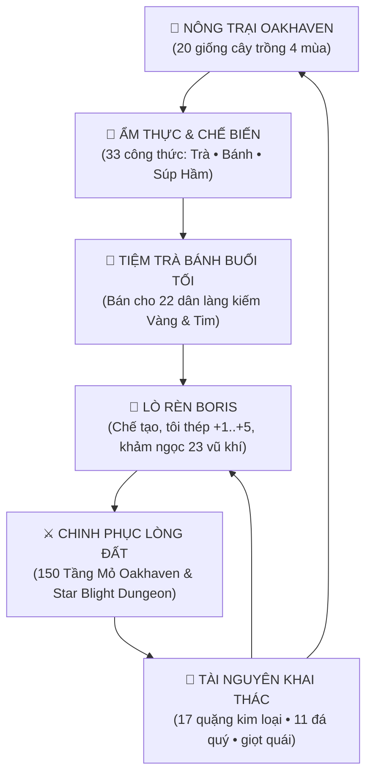
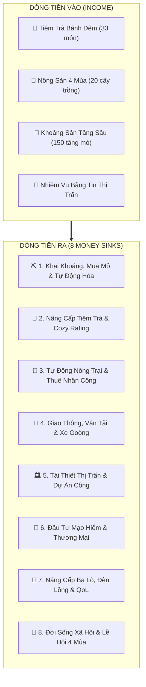

# 📜 OAKHAVEN MASTER DESIGN COMPENDIUM
> **Tài Liệu Tổng Hợp Thông Số & Thiết Kế Trò Chơi: Rowan of Oakhaven**  
> *Phiên bản:* 2.0.0 • *Cập nhật:* 14/11/2026 • *Phong cách:* Dark Cozy Pixel Art Action RPG & Shopkeeping

---

## 🧭 VÒNG LẶP CỐT LÕI (CORE GAMEPLAY LOOP)



---

## 1. BẢNG HỒ SƠ 22 CƯ DÂN & NHÂN VẬT (CHARACTERS ROSTER)

| Nhân vật (Vi / En) | Vai trò / Nghề nghiệp | Địa điểm xuất hiện & Lịch trình | Vai trò trong Gameplay | Thức ăn / Quà tặng yêu thích |
| :--- | :--- | :--- | :--- | :--- |
| **Rowan** *(Rowan)* | Chủ Tiệm Trà & Nông Trang | Tiệm Trà & Bánh Oakhaven | Nhân vật chính; quản lý nông trang, pha chế trà bánh, mở tiệm đón khách và thám hiểm hang mỏ. | Trà Sen An Thần, Bánh Mì Bơ Brioche, Cơm Risotto Nấm Trăng |
| **Pip** *(Pip)* | Cú Lùn Đưa Thư | Tiệm Trà / Rừng Thầm Thì | Đưa thư từ, giao nhiệm vụ hàng ngày; thu lượm hạt giống dại hiếm từ rừng về cho Rowan. | Hạt Giống Trà Sen, Mật Ong Rừng |
| **Mallow** *(Mallow)* | Mèo Mướp Giữ Tiệm | Quầy Bar / Lò Sưởi Tiệm Trà | Thú cưng quán trà; vuốt ve tăng độ ấm cúng, thỉnh thoảng nhả bơ béo hoặc nấm rừng. | Bơ Béo, Dâu Rừng, Nấm Rừng |
| **Lumi** *(Lumi)* | Tinh Linh Rừng Thầm Thì | Rừng Thầm Thì / Ghé tiệm đêm | Hướng dẫn ma thuật cổ xưa; dẫn dắt linh hồn Rowan trở về an toàn khi gục ngã dưới mỏ sâu. | Trà Sen An Thần, Phấn Bướm Tinh Linh |
| **Boris Barnaby** *(Boris)* | Bác Thợ Rèn Kỳ Cựu | Lò Rèn Oakhaven (Phía Đông) | **Trụ cột vũ khí:** Nơi rèn mới, tôi thép $+1 \rightarrow +5$, khảm ngọc cổ ngữ cho toàn bộ 23 vũ khí. | Bánh Cuộn Quế Nướng, Goulash Hầm Mỏ, Trà Lửa Ấm |
| **Maeve** *(Maeve)* | Bà Lão Làm Vườn | Vườn Ươm Nông Trại Oakhaven | Bán các loại hạt giống 4 mùa, hướng dẫn thời vụ gieo trồng và sản xuất phân bón hữu cơ. | Bánh Nướng Scone Dâu, Trà Cúc Mật Ong, Súp Bí Đỏ |
| **Kael** *(Kael)* | Cậu Bé Bán Diêm | Bờ Sông / Góc Chợ Oakhaven | Khách hàng nhí; mua các loại bánh nướng giá rẻ, cung cấp diêm mồi lửa hầm mỏ tầng tối. | Bánh Sinh Nhật Tinh Linh, Súp Bí Đỏ, Dâu Rừng |
| **Bà Ngoại Amalia** *(Amalia)* | Cố Nghệ Nhân Trà Bánh | Ký ức / Di cảo Sổ Tay | Tác giả cuốn sổ tay công thức; để lại các trang công thức bí truyền được mở khóa theo tiến trình. | Búp Trà Sen, Bột Mì Đa Dụng |
| **Bram** *(Bram)* | Thợ Mỏ Pha Lê Kỳ Cựu | Cửa Hang Mỏ Oakhaven | Vận hành thang máy mỏ 150 tầng; nâng cấp cuốc chim và hướng dẫn đập các mạch quặng cứng. | Bánh Mì Thợ Mỏ Sourdough, Súp Khoai Tây Hầm, Phôi Sắt |
| **Penny** *(Penny)* | Cô Bé Bán Bánh Dạo | Xe Bánh Lưu Động Chợ Làng | Đối thủ cạnh tranh thân thiện; mua sỉ bánh quy và cung cấp bơ sữa tươi nhập khẩu. | Bánh Shortcake Dâu Rừng, Bánh Scone Dâu, Trà Bạc Hà Băng |
| **Giáo Sư Orion** *(Orion)* | Nhà Chiêm Tinh Mất Ngủ | Đài Thiên Văn Trên Đồi | Nghiên cứu hiện tượng ô nhiễm Star Blight; đổi bột sao lấy các bùa hộ mệnh chiêm tinh. | Trà Hoa Cúc Mật Ong, Bột Bụi Sao, Thạch Anh Tím |
| **Clara** *(Clara)* | Cô Thủ Thư Thị Trấn | Thư Viện Cổ Oakhaven | Lưu trữ biên niên sử Oakhaven; giải mã các mảnh cuộn giấy cổ ngữ nhặt được dưới hầm ngục. | Trà Bá Tước Quý Cô, Trà Oải Hương Ngân Sao, Búp Trà Sen |
| **Thuyền Trưởng Garrick** *(Garrick)* | Cựu Thủy Thủ Biển Mây | Bến Thuyền Mây Cập Bến | Thương nhân hải hành; bán muối biển tinh thể, gia vị ngoại lai và mua nông sản số lượng lớn. | Trà Sữa Masala Dung Nham, Trà Ánh Dương, Muối Biển Tinh Thể |
| **Finn** *(Finn)* | Cậu Bé Câu Sao Bờ Hồ | Bờ Suối / Hồ Sương Mù | Chuyên gia câu cá và thủy sinh; cung cấp thông tin về các loài cá theo mùa và hồ mỏ ngầm. | Trà Bạc Hà Băng, Dâu Rừng, Thạch Lăng Kính |
| **Elora** *(Elora)* | Thợ May Áo Choàng Dạ Hội | Xưởng Dệt Rừng Yêu Tinh | Nâng cấp túi đồ cá nhân (Backpack Capacity), may tạp dề tiệm trà và áo choàng kháng lạnh. | Phấn Vàng Tinh Linh, Hoa Oải Hương |
| **Sylvan** *(Sylvan)* | Nhà Thảo Mộc Kính Một Mắt | Rừng Sâu Sylva-Fae | Thu mua dược liệu quý; chế tạo các loại thuốc giải độc bọ cạp và thuốc chống bỏng dung nham. | Trà Thảo Mộc Đêm Sylvan, Hạt Oải Hương, Búp Trà Sen |
| **Marlo** *(Marlo)* | Hiệp Sĩ Cảnh Vệ Ca Đêm | Cổng Tuần Tra Thị Trấn | Tuần tra ban đêm; khách quen mua súp nóng và bánh mì thợ mỏ; cảnh báo quái vật đêm. | Súp Hầm Gừng Cay, Bánh Mì Thợ Mỏ, Quặng Sắt |
| **Aurelia** *(Aurelia)* | Dược Sĩ Trạm Xá | Trạm Y Tế Oakhaven | Cứu chữa cho Rowan khi kiệt sức dưới hầm mỏ; bán băng gạc và thuốc bổ tăng thể lực tạm thời. | Hoa Oải Hương, Mật Ong Rừng |
| **Valen** *(Valen)* | Quý Tộc Ma Cà Rồng Ăn Chay | Lâu Đài Cổ U Ám | Khách hàng thượng lưu VIP; trả giá cực cao cho các loại trà đỏ, trà dâu tuyết và bánh kem đêm. | Trà Dâu Băng Tuyết, Dâu Rừng Mùa Xuân |
| **Kassandra** *(Kassandra)* | Phù Thủy Sao Băng Lưu Vong | Lữ Khách Ven Rừng | Hướng dẫn Rowan cách khảm ngọc nguyên tố và sử dụng pháp trượng bắn ma thuật tinh tú. | Bột Bụi Sao, Đá Lam Ngọc |
| **Chrono** *(Chrono)* | Người Máy Đồng Hồ Cổ Đại | Lòng Đất Khaz-Drakor | Mở khóa công nghệ cơ khí Người Lùn; cung cấp bánh răng cổ đại để chế tạo Nỏ Cơ Giới. | Phôi Vàng, Đá Tinh Thể |
| **Lapis** *(Lapis)* | Nàng Tiên Cá Biển Mây | Biển Sương Mù | Cung cấp ngọc trai và nước tinh khiết để pha các loại trà thanh nhiệt cao cấp. | Muối Biển Tinh Thể, Lam Ngọc |

---

## 2. BẢNG NÔNG NGHIỆP: 20 CÂY TRỒNG 4 MÙA (CROPS & FARMING)

| Tên Cây Trồng (Vi / En) | Mùa Vụ | Chu Kỳ | Tái Sinh | Giá Hạt | Giá Bán | Lợi Nhuận/Ngày | Ứng Dụng Ẩm Thực Chính |
| :--- | :--- | :--- | :--- | :--- | :--- | :--- | :--- |
| **Búp Trà Sen** *(Sen Tea Leaves)* | Xuân, Hạ | 4 ngày | 2 ngày | 40g | 65g | +12.5g/ngày | Nguyên liệu nền tảng cho 12 công thức trà thảo mộc. |
| **Lúa Mì Bạc** *(Silver Wheat)* | Xuân, Hạ, Thu | 4 ngày | 0 | 25g | 50g | +6.25g/ngày | Xay thành Bột mì đúc bánh mì, bánh brioche, scone. |
| **Hoa Cúc Mặt Trời** *(Sun Daisy)* | Xuân, Hạ | 3 ngày | 0 | 30g | 55g | +8.33g/ngày | Trà Cúc Mật Ong hồi thể lực, Trà Ánh Dương. |
| **Dâu Rừng Mùa Xuân** *(Spring Wildberry)* | Xuân | 5 ngày | 3 ngày | 60g | 85g | +14.0g/ngày | Mứt dâu, Bánh Nướng Scone Dâu, Bánh Shortcake. |
| **Hắc Cà Rốt Mắt Mèo** *(Cat-Eye Black Carrot)*| Xuân | 4 ngày | 0 | 35g | 60g | +6.25g/ngày | Súp củ cải hầm, bánh nướng bổ mắt soi đêm. |
| **Củ Cải Tuyết Xuân** *(Snow Radish)* | Xuân | 4 ngày | 0 | 30g | 55g | +6.25g/ngày | Súp Hầm Củ Cải Thợ Mỏ (+35% tốc độ đào quặng). |
| **Khoai Tây Hang Đá** *(Cave Potato)* | Xuân, Thu | 5 ngày | 0 | 40g | 75g | +7.0g/ngày | Súp Khoai Tây Hầm Thịt Lợn Rừng, bánh đá nghiền. |
| **Quả Mọng Ánh Dương** *(Solar Berry)* | Hạ | 6 ngày | 3 ngày | 70g | 110g | +18.0g/ngày | Trà Trái Cây Mùa Hè, Bánh Tart Mọng Nước Ánh Dương. |
| **Ngô Ngọt Vàng Óng** *(Golden Sweetcorn)* | Hạ, Thu | 6 ngày | 3 ngày | 65g | 95g | +15.0g/ngày | Bột ngô làm bánh đá nướng, bánh mì bắp chảo. |
| **Bạc Hà Băng Tuyết** *(Frostmint)* | Hạ, Đông | 4 ngày | 2 ngày | 35g | 60g | +11.5g/ngày | Trà Bạc Hà Băng (giải nhiệt chống nóng dung nham). |
| **Ớt Lửa Nham Thạch** *(Magma Pepper)* | Hạ | 5 ngày | 3 ngày | 50g | 85g | +16.0g/ngày | Trà Sữa Masala Dung Nham, Súp Goulash Cay Nồng. |
| **Dưa Lưới Tinh Vân** *(Nebula Melon)* | Hạ | 7 ngày | 0 | 80g | 160g | +11.4g/ngày | Món tráng miệng quý tộc giá cao tại tiệm trà. |
| **Hoa Oải Hương Ngàn Sao** *(Star Lavender)* | Thu | 5 ngày | 0 | 45g | 80g | +7.0g/ngày | Trà Oải Hương Ngân Sao an thần, túi thơm ru ngủ. |
| **Bí Ngô Trăng Rằm** *(Harvest Moon Pumpkin)* | Thu | 6 ngày | 0 | 60g | 120g | +10.0g/ngày | Súp Bí Ngô Kem Béo (giảm 20% sát thương quái). |
| **Hạt Phỉ Rừng Già** *(Ancient Hazelnut)* | Thu | 7 ngày | 4 ngày | 80g | 135g | +19.5g/ngày | Bánh Quy Bơ Hạt Phỉ, Bánh Kem Tinh Linh. |
| **Hành Tây Khói Đen** *(Smoked Black Onion)* | Thu, Đông | 4 ngày | 0 | 35g | 65g | +7.5g/ngày | Nền gia vị súp hầm thịt, súp hành thợ mỏ. |
| **Gừng Lửa Núi Cao** *(Highland Fire Ginger)* | Thu, Đông | 5 ngày | 0 | 45g | 80g | +7.0g/ngày | Súp Hầm Gừng Cay (miễn nhiễm trạng thái cóng lạnh). |
| **Lúa Mạch Mùa Đông** *(Winter Barley)* | Đông | 5 ngày | 0 | 35g | 70g | +7.0g/ngày | Bánh Mì Đen Lúa Mạch, bột ngũ cốc sưởi ấm mùa đông. |
| **Bắp Cải Băng Đảo** *(Glacier Cabbage)* | Đông | 5 ngày | 0 | 40g | 75g | +7.0g/ngày | Canh bắp cải muối chua, cuộn thịt nướng đá. |
| **Nấm Men Băng Giá** *(Frost Shroom Yeast)* | Đông | 6 ngày | 3 ngày | 75g | 125g | +22.0g/ngày | Lên men bánh sourdough thợ mỏ, ủ rượu táo mùa đông. |

---

## 3. BẢNG KHAI KHOÁNG & HẦM MỎ 150 TẦNG (MINING & MINERALS)

| Đới Địa Tầng | Độ Sâu Tầng | Quặng Kim Loại (17 loại) | Đá Quý & Tinh Thể (11 loại) | Boss Mốc (Stratum Warden) | Ứng Dụng Rèn Đúc & Khai Khai Thác |
| :--- | :--- | :--- | :--- | :--- | :--- |
| **Đới 1: Đất Mềm Khởi Đầu** | Tầng 1 – 20 | Than Đá (`ore_coal`), Đá Thô (`ore_stone`) | Thạch Anh Vụn (`gem_quartz`) | *Khu vực tập luyện* | Đốt lò nướng bánh, rèn vũ khí Bậc 1 (Gỗ & Đá). |
| **Đới 2: Mỏ Đồng Cổ Xưa** | Tầng 21 – 50 | Quặng Đồng (`ore_copper`) $\rightarrow$ Phôi Đồng | Ngọc Thạch Anh (`gem_amethyst`), Topaz | **Tầng 30:** Vua Bọ Tinh Thể | Đúc vũ khí Bậc 2; nâng cấp cuốc đồng, bình tưới đồng. |
| **Đới 3: Vực Thép Người Lùn**| Tầng 51 – 80 | Quặng Sắt (`ore_iron`) $\rightarrow$ Phôi Sắt | Ngọc Lục Bảo (`gem_emerald`), Sapphire | **Tầng 60:** Cỗ Máy Hơi Nước Cổ | Rèn vũ khí Bậc 3; làm cối xay bột tự động, búa đập đá. |
| **Đới 4: Đới Hoàng Kim & Bạc**| Tầng 81 – 110 | Quặng Vàng (`ore_gold`), Quặng Bạc (`ore_silver`)| Lam Ngọc (`gem_sapphire`), Ruby | **Tầng 90:** Kỳ Nhông Nham Thạch | Rèn vũ khí Bậc 4; hệ thống vòi phun nước tự động. |
| **Đới 5: Vực Hắc Diện Thạch**| Tầng 111 – 140 | Hắc Diện Thạch (`ore_obsidian`), Đá Dung Nham | Hồng Ngọc (`gem_ruby`), Kim Cương | **Tầng 120:** Bóng Ma Băng Vĩnh Cửu | Rèn vũ khí Bậc 5 (kháng cháy); nung chảy dụng cụ. |
| **Đới 6: Đáy Mỏ Tinh Tú** | Tầng 141 – 150 | Quặng Tinh Tú, Lõi Hư Không (`item_starlight_core`)| Kim Cương Hoàn Hảo (`gem_diamond`) | **Tầng 150:** Trái Tim Ô Nhiễm Blight| Rèn 5 vũ khí tối thượng Bậc 6; mở lối Khaz-Drakor. |

---

## 4. BẢNG ẨM THỰC: 33 CÔNG THỨC & 3 BÀN CHẾ TÁC (RECIPES & CUISINE)

### A. Trạm Pha Trà (`tea_station` — 12 Món Thức Uống)
| Tên Món Trà | Nguyên Liệu | Giá Bán | Hiệu Ứng Buff Tác Dụng |
| :--- | :--- | :--- | :--- |
| **Trà Sen An Thần** | Búp Trà Sen + Nước Tinh Khiết | 85g | Hồi $+45$ Thể lực; hồi $2$ Thể lực/giây trong 60s. |
| **Trà Hoa Cúc Mật Ong** | Hoa Cúc + Mật Ong + Búp Trà Sen | 110g | Hồi $+60$ Thể lực; tăng $+15\%$ tốc độ làm việc đồng áng. |
| **Trà Oải Hương Ngân Sao** | Hoa Oải Hương + Búp Trà Sen + Bột Bụi Sao | 150g | Hồi $+80$ Thể lực; tạo vòng sáng nhỏ soi đường hầm tối. |
| **Trà Bạc Hà Băng Tuyết** | Bạc Hà Băng + Búp Trà Sen + Nước Đá | 120g | Hồi $+50$ Thể lực; **Giải nhiệt, giảm $50\%$ sát thương nóng dung nham**. |
| **Trà Lửa Ấm Áp** | Búp Trà Sen + Than Củi Ngọt + Mật Ong | 95g | Hồi $+55$ Thể lực; **Giữ ấm, miễn nhiễm cóng lạnh tầng băng**. |
| **Trà Bá Tước Quý Cô** | Búp Trà Sen + Cam Bergamot + Sữa Tươi | 140g | Hồi $+75$ Thể lực; tăng $+10\%$ giá bán mọi vật phẩm trong ngày. |
| **Trà Sữa Masala Dung Nham**| Ớt Nham Thạch + Búp Trà Sen + Sữa Tươi | 160g | Hồi $+90$ Thể lực; tăng $+15\%$ tốc độ vung vũ khí cận chiến. |
| **Trà Dâu Băng Tuyết** | Dâu Rừng + Bạc Hà Băng + Búp Trà Sen | 135g | Hồi $+70$ Thể lực; tăng $+20\%$ tốc độ chạy trong 120s. |
| **Trà Ánh Dương** | Hoa Cúc + Quả Mọng Ánh Dương + Mật Ong | 175g | Hồi $+100$ Thể lực; **Tăng $+25\%$ tốc độ cuốc quặng trong mỏ**. |
| **Trà Thảo Mộc Đêm Sylvan** | Rễ Cây Rừng + Búp Trà Sen + Thảo Mộc | 130g | Hồi $+65$ Thể lực; kháng toàn bộ độc tố từ nhện và bọ cạp. |
| **Trà Tinh Thể Băng Giá** | Tinh Thể Băng + Búp Trà Sen + Bạc Hà | 190g | Hồi $+110$ Thể lực; làm chậm kẻ địch chạm vào người 2s. |
| **Trà Bụi Sao Thần Diệu** | Búp Trà Sen + Lõi Tinh Tú + Mật Ong Thần | 350g | Hồi **$100\%$ Thể lực**; tăng $+30\%$ sát thương phép thuật. |

### B. Lò Nướng Bánh Đá (`bakery_oven` — 13 Món Bánh Nướng)
| Tên Món Bánh | Nguyên Liệu | Giá Bán | Hiệu Ứng Buff Tác Dụng |
| :--- | :--- | :--- | :--- |
| **Bánh Mì Thợ Mỏ Sourdough**| Bột Mì Bạc + Men Nấm Băng + Nước | 90g | Hồi $+70$ Thể lực; tăng $+10\%$ sức chống chịu va đập quái. |
| **Bánh Mì Bơ Brioche** | Bột Mì Bạc + Bơ Béo + Trứng Gà | 125g | Hồi $+85$ Thể lực; tăng $+15\%$ độ hảo cảm khi tặng quà dân làng. |
| **Bánh Cuộn Quế Nướng** | Bột Mì + Vỏ Quế Rừng + Đường Mật | 115g | Hồi $+80$ Thể lực; bước chân lướt nhanh hơn $10\%$. |
| **Bánh Nướng Scone Dâu** | Bột Mì + Dâu Rừng + Bơ Béo | 130g | Hồi $+90$ Thể lực; tăng may mắn nhặt được hạt giống kép. |
| **Bánh Shortcake Dâu Rừng** | Bột Mì + Dâu Rừng + Kem Sữa Tươi | 165g | Hồi $+110$ Thể lực; tăng $+20\%$ tỉ lệ rơi đá quý khi đập đá. |
| **Bánh Bí Ngô Lễ Hội** | Bí Ngô Vàng + Bột Mì + Mật Ong | 145g | Hồi $+100$ Thể lực; tăng $+20$ Thể lực tối đa trong 180s. |
| **Bánh Quy Bơ Hạt Phỉ** | Bột Mì + Hạt Phỉ Rừng + Bơ Béo | 135g | Hồi $+95$ Thể lực; tăng cự ly hút vật phẩm từ xa. |
| **Bánh Tart Quả Mọng Nắng** | Quả Mọng Ánh Dương + Bột Mì + Kem | 180g | Hồi $+120$ Thể lực; hồi Thể lực nhanh gấp đôi khi đứng yên. |
| **Bánh Sinh Nhật Tinh Linh** | Bột Mì + Bột Bụi Sao + Dâu + Bơ | 280g | Hồi $+180$ Thể lực; hào quang bụi sao đẩy lùi quái nhỏ xung quanh. |
| **Bánh Mì Đen Lúa Mạch** | Lúa Mạch Mùa Đông + Men Nấm + Muối | 100g | Hồi $+75$ Thể lực; giảm $20\%$ tốc độ tụt thể lực khi cuốc đất. |
| **Bánh Sừng Bò Bơ Giòn** | Bột Mì Bạc + Bơ Béo Cao Cấp | 140g | Hồi $+95$ Thể lực; tăng độ linh hoạt khi lướt né Stardust Dash. |
| **Bánh Nướng Phô Mai Mỏ** | Bột Mì + Phô Mai Ủ + Muối Biển | 160g | Hồi $+115$ Thể lực; tăng $+15\%$ lực chém vũ khí cận chiến. |
| **Bánh Trăng Rằm Tinh Tú** | Bột Mì + Lõi Tinh Tú + Mật Ong Rừng | 380g | Hồi **$100\%$ Thể lực**; nhận 1 lớp khiên ảo chặn 1 đòn tử mạng. |

### C. Bếp Nấu & Nồi Hầm (`cooking_pot` — 8 Món Ăn Chính & Súp Hầm)
| Tên Món Ăn | Nguyên Liệu | Giá Bán | Hiệu Ứng Buff Tác Dụng |
| :--- | :--- | :--- | :--- |
| **Súp Hầm Củ Cải Thợ Mỏ** | Củ Cải Tuyết + Khoai Hang + Nước Dùng | 140g | Hồi $+90$ Thể lực; **$+35\%$ Tốc độ cuốc mỏ trong 240s**. |
| **Súp Bí Đỏ Kem Béo** | Bí Ngô Vàng + Sữa Tươi + Bơ + Nấm Rừng | 160g | Hồi $+105$ Thể lực; **Giảm $20\%$ sát thương nhận vào từ quái vật**. |
| **Goulash Sắt Người Lùn** | Thịt Rừng + Khoai + Ớt Lửa + Cà Rốt | 220g | Hồi $+140$ Thể lực; **$+30\%$ Lực đánh đòn nặng (Heavy Attack)**. |
| **Súp Gừng Lửa Cay Nồng** | Gừng Lửa + Hành Tây Khói + Nước Dùng | 150g | Hồi $+95$ Thể lực; **Miễn nhiễm hoàn toàn trạng thái Băng Giá**. |
| **Cơm Risotto Nấm Trăng** | Gạo Nước + Nấm Rừng + Bơ + Bột Sao | 260g | Hồi $+160$ Thể lực; **Hút $5\%$ sát thương gây ra thành Thể lực**. |
| **Canh Rau Thảo Dược Rừng** | Cà Rốt + Củ Cải + Thảo Mộc Sylvan | 130g | Hồi $+85$ Thể lực; **Tự động giải trừ mọi chất độc ngay lập tức**. |
| **Bò Hầm Nham Thạch Núi Lửa**| Thịt Bò + Hắc Diện Thạch Vụn + Ớt Lửa | 280g | Hồi $+175$ Thể lực; **Đòn đánh cận chiến thiêu đốt quái 5s**. |
| **Lương Khô Thám Hiểm Hư Không**| Bột Đen + Men Nấm Băng + Lõi Tinh Tú | 320g | Hồi $+200$ Thể lực; **Tăng $+25\%$ Sát thương lên quái Blight**. |

---

## 5. BẢNG KHO VŨ KHÍ: 23 VŨ KHÍ 5 PHÂN HỆ & 6 BẬC LÒ RÈN BORIS

| Bậc (Tier) | Tên Vũ Khí (Vi / En) | Phân Hệ | ATK & Tốc Độ | Tầm Đánh | Kỹ Năng Cổ Ngữ (Runic Skill) | Công Thức Lò Rèn Boris |
| :--- | :--- | :--- | :--- | :--- | :--- | :--- |
| **Bậc 1** | **Kiếm Gỗ Huấn Luyện** *(Wooden Training Sword)* | Cận chiến | ATK 6 • 2.2 nhịp/s | Cận chiến 1.1 ô | **Đập Chuôi Kiếm:** Choáng quái nhỏ 0.5s. | 15 Gỗ Sồi + 100g |
| **Bậc 1** | **Liềm Làm Nông Cũ** *(Rusty Farm Scythe)* | Cận chiến | ATK 8 • 1.4 nhịp/s | Bán nguyệt 2.0 ô | **Vung Quét Rộng:** Văng lùi quái nhỏ xung quanh. | 10 Gỗ Sồi + 5 Đá Thô + 150g |
| **Bậc 1** | **Búa Đá Thợ Mỏ** *(Miner's Stone Mallet)* | Hạng nặng | ATK 12 • 0.9 nhịp/s | Đập đất 1.5 ô | **Dậm Đất Nặng:** Dậm choáng quái xung quanh 1s. | 20 Đá Thô + 5 Gỗ Sồi + 200g |
| **Bậc 1** | **Cung Săn Oakhaven** *(Oakhaven Hunter Bow)* | Tầm xa | ATK 10 • 1.2 tên/s | Tầm xa 5.0 ô | **Tiễn Ngắm Chuẩn:** Kéo căng x2 sát thương chí mạng. | 15 Gỗ Sồi + 5 Dây Leo + 180g |
| **Bậc 1** | **Đũa Phép Gỗ Sơ Cấp** *(Apprentice Oak Wand)* | Pháp thuật | ATK 9 • 1.5 phát/s | Tầm trung 4.5 ô | **Chớp Sáng Đẩy Lùi:** Nổ chớp sáng đẩy lùi bọ cánh cứng. | 12 Gỗ Sồi + 2 Thạch Anh + 220g |
| **Bậc 2** | **Kiếm Bản Rộng Đồng Đỏ** *(Copper Broadsword)* | Cận chiến | ATK 14 • 2.6 nhịp/s | Cận chiến 1.2 ô | **Trảm Phong:** Vung kiếm 360° đẩy lùi kẻ địch bao vây. | 6 Phôi Đồng + 2 Than + 600g |
| **Bậc 2** | **Chùy Gai Đồng Đỏ** *(Copper Spiked Mace)* | Hạng nặng | ATK 22 • 1.1 nhịp/s | Cận chiến 1.6 ô | **Nghiền Giáp:** Đòn đập giảm 40% giáp mục tiêu 5s. | 8 Phôi Đồng + 4 Than + 850g |
| **Bậc 3** | **Kiếm Thép Rèn Oakhaven** *(Forged Steelblade)* | Cận chiến | ATK 24 • 2.8 nhịp/s | Cận chiến 1.3 ô | **Đỡ & Phản Kích:** Parry hoàn hảo choáng 2s, phản 150% dmg. | 8 Phôi Sắt + 4 Than + 1,800g |
| **Bậc 3** | **Liềm Ma Thuật** *(Mystic Scythe)* | Cận chiến | ATK 28 • 1.8 nhịp/s | Bán nguyệt 2.5 ô | **Lốc Thu Hoạch:** Xoay lốc xoáy nhỏ gom quái lại một điểm. | 6 Phôi Đồng + 4 Phôi Sắt + 1 Emerald + 2,400g |
| **Bậc 3** | **Gậy Quấy Trà Khổng Lồ** *(Whisk Hammer)* | Hạng nặng | ATK 38 • 0.8 nhịp/s | Sóng nứt 2.0 ô | **Sóng Bụi Trà:** Đập búa tạo sóng bột trà làm chậm quái 50%.| 10 Phôi Sắt + 2 Đá Tinh Thể + 2,500g |
| **Bậc 3** | **Nỏ Cơ Giới Bánh Răng** *(Clockwork Crossbow)* | Tầm xa | ATK 26 • 1.8 phát/s | Tầm xa 6.5 ô | **Xạ Kích Liên Hoàn:** Bắn liền 3 mũi tên thép xuyên thấu. | 8 Phôi Sắt + 2 Bánh Răng Vàng + 2,800g |
| **Bậc 3** | **Đèn Lồng Bão Đom Đóm** *(Spirit Lantern)* | Pháp thuật | ATK 25 • 2.0 tia/s | Tầm xa 6.0 ô | **Hào Quang Huỳnh Quang:** Đom đóm bay quanh tạo khiên hộ thể.| 6 Phôi Sắt + 1 Tinh Chất Đom Đóm + 2 Quartz + 2,200g |
| **Bậc 4** | **Kiếm Liễu Thái Dương** *(Sunburst Rapier)* | Cận chiến | ATK 35 • 3.5 nhịp/s | Đâm thẳng 1.5 ô | **Lướt Đâm Quang Năng:** Lướt xuyên hàng quái để lại vệt cháy.| 6 Phôi Vàng + 1 Ruby + 4,500g |
| **Bậc 4** | **Lưỡi Hái Ngân Nguyệt** *(Silver Moon Scythe)* | Cận chiến | ATK 42 • 2.0 nhịp/s | Bán nguyệt 2.6 ô | **Sóng Ngân Nguyệt:** Phóng lưỡi đao ánh trăng xuyên hàng quái.| 8 Phôi Bạc + 2 Amethyst + 6,000g |
| **Bậc 4** | **Nỏ Bắn Tỉa Kim Quang** *(Solar Arbalest)* | Tầm xa | ATK 44 • 1.4 phát/s | Siêu xa 8.0 ô | **Lao Quang Tuyến:** Bắn lao sáng xuyên quái, làm mù quái 3s. | 10 Phôi Vàng + 2 Topaz + 6,500g |
| **Bậc 5** | **Kiếm Lửa Hắc Diện Thạch** *(Obsidian Saber)* | Cận chiến | ATK 50 • 3.0 nhịp/s | Cận chiến 1.4 ô | **Dung Nham Phun Trào:** Cắm kiếm tạo cột dung nham hất tung. | 10 Hắc Diện Thạch + 5 Phôi Sắt + 9,000g |
| **Bậc 5** | **Búa Tạ Nham Thạch** *(Magma Warhammer)* | Hạng nặng | ATK 62 • 0.7 nhịp/s | Nứt đất 2.4 ô | **Địa Chấn Dung Nham:** Tạo rãnh dung nham nổ 4 ô thẳng. | 12 Hắc Diện Thạch + 6 Phôi Sắt + 10,500g |
| **Bậc 5** | **Trượng Hỏa Sơn Dung Nham** *(Magma Rod)* | Pháp thuật | ATK 54 • 1.3 phát/s | Tầm xa 6.5 ô | **Vòng Lửa Thiêu Rụi:** Dựng tường lửa tròn chặn quái áp sát 6s.| 8 Hắc Diện Thạch + 2 Ruby + 8,500g |
| **Bậc 6** | **Kiếm Pha Lê Sao** *(Starlight Blade)* | Cận chiến | ATK 68 • 3.8 nhịp/s | Cận chiến 1.4 ô | **Bụi Sao Thác Đổ:** Phóng 5 phi kiếm sao tự tìm mục tiêu. | 1 Lõi Tinh Tú + 4 Kim Cương + 20,000g |
| **Bậc 6** | **Lưỡi Hái Hư Không Tinh Tú** *(Void Reaper)* | Cận chiến | ATK 74 • 2.2 nhịp/s | Bán nguyệt 3.0 ô | **Đoạt Hồn Trảm:** Trảm sát ngay quái thường dưới 25% HP. | 1 Lõi Tinh Tú + 8 Hắc Diện Thạch + 2 Diamond + 22,000g |
| **Bậc 6** | **Búa Tinh Vân Thần Tượng** *(Stellar Crusher)* | Hạng nặng | ATK 92 • 0.75 nhịp/s | Địa chấn 2.8 ô | **Thiên Thạch Giáng Thế:** Nhảy vọt lên giáng búa như thiên thạch.| 1 Lõi Tinh Tú + 4 Diamond + 10 Phôi Vàng + 25,000g |
| **Bậc 6** | **Nỏ Liên Thanh Hư Không** *(Void Repeater)* | Tầm xa | ATK 65 • 2.5 phát/s | Tầm xa 7.0 ô | **Mưa Tên Tinh Tú:** Trút cơn mưa tên sao nổ diện tích 4x4 ô. | 1 Lõi Tinh Tú + 6 Phôi Bạc + 3 Diamond + 24,000g |
| **Bậc 6** | **Pháp Trượng Khởi Nguyên** *(Starlight Staff)*| Pháp thuật | ATK 76 • 2.0 phát/s | Bao quát 7.5 ô | **Siêu Tân Tinh (Supernova):** Quả cầu sao nổ quét sạch màn hình.| 1 Lõi Tinh Tú + 3 Sapphire + 3 Diamond + 26,000g |

### 🛠️ Nguyên Tắc Thiết Kế Lò Rèn Boris:
1. **Tôi Thép Cường Hóa ($+1 \rightarrow +5$):** Mỗi cấp tăng $+10\%$ ATK và $+5\%$ Tốc độ vung.
2. **Cam Kết Nhân Văn (Dark Cozy):** **Tỉ lệ thành công LUÔN LÀ 100%**. Không bao giờ có cơ chế xịt đồ, tụt cấp hay vỡ vũ khí.
3. **Khảm Ấn Ngọc Cổ Ngữ:**
   * 🔴 *Ruby:* Hiệu ứng Cháy (Burn) 4s.
   * 🔵 *Sapphire:* Hiệu ứng Làm Chậm $40\%$ (Frost Slow).
   * 🟢 *Emerald:* Phóng thích Bào Tử Độc (Poison Spores).
   * 💎 *Diamond:* Tăng vĩnh viễn $+20\%$ Tỉ lệ đòn Chí Mạng.
   * 🟣 *Amethyst:* Giảm $25\%$ Thể lực tiêu hao khi vung vũ khí.
   * 🟡 *Topaz:* Tăng $+35\%$ Lực Đẩy Lùi (Knockback).
4. **Tái Chế Nấu Chảy:** Hoàn lại $60\%$ số phôi kim loại và $100\%$ viên đá quý đã khảm.

---

## 6. BẢNG BẢN ĐỒ THẾ GIỚI & CÁC VÙNG ĐẤT (WORLD ATLAS)

| Địa Danh (Vi / En) | Phân Loại | Cư Dân Tiêu Biểu | Cảnh Quan & Khí Hậu | Tính Năng Hoạt Động |
| :--- | :--- | :--- | :--- | :--- |
| **Thị Trấn Oakhaven** *(The Stardust Valley)* | Thị trấn Khởi đầu | Rowan, Pip, Mallow, Boris, Maeve, Penny, Clara | Thung lũng êm đềm dưới bóng cây sồi ngàn năm, suối trong vắt, ban đêm có bụi sao rơi. | Nông trại, Tiệm Trà Bánh, Lò Rèn Boris, Cửa Hang Mỏ, Thư viện, Trạm xá. |
| **Kinh Đô Ánh Sáng Solaria** *(The Royal Capital)* | Vùng đất liên thông | Giáo sư Orion, Thương nhân Hoàng triều | Thành phố tráng lệ lát đá cẩm thạch trắng, cung điện dát vàng phản chiếu ánh dương rực rỡ. | Chợ giao thương hoàng gia, Đài thiên văn chiêm tinh, Viện nghiên cứu ma thuật. |
| **Đại Rừng Yêu Tinh Sylva-Fae** *(The Ancient Elven Canopy)* | Vùng đất liên thông | Lumi, Elora, Sylvan | Tán rừng nguyên sinh khổng lồ, những ngôi nhà hình nấm phát quang, đom đóm dạ quang bay rợp trời. | Thu hái nấm rừng quý, dệt áo choàng dạ hội, học ma thuật tinh linh cổ xưa. |
| **Đô Thị Ngầm Khaz-Drakor** *(The Dwarven Megalopolis)* | Vùng đất liên thông | Bram, Chrono, Thợ rèn Người Lùn | Đại đô thị xây sâu trong lòng núi đá dung nham, guồng máy hơi nước khổng lồ và lò cao luyện kim. | Luyện kim thuật đỉnh cao, phụ kiện bánh răng cơ giới, thông tới Tầng 150 đáy mỏ. |
| **Cõi Địa Đàng Aethelgard** *(The Floating Elysium)* | Vùng đất liên thông | Kassandra, Lapis, Thủy thủ Garrick | Quần thể đảo bay lơ lửng giữa biển mây bồng bềnh, thác nước đổ ngược lên trời, cực quang vĩnh cửu. | Khai thác Lõi Tinh Tú, bến thuyền mây viễn du, chinh phục Hầm ngục Star Blight. |

---

## 7. CƠ CHẾ SINH TỒN & CHIẾN ĐẤU CỐT LÕI (CORE COMBAT MECHANICS)

1. **Thanh Thể Lực Hợp Nhất (Unified Stamina Bar):**
   * Không có thanh HP riêng biệt. Nhận sát thương = Trừ Thể lực. Cạn Thể lực = Gục ngã.
   * Thức ăn nóng, bánh nướng và trà thảo mộc là nguồn hồi phục sinh lực sống còn.
2. **Lướt Né Tránh (Stardust Dash):**
   * Tiêu tốn 12 Thể lực, lướt 2.5 ô để lại vệt tàn ảnh bụi sao.
   * Nhận **0.25 giây bất tử (i-Frames)** để né mọi đòn quét diện rộng và bẫy hang.
3. **Phản Đòn Hoàn Hảo (Perfect Parry):**
   * Giơ thế thủ trước 0.2s khi quái chạm đòn $\rightarrow$ Miễn nhiễm sát thương, hồi **+15 Thể lực** và gây choáng quái 2 giây.
4. **Cơ Chế Bóng Tối Hang Mỏ (Lantern Darkness):**
   * Từ tầng 30 trở đi hoàn toàn tối đen. Quái vật trong bóng tối tàng hình và tăng 50% tốc độ.
   * Bắt buộc trang bị Đèn Lồng Đom Đóm để soi sáng, làm hiện hình điểm yếu của quái vật.
5. **Mức Độ Rủi Ro Khi Gục Ngã (Stakes & Defeat):**
   * **Không Perma-death.**
   * Giữ nguyên 100% trang bị, vũ khí, tiền vàng và hòm đồ trên mặt đất.
   * Chỉ rơi lại $\approx 30\%$ quặng thô và thảo mộc vừa thu nhặt trong chuyến đi đó (có thể điều chỉnh theo Chế độ chơi).

---

## 8. HỆ THỐNG KINH TẾ, DÒNG TIỀN & 8 KÊNH TIÊU TIỀN (MACRO ECONOMY & MONEY SINKS)

### 💡 Triết Lý Kinh Tế Cốt Lõi:
Nền kinh tế của *Rowan of Oakhaven* vận hành theo nguyên lý: **"Tiền (Vàng) = Thời gian được giải phóng + Không gian ấm cúng được mở rộng + Cảm giác tự hào của người bảo hộ thị trấn."**
Tiền kiếm được từ Tiệm Trà Đêm và Nông Trại không bao giờ bị nghẽn ở Lò Rèn Boris, mà liên tục luân chuyển qua 8 trụ cột lớn:



### 8.1. Trụ Cột 1: Khai Khoáng, Sở Hữu Mỏ & Nguyên Vật Liệu Thô (Mining Sinks)
* **Mua Lẻ Cấp Bách (Bram & Boris):**
  * *Năm 1:* Đá cuội (10g), Than đen (30g), Quặng Đồng (50g), Quặng Sắt (120g), Phôi Đồng (200g), Phôi Sắt (450g).
  * *Năm 2 trở đi (Lạm phát):* Giá tăng $+50\% \rightarrow +100\%$ nhằm hấp thụ lượng tiền mặt dư thừa của người chơi giàu.
* **Hợp Đồng Bao Tiêu Mỏ Của Bram (Bram's Mining Contracts):**
  * *Gói Tầng Nông (Tầng 1–30):* 1,800g / tuần $\rightarrow$ Giao 15 Đồng, 20 Than, 40 Đá Cuội, 2 Mã Não Rêu mỗi sáng lúc 6:00.
  * *Gói Lòng Sắt & Vàng (Tầng 31–90):* 6,500g / tuần $\rightarrow$ Giao 15 Sắt, 8 Vàng, 10 Đất Sét Đỏ, 1 Hồng Ngọc Lửa.
  * *Gói Vực Thẳm Tinh Tú (Tầng 91–150):* 22,000g / tuần $\rightarrow$ Giao 6 Mithril, 6 Obsidian, 2 Tinh Thể Băng, 1 Kim Cương Thô.
* **Mua Đứt Bãi Mỏ Bỏ Hoang Nông Trang (The Abandoned Farm Quarry):**
  * Chi phí: **35,000g + 50 Phôi Sắt + 80 Gỗ Sồi**.
  * Mỗi 2 ngày tự động sản sinh 8–12 khối quặng ngẫu nhiên theo mốc tầng mỏ cao nhất từng đạt, kèm hạch đá Geodes.
* **Robot Đào Mỏ Tự Động Chrono (Dwarven Auto-Miner):**
  * Giá mua: 15,000g + 5 Bánh Răng Cổ tại Khaz-Drakor. Cắm cố định tại các tầng mốc.
  * Chi phí vận hành: 2,500g / tuần tiền mua Lõi Hơi Nước Cổ để máy hoạt động liên tục.
* **Chợ Đá Quý Kassandra:**
  * Bán đá quý khảm ngọc chưa giám định (2,000g – 10,000g) vào Thứ Bảy hàng tuần.

### 8.2. Trụ Cột 2: Nâng Cấp Tiệm Trà & Kinh Tế Cozy (Hospitality Sinks)
* **Mở Rộng Không Gian Phục Vụ:**
  * *Cấp 1 (Mặc định):* 2 bàn (4 khách/đêm).
  * *Cấp 2 (12,000g):* 4 bàn + 2 ghế quầy bar, khách gọi thêm món phụ.
  * *Cấp 3 (40,000g):* Gác xép VIP phục vụ khách đặc biệt (Valen, Orion, Garrick) với giá thực đơn $\times 2.5$.
* **Thiết Bị Chế Biến Cao Cấp (Kitchen Tier):**
  * *Lò Nướng Đá Cổ (Stone Hearth Oven - 8,000g):* Tốc độ nướng $\times 2$, giảm $30\%$ rủi ro cháy bánh, tăng tỷ lệ bánh Star-Tier.
  * *Bộ Ấm Đồng Rót Chậm (Copper Kettle - 5,000g):* Giữ trà ấm trong 4 giờ, tăng điểm hài lòng và tip $+30\%$.
  * *Tủ Kính Pha Lê (Starlight Showcase - 15,000g):* Giữ bánh trà qua đêm không giảm độ tươi.
* **Chỉ Số Ấm Cúng (Cozy Rating) & Hộp Nhạc:**
  * Mua thảm dệt Elora (3,000g), lò sưởi đá (7,500g), đèn chùm pha lê sao (10,000g).
  * *Hộp Nhạc Oakhaven (Jukebox - 12,000g):* Mua băng nhạc lofi (1,500g/băng). Khi Cozy Rating đạt cực đại, khách kiên nhẫn chờ $+50\%$ và tỷ lệ tặng quà lưu niệm là $20\%$.

### 8.3. Trụ Cột 3: Tự Động Hóa Nông Trại & Nhân Công (Farming & Helpers)
* **Thuê Nhân Công Làng Oakhaven:**
  * *Kael (400g/tuần):* Dọn cỏ dại, nhặt cành khô, tưới các ô đất chưa lắp vòi phun nước.
  * *Penny (1,200g/tuần + 5% hoa hồng):* Bán sỉ bánh mì tồn kho dư thừa tại xe đẩy chợ sáng.
* **Thú Cưng & Tinh Linh Phụ Tá:**
  * *Mèo Mallow:* Nệm nhung (4,000g), đồ chơi cào móng (2,000g), hạt cá hồi (200g/ngày) $\rightarrow$ Mallow hạnh phúc, tha nấm quý và bơ béo về tiệm mỗi sáng.
  * *Cú Pip:* Chuồng cú hoàng gia (8,000g) $\rightarrow$ Đi xa giao hàng buôn sỉ và tha về hạt giống trà dại đột biến.
  * *Tổ Ong Tinh Linh (Fae Apiary):* Dựng thùng ong rừng gần luống hoa trà để tự thu hoạch Mật Ong Rừng mỗi 3 ngày.
* **Nhà Kính Cổ Oakhaven (Ancient Greenhouse):**
  * Chi phí phục hồi: **50,000g + 100 Gỗ Sồi + 40 Phôi Vàng**.
  * Cho phép trồng bất kỳ loại cây nào trong 20 loại cây trồng quanh năm không phụ thuộc mùa.

### 8.4. Trụ Cột 4: Giao Thông, Vận Tải & Logistics (Mobility Sinks)
* **Vé Xe Ngựa Bác Bram:** Vé tháng 2,000g dịch chuyển tức thời Nông Trại ↔ Làng ↔ Cửa Mỏ.
* **Đường Ray Xe Goòng Ngầm (Minecart Network):**
  * 20,000g + 30 Thanh Ray Sắt: Nối thẳng từ hầm tiệm trà xuống Tầng 30, 60, 90 hầm mỏ.
* **Vé Thuyền Mây Garrick:**
  * 500g / lượt đi sang Chợ Nổi Biển Mây mua gia vị ngoại lai và câu cá hiếm.

### 8.5. Trụ Cột 5: Tái Thiết Thị Trấn & Dự Án Công Cộng (Public Works)
* **Sửa Cầu Gỗ Hồ Sương Mù (15,000g + 50 Gỗ Sồi + 20 Phôi Sắt):** Mở lối gặp Nàng Tiên Cá Lapis và bãi câu đêm.
* **Trùng Tu Thư Viện Clara (25,000g + 30 Granite + 10 Phôi Vàng):** Mở khóa 5 công thức bánh Hoàng Gia thất truyền.
* **Đèn Khí Đốt Phố Đêm (30,000g + 40 Phôi Đồng + 50 Tinh Thể Bạc):** Đẩy lùi quái đêm, lượng khách ghé quán đêm tăng $+40\%$.
* **Tài Trợ Đài Thiên Văn Orion (45,000g + 15 Thạch Anh Tím + 10 Kính Pha Lê):** Mở tính năng Dự Báo Khí Tượng Chiêm Tinh (báo trước Mưa Sao Băng, Trăng Máu 3 ngày).
* **Trạm Y Tế Aurelia Mới (20,000g + 40 Gỗ Thông + 20 Đất Sét):** Giảm 50% viện phí, mở bán thuốc kháng độc cao cấp.

### 8.6. Trụ Cột 6: Đầu Tư Mạo Hiểm & Thương Mại Viễn Dương (Investments)
* **Góp Vốn Tàu Buôn Garrick:**
  * Gói Ven Bờ (5,000g / 3 ngày): Lãi $120\% - 140\%$ hoặc gia vị hiếm.
  * Gói Biển Sâu (20,000g / 7 ngày): Rương báu cổ đại, phôi Mithril, hạt giống cây ngoại lai.
* **Bản Quyền Công Thức Hoàng Gia (Exclusive Licenses):** 10,000g – 30,000g / món từ các đầu bếp lữ hành ghé làng.
* **Quỹ Bảo Hiểm Hầm Mỏ Aurelia:** Phí 5,000g / mùa $\rightarrow$ Gục ngã trong mỏ không bị trừ tiền và giữ 100% túi đồ.

### 8.7. Trụ Cột 7: Nâng Cấp Cá Nhân, Đèn Lồng & QoL (Gear & Survival)
* **4 Bậc Đèn Lồng:** Đèn Dầu Cũ (Gốc) $\rightarrow$ Đèn Đồng (2,500g) $\rightarrow$ Đèn Pha Lê Tinh Thể (8,000g) $\rightarrow$ Đèn Tinh Tú Vĩnh Cửu (25,000g).
* **4 Bậc Ba Lô Elora:** Túi Vải 16 ô (Gốc) $\rightarrow$ Ba Lô Da 24 ô (3,000g) $\rightarrow$ Ba Lô Thám Hiểm 36 ô (10,000g) $\rightarrow$ Túi Càn Khôn 48 ô (30,000g).
* **Bình Giữ Nhiệt Titan (Thermos Flask - 6,000g):** Giữ súp/trà nóng không bị nguội trong tầng mỏ tuyết băng.

### 8.8. Trụ Cột 8: Đời Sống Xã Hội, Quà Tặng & Lễ Hội 4 Mùa (Social Sinks)
* **Hộp Quà Lụa Elora (500g/hộp):** Tặng quà trong hộp lụa nhận $+50$ Tim và lời thoại cảm động độc quyền.
* **Gian Hàng Hội Chợ 4 Mùa (5,000g thuê quầy trung tâm):** Bán đặc sản cho du khách thập phương kiếm lãi đậm.
* **Vé Mini-game Lễ Hội:** Đổi lấy tượng pixel trang trí sân vườn độc bản.

---

## 9. HỆ THỐNG CHẾ ĐỘ CHƠI & ĐIỀU TIẾT DÒNG TIỀN (DIFFICULTY MODES & CASHFLOW REGULATION)

Game phân chia 3 chế độ chơi chính gắn liền với công thức điều tiết kinh tế và tỷ suất sinh lời:

### 9.1. Định Danh 3 Chế Độ Chơi:
1. 🍃 **Hương Trà Ấm Cúng (Cozy Sip Mode - Dễ):** Dành cho người muốn thư giãn tuyệt đối, đọc thoại, trang trí tiệm trà, dòng tiền luôn dồi dào, sai lầm không bị trừng phạt.
2. 🧭 **Lữ Khách Oakhaven (Adventurer Standard - Vừa / Mặc Định):** Cân bằng hoàn hảo theo đúng thiết kế gốc; luân chuyển vốn nhịp nhàng giữa tiệm trà, nông trang và hầm mỏ.
3. 🌑 **Đêm Tinh Tú Khắc Nghiệt (Star Blight Hardcore - Khó):** Quản lý kinh doanh căng thẳng, tính toán biên lợi nhuận mỏng, khách khó tính, quái mỏ hung dữ, rủi ro mất tiền lớn khi gục ngã.

### 9.2. Bảng Ma Trận Hệ Số Kinh Tế Theo Chế Độ:

| Chỉ Số Kinh Tế & Vận Hành | 🍃 Hương Trà Ấm Cúng (Easy) | 🧭 Lữ Khách Oakhaven (Normal) | 🌑 Đêm Tinh Tú Khắc Nghiệt (Hard) |
| :--- | :---: | :---: | :---: |
| **Hệ số Bán Hàng (Sell Price)** | **$\times 1.5$** *(+50% giá bán)* | **$\times 1.0$** *(Chuẩn)* | **$\times 0.75$** *(-25% giá bán)* |
| **Hệ số Giá Mua Đầu Vào (Buy Price)**| **$\times 0.8$** *(-20% giá mua)* | **$\times 1.0$** *(Chuẩn)* | **$\times 1.3$** *(+30% giá mua)* |
| **Biên Lợi Nhuận Cơ Bản** | $60\% - 75\%$ | $35\% - 45\%$ | $15\% - 20\%$ |
| **Thời Gian Khách Chờ Tiệm Trà** | Rất kiên nhẫn ($+50\%$ time) | Chuẩn ($25$s / khách) | Gắt gao ($15$s / khách, dễ bỏ về) |
| **Tỷ Lệ Tiền Boa (Tip Rate)** | $20\% \rightarrow 35\%$ bill | $10\% \rightarrow 15\%$ bill | $0\% \rightarrow 5\%$ (Chỉ tip khi 100% điểm) |
| **Chi Phí Thuê Nhân Công & Mỏ** | Giảm $30\%$ chi phí | Chuẩn theo bảng giá | Tăng $+30\%$ chi phí lương |
| **Hình Phạt Khi Gục Ngã (Faint)** | $0$ Vàng • $0$ Rơi đồ | Mất $10\%$ tiền mặt • Rơi 1 ô đồ | Mất $25\%$ tiền mặt • Rơi 3-5 ô đồ |
| **Rủi Ro Mất Mùa & Thời Tiết** | Không sâu bệnh | Thời tiết xấu chậm 1 ngày lớn | Sâu Blight ăn hỏng hoa màu nếu không xịt |

### 9.3. Thanh Trượt Tùy Chỉnh Nâng Cao (Custom Accessibility Modifiers):
Người chơi có thể tùy biến độc lập trong menu Cài đặt (Settings):
* **Thanh Trượt Biên Lợi Nhuận (Profit Margin):** `50%` • `75%` • `100%` (Mặc định) • `125%` • `150%`.
* **Giữ Nguyên Túi Đồ Khi Gục Ngã (Keep Inventory on Faint):** Bật / Tắt.
* **Thời Lượng Một Ngày (Day Length Duration):** `14 phút` (Chuẩn) $\rightarrow$ `20 phút` (Thư thái).

---

## 10. HỆ THỐNG TRANG BỊ MỞ RỘNG & CHẾ TÁC TRANG SỨC (EXTENDED EQUIPMENT & JEWELRY CRAFTING)

Kế thừa giao diện trực quan của *Stardew Valley* nhưng mở rộng sâu hơn để đáp ứng 3 trụ cột của Rowan: **Làm Bánh Trà • Làm Nông • Khai Mỏ & Chiến Đấu**.

### 10.1. Giao Diện Búp Bê Nhân Vật (Paperdoll Inventory - 10 Ô Trang Bị):

```
                  ┌──────────────────────────────┐
                  │   GIAO DIỆN TRANG BỊ ROWAN   │
                  │                              │
                  │     [ 👒 1. MŨ / NÓN ]       │
                  │                              │
    [ ⚔️ 10.VŨ KHÍ]│     [ 🦺 2. ÁO / TẠP DÈ ]    │ [ 🏮 5. ĐÈN LỒNG HÔNG ]
                  │                              │
    [ 🧤 3.GĂNG TAY│     [ 👢 4. GIÀY / ỦNG ]    │ [ 🔮 8. CỔ VẬT 1 ]
    [ 💍 6. NHẪN 1]│                              │ [ ⚙️ 9. CỔ VẬT 2 ]
    [ 💍 7. NHẪN 2]└──────────────────────────────┘
                  [ 🛠️ THẮT LƯNG 5 DỤNG CỤ LAO ĐỘNG ]
```

| STT | Ô Trang Bị (Slot) | Chức Năng Cốt Lõi | Món Tiêu Biểu |
| :---: | :--- | :--- | :--- |
| **1** | **Mũ / Nón** *(Headgear)* | Tăng hiệu suất công việc theo ngành nghề | • *Mũ Trưởng Bếp:* Nướng nhanh $+20\%$, $0\%$ cháy bánh.<br>• *Nón Lá Trà:* Giảm 15% thể lực làm vườn.<br>• *Mũ Thợ Mỏ Pha Lê:* +2 Giáp, rọi vệt sáng trước mặt.<br>• *Vương Miện Solaria:* +15% sát thương ma thuật. |
| **2** | **Áo / Tạp Dề & Áo Choàng** *(Attire / Apron / Cloak)* | Phòng thủ, tốc độ phục vụ & thích ứng môi trường | • *Tạp Dề Tiệm Trà:* Khách tip thêm $+15\%$.<br>• *Áo Choàng Rừng Sylva:* Giảm 40% tầm phát hiện của quái mỏ, kháng gai rừng.<br>• *Áo Giáp Sắt Boris:* +6 Giáp, không bị ngắt chiêu.<br>• *Áo Choàng Lông Thú:* Kháng lạnh hầm mỏ băng. |
| **3** | **Găng Tay Đa Năng** *(Gloves / Gauntlets)* | Tác vụ bàn tay: Lấy bánh, hái quả, đập đá, phản đòn | • *Găng Tay Nhấc Lò Bọc Bông:* Rút ngắn $20\%$ thời gian nướng.<br>• *Găng Tay Da Dê:* Thu hoạch cụm $3 \times 3$ trong 1 chạm.<br>• *Găng Tay Đập Đá Bram:* Giảm 1 nhát cuốc đập đá.<br>• *Găng Tay Đấu Sĩ:* Tăng cửa sổ **Perfect Parry từ 0.2s lên 0.35s**. |
| **4** | **Giày / Ủng** *(Footwear / Boots)* | Tốc độ chạy & thích ứng địa hình hiểm trở | • *Ủng Cao Su:* Đi trên bùn/nước không bị chậm.<br>• *Giày Da Du Mục:* +12% tốc độ chạy ngoài trời.<br>• *Ủng Thép Chống Gai:* Miễn nhiễm 100% bẫy chông.<br>• *Giày Bụi Sao:* Bứt tốc $+35\%$ trong 2s sau khi Dash. |
| **5** | **Đèn Lồng Đeo Thắt Lưng** *(Hip-Mounted Lantern)* | Soi sáng độc lập, giải phóng 2 tay để chiến đấu | • *Cấp 1 - Đèn Dầu Vải:* Bán kính 2.5 ô.<br>• *Cấp 2 - Đèn Đồng Bram:* Bán kính 4.5 ô, xua sương mù.<br>• *Cấp 3 - Đèn Pha Lê:* Bán kính 6.5 ô, phát hiện bẫy ngầm.<br>• *Cấp 4 - Đèn Tinh Tú:* Soi sáng toàn phòng, đốt cháy nhẹ quái bóng tối. |
| **6 & 7** | **2 Nhẫn Ma Thuật** *(Left & Right Rings)* | Kích hoạt hiệu ứng ma thuật từ kim loại & đá quý | Tự chế tác từ 6 Bậc Khung Kim Loại + Đính 8 Loại Ngọc Ma Thuật (Ruby, Sapphire, Diamond...). Có thể nung chảy kép. |
| **8 & 9** | **2 Cổ Vật & Bùa Hộ Mệnh** *(Starlight Relics)* | Bùa chú linh hồn trợ chiến & sinh tồn | • *Chuông Lumi:* Rung chuông hồi +8 Thể lực mỗi 15s.<br>• *Đồng Hồ Chrono:* Ngưng đọng thời gian 2.5s khi máu dưới 20%.<br>• *Lông Vũ Pip:* +15% tốc độ vung 23 vũ khí.<br>• *Bình Cà Phê Vĩnh Cửu:* Không bị đi chậm khi kiệt sức. |
| **10** | **Vũ Khí Chiến Đấu Chính** *(Main Weapon)* | Gây sát thương hầm ngục & kỹ năng cổ ngữ | 1 trong 23 loại vũ khí thuộc 5 trường phái (Kiếm, Liềm, Búa, Nỏ, Pháp Trượng). |
| **—** | **Thắt Lưng 5 Dụng Cụ** *(Tool Belt)* | 5 phím số nhanh (1–5) không chiếm ô ba lô | 1. Cuốc Chim • 2. Bình Tưới • 3. Rìu Đốn Củi • 4. Liềm Thu Hoạch • 5. Cần Câu Sao. |

### 10.2. Hệ Thống Chế Tác Nhẫn 2 Thành Phần (Jewelry Crafting & Socketing):
Công thức: **Khung Kim Loại (Base Band)** + **Ngọc Ma Thuật (Gem Inset)** + **Phí Boris (Gold)**.

#### A. 6 Bậc Khung Kim Loại (Ring Bases):
* **Bậc 1 - Khung Đồng (Copper Band):** 2 Phôi Đồng $\rightarrow$ $+5$ Thể Lực Tối Đa (Phí 200g).
* **Bậc 2 - Khung Sắt (Iron Band):** 2 Phôi Sắt $\rightarrow$ $+2$ Phòng Thủ • Giảm 5% thời gian choáng (Phí 600g).
* **Bậc 3 - Khung Bạc (Silver Band):** 2 Phôi Bạc $\rightarrow$ $+10$ Thể Lực • Giảm 10% Thể lực dùng kỹ năng (Phí 1,500g).
* **Bậc 4 - Khung Vàng (Gold Band):** 2 Phôi Vàng $\rightarrow$ $+15\%$ Tiền rơi từ quái & Tiền Tip quán trà (Phí 3,500g).
* **Bậc 5 - Khung Mithril (Mithril Band):** 2 Phôi Mithril $\rightarrow$ $+4$ Phòng Thủ • $+10\%$ Tốc độ di chuyển (Phí 8,000g).
* **Bậc 6 - Khung Tinh Tú (Starlight Band):** 1 Lõi Tinh Tú + 2 Phôi Bạc $\rightarrow$ $+20$ Thể Lực • Hồi 1 Thể lực mỗi 3 giây (Phí 20,000g).

#### B. 8 Loại Ngọc Ma Thuật Đính Kèm (Gemstone Enchants):
1. 🔴 **Hồng Ngọc (Ruby):** Hỏa Ngục $\rightarrow$ $+10\%$ ATK; đòn đánh có 25% cơ hội thiêu đốt quái 4s.
2. 🔵 **Lam Ngọc (Sapphire):** Băng Phong $\rightarrow$ Đòn đánh làm chậm 30%; Perfect Parry đóng băng quái xung quanh 2s.
3. 🟢 **Ngọc Lục Bảo (Emerald):** Sinh Khí & Kịch Độc $\rightarrow$ Đòn đánh gây độc; tăng $+15$ Thể lực tối đa.
4. 💎 **Kim Cương (Diamond):** Chí Mạng Tuyệt Đối $\rightarrow$ $+15\%$ Crit Rate; Sát thương Crit tăng lên $200\%$.
5. 🟣 **Thạch Anh Tím (Amethyst):** Nam Châm $\rightarrow$ Hút nông sản, quặng rơi và tiền vàng trong bán kính 4 ô.
6. 🟡 **Hoàng Ngọc (Topaz):** Lôi Đình $\rightarrow$ Tăng $+40\%$ Lực đẩy lùi; tăng $+10\%$ Tốc độ vung đòn vũ khí.
7. 🌙 **Đá Mặt Trăng (Moonstone):** Hào Quang $\rightarrow$ Tự phát sáng 3 ô; tăng 15% tỷ lệ trà pha ra đạt Star-tier.
8. 🌈 **Thạch Lăng Kính (Prismatic):** Vạn Cổ $\rightarrow$ Kích hoạt ngẫu nhiên 3 hiệu ứng nguyên tố cùng lúc (Cháy + Chậm + Độc).

#### C. Tháo Ngọc An Toàn & Hợp Nhất Nhẫn Cuối Game:
* **Tháo Ngọc An Toàn 100% (Unsocketing):** Mang nhẫn đến Boris tháo ngọc cũ giữ nguyên vẹn 100% viên ngọc để gắn vào khung xịn hơn (Phí 300g – 1,000g).
* **Nung Chảy Kép (Ring Fusion):** Cho phép Boris dung hợp 2 chiếc nhẫn thành 1 Nhẫn Kép mang đủ 2 dòng thuộc tính. Người chơi có thể sở hữu tối đa 4 hiệu ứng nhẫn cùng lúc trên 2 ngón tay.

### 10.3. Hệ Thống Bộ Trang Phục Đồng Bộ (Set Bonuses):
* 🍵 **Set Bậc Thầy Tiệm Trà** *(Mũ Bếp + Tạp Dề Tiệm + Găng Lụa Phục Vụ + Giày Du Mục):* Tăng $+25\%$ giá bán toàn bộ menu tiệm trà đêm; khách tip thêm $+15\%$ và không bao giờ bỏ về.
* ⛏️ **Set Thợ Mỏ Khaz-Drakor** *(Mũ Mỏ Pha Lê + Giáp Sắt + Găng Đập Đá Bram + Ủng Chống Gai):* Giảm $30\%$ Thể lực đập đá; $+25\%$ quặng rơi; kháng $100\%$ bẫy chông và đá rơi.
* 🌌 **Set Pháp Sư Tinh Tú** *(Vương Miện Solaria + Áo Choàng Sylva + Găng Bụi Sao + Giày Bụi Sao):* Giảm $30\%$ thời gian hồi chiêu Runic Skills; Stardust Dash để lại vệt sao thiêu đốt kẻ địch.

### 10.4. Lớp Thẩm Mỹ Tự Do (Vanity / Transmog System):
* Giao diện Gương Tủ Đồ của Elora chia làm 2 lớp độc lập:
  * **Lớp Chỉ Số (Stats Layer):** Gắn các trang bị giáp nặng, ủng thép, mũ mỏ để lấy sức mạnh cao nhất.
  * **Lớp Thẩm Mỹ (Vanity Layer):** Chọn hiển thị bên ngoài là Tạp Dề Thêu Hoa, Váy Yếm, Mũ Vành Cozy.
  * Nhân vật pixel art luôn duy trì đúng phong cách Dark Cozy thanh lịch mà không bao giờ bị phá hỏng thẩm mỹ bởi chỉ số chiến đấu.


