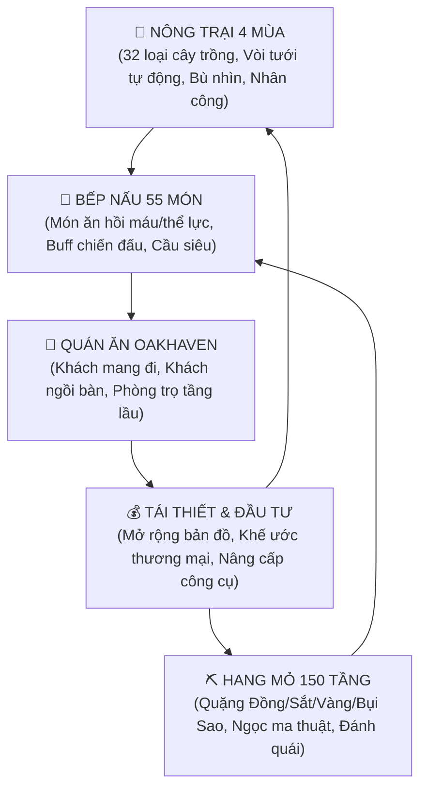

# Oakhaven Design Compendium: Master Specification (Quán Ăn, Nông Trại & Thám Hiểm)

> **Dự án:** Rowan of Oakhaven  
> **Thể loại:** Dark Pixel Action RPG + Farming & Tavern/Eatery Life-Sim  
> **Engine:** Godot 4.7.2  

---

## 1. Tổng Quan Kiến Trúc Vòng Lặp Trò Chơi (Core Loop)

---

## 2. Hệ Thống HP, Stamina & Cơ Chế Phạt Ngất Xỉu (Chuẩn Stardew)

### 2.1. Thanh Chỉ Số
- **Thanh Thể Lực (Stamina Bar - Mặc định 270):** 
  - Mọi thao tác cuốc đất, gieo hạt, tưới nước, đập đá, chặt cây, câu cá tiêu hao Stamina (từ 1 đến 4 điểm tùy cấp công cụ).
  - Khi Stamina chạm 0: Kích hoạt trạng thái **Kiệt Sức (Exhausted)** — tốc độ di chuyển giảm 50%, màn hình tối dần xung quanh.
  - Cố gắng làm việc thêm $\rightarrow$ Ngất xỉu.
- **Thanh Máu (HP Bar - Mặc định 100):**
  - Giảm khi trúng đòn của quái vật hoặc bẫy hầm ngục. Chạm 0 $\rightarrow$ Gục ngã.

### 2.2. Cơ Chế Rơi Đồ Khi Ngất Xỉu & Dịch Vụ Tìm Đồ Hộ (Lost & Found)
- Khi ngất xỉu trong hang mỏ hoặc ngoài đồng lúc 2:00 AM:
  - Rowan được cứu về **Trạm Xá Làng Oakhaven** bởi bác thợ rèn Boris hoặc dược sĩ Maeve.
  - Bị trừ 10% số tiền mặt hiện có (tối đa 1,000g viện phí).
  - **Mất đồ ngẫu nhiên:** Rơi mất từ 1 đến 4 món đồ đang chứa trong Balo (có thể mất stack quặng, nguyên liệu, thức ăn hoặc thậm chí vũ khí).
  - **Dịch Vụ Tìm Đồ Hộ Tại Lò Rèn Boris:**
    - Người chơi có thể đến gặp Boris để nhờ đội tuần tra thám hiểm xuống mỏ tìm lại đồ.
    - Boris cho phép **chọn chuộc lại 1 món đồ quan trọng nhất** đã làm rơi với chi phí tương đương giá trị món đồ.

---

## 3. Hệ Thống 32 Cây Trồng & Cơ Chế Tự Động Hóa Nông Trại

### 3.1. Danh Sách Cây Trồng Theo Mùa
1. **Mùa Xuân (8):**
   - Cải thìa (4 ngày)
   - Khoai tây (6 ngày, tỉ lệ thu hoạch x2)
   - Dâu tây tuyết (8 ngày, mọc lại sau 4 ngày)
   - Hành hoa (4 ngày)
   - Tỏi dại (4 ngày)
   - Đậu hà lan (10 ngày, mọc giàn)
   - Bắp cải sớm (9 ngày)
   - Trà xanh búp non (12 ngày, thu hoạch lá định kỳ)
2. **Mùa Hạ (8):**
   - Ngô ngọt (14 ngày, thu hoạch qua 2 mùa Hạ-Thu)
   - Cà chua mọng (11 ngày, mọc lại sau 4 ngày)
   - Ớt lửa hầm ngục (5 ngày, mọc lại sau 3 ngày)
   - Dưa lưới tinh vân (12 ngày, giá trị cao)
   - Cà tím tím than (5 ngày)
   - Lúa miến hoàng kim (8 ngày, xay làm gạo/bột)
   - Mía đường (7 ngày, ép lấy đường)
   - Quả việt quất (13 ngày, mọc lại sau 4 ngày, thu 3 quả/bụi)
3. **Mùa Thu (8):**
   - Lúa mì vàng (4 ngày, xay làm bột mì)
   - Bí đỏ đại thụ (14 ngày)
   - Khoai môn tro trấu (10 ngày, nguyên liệu món thanh tẩy)
   - Nấm sao tím (Trồng luống tối, 7 ngày)
   - Củ dền đỏ (6 ngày)
   - Nho đêm (10 ngày, mọc giàn)
   - Đậu đen (8 ngày)
   - Hạt hướng dương (8 ngày, rớt thêm hạt giống khi hái)
4. **Mùa Đông (4):**
   - Củ cải mùa đông (6 ngày)
   - Khoai tuyết (7 ngày)
   - Rễ địa y lạnh (8 ngày)
   - Hoa tuyết liên (12 ngày)
5. **Cây Ăn Quả Lâu Năm (4):**
   - Cây Táo sồi (Cho trái mùa Thu)
   - Cây Chanh vàng (Cho trái mùa Hạ)
   - Bụi Dâu rừng (Cho trái mùa Xuân)
   - Bụi Ớt ma thuật (Cho trái quanh năm trong nhà kính)

### 3.2. Tự Động Hóa Nông Trại
- **Hệ Thống Vòi Phun Tự Động (Sprinklers):**
  - *Vòi Phun Đồng (Copper Sprinkler):* Tưới 4 ô chữ thập liền kề mỗi sáng sớm lúc 6:00 AM.
  - *Vòi Phun Sắt (Iron Sprinkler):* Tưới 8 ô xung quanh (khung 3x3).
  - *Vòi Phun Bụi Sao (Stardust Sprinkler):* Tưới 24 ô xung quanh (khung 5x5).
- **Bù Nhìn Đuổi Chim (Scarecrows):**
  - Bù nhìn rơm cơ bản: Bảo vệ vùng bán kính 8 ô tròn xung quanh khỏi bầy chim rừng ăn hạt.
  - Bù nhìn ma thuật Oakhaven: Bảo vệ toàn bộ nông trại và tự động nhặt quả rụng.
- **Nhân Công Phụ Tá (Farmhand Contracts):**
  - Khi xây nhà tá điền phụ trong nông trại, người chơi có thể ký hợp đồng với dân làng nhàn rỗi (hoặc hình nhân gỗ bù nhìn) để tự động thu hoạch nông sản vào hòm xuất khẩu.

---

## 4. Hệ Thống Bản Đồ Thế Giới Mở Rộng & Sửa Chữa Tuyến Đường

Thế giới game Oakhaven không cố định mà mở rộng theo các công trình sửa chữa:

| Tuyến Đường / Công Trình | Tài Nguyên Yêu Cầu | Khu Vực & Tính Năng Mở Khóa |
|:---|:---|:---|
| **Cầu Gỗ Bờ Tây** | 300 Gỗ Sồi, 50 Thỏi Đồng, 2,000g | **Thảo Nguyên Đồng Cỏ Nắng:** Mở rộng đất chăn nuôi đại gia súc (bò sữa, cừu, dê) và đồng hoa nuôi ong lấy mật. |
| **Dọn Đống Đá Đèo Phía Bắc** | 20 Thuốc Nổ Lớn, 50 Thỏi Sắt, 5,000g | **Chiến Trường Tro Tàn & Rừng Ma:** Vùng phế tích chiến tranh chứa các Bàn Thờ Cầu Siêu, mỏ khoáng sản quý, và quái vật cấp cao. |
| **Sửa Ga Tàu Hỏa Oakhaven** | 100 Thanh Ray Sắt, 30 Thỏi Vàng, 20,000g | **Tuyến Tàu Hơi Nước Đại Lục:** Đón khách du lịch quý tộc, ký hợp đồng cung ứng lương thực cho các thương hội xa. |
| **Khôi Phục Bến Thuyền Hồ Sao** | 150 Gỗ Lõi Cứng, 20 Vải Bạt Dệt, 10,000g | **Hòn Đảo Ngọc Bích (Emerald Isle):** Khu vườn nhiệt đới trồng cây quanh năm không phụ thuộc mùa đông, bãi câu cá huyền thoại. |
| **Thang Máy Sâu Hầm Mỏ Tầng 150**| 50 Tinh Thể Nhiệt, 100 Thỏi Vàng, 30,000g | **Thành Phố Ngầm Khaz-Drakor:** Đô thị người lùn cổ đại, đe rèn thần thoại nâng cấp trang bị lên cấp Bụi Sao. |

---

## 5. Hệ Thống Ẩm Thực 55 Món & Cơ Chế Thanh Tẩy Cầu Siêu

### 5.1. Bếp Nấu Quán Ăn (Kitchen Stations)
- Không dùng tiệm trà. Bếp nấu bao gồm:
  - Bếp lò lửa xào nấu thức ăn nóng.
  - Nồi ninh hầm súp và canh thảo mộc.
  - Lò nướng bánh mì và thịt nướng.
  - Chõ hấp xôi và bánh cổ truyền.

### 5.2. Cơ Chế Thanh Tẩy Bằng Thức Ăn Cầu Siêu
- Trên Chiến Trường Tro Tàn có các **Bàn Thờ Gió & Bia Đá Trận Vong**.
- Mỗi bàn thờ có một linh hồn binh lính ngự trị với ước nguyện riêng:
  - Linh hồn thèm hương vị quê nhà $\rightarrow$ Dâng món **Cơm Nắm Muối Rừng** hoặc **Bánh Khoai Môn Tro Trấu**.
  - Linh hồn chết rét trong đêm đông $\rightarrow$ Dâng món **Canh Chua Cá Suối Cay** hoặc **Bánh Quy Gừng Giữ Ấm**.
  - Tướng quân trận vong $\rightarrow$ Dâng món **Yến Tiệc Cầu Siêu Anh Hồn**.
- **Hiệu quả:** Khi dâng đúng món ăn, linh hồn mỉm cười tan biến thành luồng sáng bay lên trời $\rightarrow$ Vùng đất xung quanh biến thành đất đen phì nhiêu, xua tan toàn bộ sương mù độc hại.

---

## 6. Trang Bị, Công Cụ, Nhẫn & Ngọc Ma Thuật (Chuẩn Stardew)

### 6.1. Trang Phục Nhân Vật
- **Mũ (Headgear):** Mũ rơm, Mũ thợ mỏ có đèn chiếu sáng, Mũ sắt hiệp sĩ, Mũ len mùa đông.
- **Áo (Shirt / Armor):** Áo sơ mi mộc mạc, Áo giáp da dẻo dai, Áo giáp sắt Boris, Áo choàng kháng lửa.
- **Quần (Pants):** Quần bò lao động, Quần kaki du hành, Quần giáp sắt bảo vệ.
- **Giày (Boots):** Giày da nhẹ (+1 Tốc), Ủng thợ mỏ (+1 Thủ, +1 Kháng gai), Ủng Bụi Sao (+3 Thủ, +2 Tốc).
- **2 Khe Đeo Nhẫn (Left/Right Ring).**

### 6.2. Hệ Thống Nhẫn (Ring System & Fusion)
- Nhẫn Nam Châm (Magnet Ring): Hút đồ vật rơi ra từ khoảng cách xa.
- Nhẫn Phát Sáng (Glow Ring): Chiếu sáng xung quanh nhân vật trong bóng tối.
- Nhẫn Chiến Binh (Warrior Ring): +10% Sát thương cận chiến.
- Nhẫn Hút Máu (Vampire Ring): Hồi 2 HP mỗi khi hạ 1 quái vật.
- Nhẫn Thần Tốc (Savage Ring): Tăng tốc độ chạy tức thì sau khi tiêu diệt mục tiêu.
- **Ghép Nhẫn:** Tại Tầng 100 Hầm mỏ, cho phép hợp nhất 2 nhẫn thành 1 chiếc nhẫn tích hợp cả 2 hiệu ứng.

### 6.3. Hệ Thống Ngọc Ma Thuật (Không Tháo Ngọc)
- Các loại ngọc: Hồng Ngọc (+Sát thương), Ngọc Bích (+Tốc độ đánh), Lam Ngọc (+Phòng ngự), Hoàng Ngọc (+Choáng), Thạch Anh Tím (+Chí mạng), Ngọc Hổ Phách Bụi Sao (+Toàn chỉ số).
- **Quy tắc:** **Khảm vĩnh viễn vào vũ khí/giáp (Không có cơ chế gỡ ngọc)**. Muốn dùng ngọc khác người chơi cần rèn trang bị mới.

### 6.4. 5 Cấp Bậc Công Cụ
- **Gỗ / Sơ cấp:** 1 ô, tốn nhiều sức.
- **Đồng (Copper):** 3 ô thẳng (Cuốc/Tưới), chặt gốc cây nhỏ (Rìu).
- **Sắt (Iron):** 5 ô thẳng, chặt cây cổ thụ to.
- **Vàng (Gold):** Vùng 3x3 (9 ô), đập đá thiên thạch trong hang.
- **Bụi Sao (Stardust):** Vùng 5x5 (25 ô), tiêu hao cực ít thể lực.

---

## 7. Quán Ăn, Dịch Vụ Nhà Trọ & Đầu Tư Mạo Hiểm

### 7.1. Quán Ăn Oakhaven (The Hearth Eatery)
- Lật biển `[OPEN] / [CLOSED]` tự do mỗi ngày.
- **Khách Mua Mang Đi (Takeaway):** Ghé quầy mua đồ ăn nhanh (cơm nắm, bánh mì, nước hoa quả).
- **Khách Ngồi Lại Bàn (Dine-in):** Ngồi tại các bộ bàn ghế, gọi các món ăn đắt tiền kèm đồ uống, tâm sự chia sẻ hoàn cảnh và gia tăng mức độ thân thiết.

### 7.2. Dịch Vụ Cho Thuê Phòng Trọ (The Hearth Inn)
- Xây dựng tầng lầu với 3-5 phòng ngủ cho khách vãng lai và đoàn buôn thuê phòng.
- Tiền phòng thu về tự động mỗi sáng.
- Khách thuê phòng là nguồn khách ăn sáng cố định cho quán ăn.

### 7.3. Tái Thiết Thị Trấn & Đầu Tư Thương Mại
- Đóng góp vàng và tài nguyên tái thiết: Sửa Cối Xay Gió, Sửa Trạm Xá, Dựng Đèn Đường.
- Hợp đồng cung ứng lương thực số lượng lớn cho các thương đội viễn chinh.
- Đầu tư vốn vào đội tàu thám hiểm của Thuyền Trưởng Garrick để thu về nguyên liệu quý hiếm từ biển xa.
