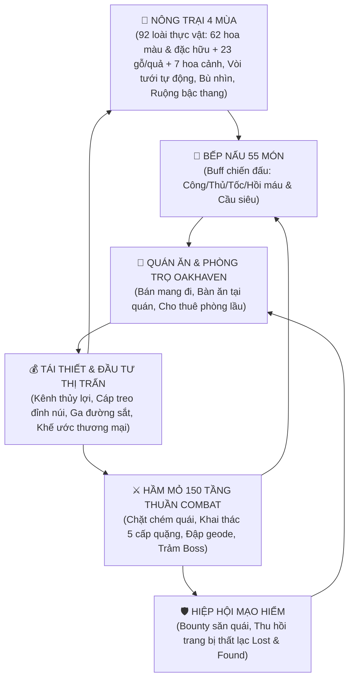

# Oakhaven Design Compendium: Master Specification (Quán Ăn, Nông Trại & Thám Hiểm)

> **Dự án:** Rowan of Oakhaven  
> **Thể loại:** Dark Pixel Action RPG + Farming & Tavern/Eatery Life-Sim  
> **Engine:** Godot 4.7.2  

---

## 1. Tổng Quan Kiến Trúc Vòng Lặp Trò Chơi (Core Loop)

---

## 2. Hệ Thống HP, Stamina & Cơ Chế Phạt Ngất Xỉu

### 2.1. Thanh Chỉ Số Sinh Mệnh
- **Thanh Thể Lực (Stamina Bar - Khởi điểm 270, Trần 450):** 
  - Mọi thao tác cuốc đất, gieo hạt, tưới nước, đập đá, chặt cây, câu cá tiêu hao Stamina (từ 1 đến 4 điểm tùy cấp công cụ).
  - **Tăng trần Stamina (+30/mốc, tối đa +180):** 3 bình Thuốc Bồi Bổ mua tại Trạm Y Tế của **Dược Sĩ Aurelia** + 3 mốc giải phóng vùng đất tại **Bàn Thờ Cổ Đại**.
  - Khi Stamina chạm 0: Kích hoạt trạng thái **Kiệt Sức (Exhausted)** — tốc độ di chuyển giảm 50%, nhân vật thở dốc, màn hình tối góc.
  - Tiếp tục dùng công cụ khi đang kiệt sức $\rightarrow$ Ngất xỉu ngay lập tức.
- **Thanh Máu (HP Bar - Khởi điểm 100, Trần 250):**
  - Máu giảm khi trúng đòn tấn công của quái vật hoặc bẫy hầm ngục. Chạm 0 $\rightarrow$ Gục ngã tại trận.
  - **Tăng trần HP (+30/mốc, tối đa +150):** Phần thưởng hạ Boss Hầm Mỏ lần đầu tại các tầng mốc `30, 60, 90, 120, 150`.

### 2.2. Cơ Chế Phạt Ngất Xỉu & Dịch Vụ Thu Hồi Tại Hiệp Hội Mạo Hiểm (Rescue & Lost & Found)
Phân định rõ rệt giữa hai trường hợp kiệt sức trên mặt đất và gục ngã dưới hầm mỏ:

1. **Ngất Xỉu Trên Mặt Đất (Cạn Stamina hoặc quá 02:00 AM):**
   - **Cậu phụ tá Colm** phát hiện và vác cáng khiêng Rowan về giường ngủ tại The Hearth.
   - Bị trừ 10% tiền mặt hiện có (tối đa 1,000g viện phí chi trả cho Trạm Y Tế của **Dược Sĩ Aurelia**).
   - **Bảo toàn trang bị & túi đồ:** Hoàn toàn **KHÔNG mất bất kỳ món đồ nào** trong ba lô hay nông sản vừa thu hoạch.
   - **Hồi phục sáng hôm sau:** Tỉnh dậy với **50% HP & 50% Stamina**.
2. **Gục Ngã Trong Hầm Ngục Mỏ Cổ 150 Tầng (Cạn HP do quái vật hoặc bẫy):**
   - Đội cứu nạn của **Hiệp Hội Mạo Hiểm (dưới quyền Hội Trưởng Thorne)** khẩn cấp kéo Rowan về Trạm Y Tế của **Dược Sĩ Aurelia**.
   - Bị trừ 10% tiền mặt (tối đa 1,000g phí cứu hộ và điều trị).
   - **Mất mát chiến lợi phẩm (Permanent Loss - Mất đồ là mất đồ):** Rơi mất vĩnh viễn toàn bộ quặng thô, đá quý, linh kiện quái và vật liệu nhặt được trong chuyến đi mỏ hôm đó *(tuân thủ quy tắc 100% Non-Food Drops)*.
   - **Bảo vệ Trang bị & Công cụ chính (Tools & Weapons Guard):** Vũ khí chính, giáp trụ và nông cụ không bao giờ bị xóa vĩnh viễn, nhưng sẽ bị rơi lại tại hiện trường. Đội tuần tra đưa về bàn **Đồ Thất Lạc (Lost & Found)** của Hiệp Hội Mạo Hiểm do Thorne và Valerie quản lý:
     - Cách 1: **Trả Vàng chuộc đồ:** Chi trả khoản tiền tương ứng với giá trị món đồ.
     - Cách 2: **Đổi Bằng Cơm Hộp Tiếp Tế (Expedition Bento):** Nấu các phần thức ăn dã chiến theo đơn uỷ thác của Hiệp Hội để nhận **Huy Hiệu Cứu Viện** đổi lại vũ khí/công cụ miễn phí.

---

## 3. Không Gian Riêng & Tùy Biến Nhà Của Rowan (Private Quarters)

Rowan sở hữu không gian sống hoàn toàn riêng biệt nằm trên tầng gác mái của quán ăn (hoặc khuôn viên nhà riêng ven suối), tách bạch với khu kinh doanh phục vụ thực khách:

### 3.1. Các Khu Vực Chức Năng Riêng Biệt
1. **Giường Ngủ Cá Nhân (Personal Bed):**
   - Đi ngủ để kết thúc ngày, hồi phục chỉ số và lưu game.
   - Nâng cấp: Giường Rơm $\rightarrow$ Giường Gỗ Sồi $\rightarrow$ Giường Nệm Lông Ngỗng (hồi phục 100% Stamina ngay cả khi hôm trước bị kiệt sức).
2. **Bàn Thử Nghiệm Ẩm Thực R&D (Rowan's Secret Lab Counter):**
   - Nơi Rowan tự do ghép 2 đến 4 nguyên liệu bất kỳ để tự mò ra công thức nấu ăn mới mà không lo làm hỏng nguyên liệu trước mặt khách.
3. **Tủ Đồ Thời Trang & Gương Soi (Wardrobe & Mirror):**
   - Quản lý và thay đổi trang phục: Nón, Áo giáp/Trang phục, Quần, Giày với hiệu ứng thị giác hiển thị trực tiếp lên nhân vật.
4. **Kệ Trưng Bày Chiến Tích & Cổ Vật (Trophy & Relic Showcase):**
   - Nơi cắm các cúp vàng Lễ hội ẩm thực Oakhaven, đầu lâu quái vật tinh anh và cổ vật khai quật từ phế tích.
5. **Hầm Ủ Men & Lên Men Riêng (Private Aging Cellar):**
   - Mở khóa khi nâng cấp nhà cấp 2. Chứa các thùng gỗ sồi ủ phô mai, tương đậu, dấm hoa quả và rượu vang mật ong hảo hạng.

---

## 4. Hệ Thống Hầm Ngục Mỏ Cổ Vô Tận & Chiến Đấu (The Infinite Mine-Dungeon & Action RPG Combat)

> **NGUYÊN TẮC CỐT LÕI:** Hầm mỏ và Dungeon **GỘP LÀM 1 THỂ THỐNG NHẤT** mang tên **Hầm Ngục Mỏ Cổ Vô Tận (The Infinite Mine-Dungeon)**. Đây là **chiến trường sinh tử thuần túy**. Quái vật mang tính thù địch (Hostile), cực kỳ hung dữ và tấn công lập tức khi thấy người chơi. **Tuyệt đối không có cơ chế xoa dịu hay dâng đồ ăn cho quái vật trong hầm ngục.** 
> Thức ăn 55 món được sử dụng làm **buff chỉ số chiến đấu cho chính Rowan** (Công, Thủ, Tốc độ, Kháng nguyên tố, Hồi máu tức thì) để tiêu diệt kẻ thù!

### 4.1. Cơ Chế Chinh Phục Hầm Mỏ (Soul-Knight Style Dungeon Flow & Endless Abyss)
- **Cấu Trúc Hầm Ngục Thống Nhất:**
  - **Tầng 1–150 (Chiến Dịch Cốt Truyện):** Chia làm 4 đới địa chất chính nối tiếp nhau. Mỗi tầng bao gồm các phòng hang kết nối qua cửa đá phong ấn.
  - **Tầng 151+ (Vực Thẳm Vô Tận - The Infinite Abyss):** Không giới hạn tầng mỏ (Endless), độ khó tăng tiến liên tục, quái vật đột biến tinh anh mang thuộc tính ngẫu nhiên, tỉ lệ rơi quặng hiếm và ngọc tinh linh tối thượng cao nhất dành cho lối chơi hardcore endgame.
- **Dọn sạch phòng:** Bước vào phòng đá, cửa sau lập tức khóa chặt $\rightarrow$ Tiêu diệt toàn bộ quái vật trong phòng để cửa thông tầng tiếp theo mở ra và nhận rương tài nguyên.
- **Quy Tắc Sinh Tử — "Mất Đồ Là Mất Đồ" (Permanent Loss on Defeat):**
  - Khi Rowan kiệt sức (HP = 0) trong hầm mỏ: Cậu phụ tá Colm dùng cáng kéo Rowan về Trạm Xá để bảo toàn tính mạng (tránh permadeath/xóa file save).
  - Người chơi bị trừ tiền viện phí cấp cứu điều trị chấn thương.
  - **Toàn bộ khoáng sản, vật phẩm và chiến lợi phẩm thu thập trong lượt thám hiểm đó rơi lại dưới lòng đất và MẤT VĨNH VIỄN.**
  - **Tuyệt đối không có cơ chế cứu hộ miễn phí 100%, không giảm giá chuộc đồ, không giữ an toàn hành trang.** Người chơi phải luôn tính toán lượng máu và chủ động dùng Dây Thừng Thoát Hiểm (Escape Rope) hoặc Cửa Dịch Chuyển để rút lui an toàn.
- **Quy Tắc Cư Dân Mặt Đất & Chạm Trán Ngẫu Nhiên Trong Mỏ (Surface-Only NPCs & Mine Encounters):**
  - **100% NPC đều sinh sống cố định tại thị trấn, điền trang hoặc các lán trại trên MẶT ĐẤT.** Không có NPC nào dựng lều định cư lâu dài trong hầm ngục.
  - **Chạm trán ngẫu nhiên:** Trong quá trình đào mỏ, Rowan thỉnh thoảng có thể bắt gặp một số NPC đang làm công việc dã ngoại ngắn hạn (`Bram` gõ mạch quặng sâu, `Lão Gomer` thử mìn phá đá, `Thợ lặn Vael` khảo sát hồ ngầm, `Hiệp sĩ Hester` tìm mảnh thép vụn, `Hội trưởng Thorne` kiểm tra phong ấn). **Quy tắc chống cản trở combat:** Chỉ xuất hiện tại **phòng nghỉ / tầng thường** (tuyệt đối không spawn ở tầng Boss 30, 70, 110, 150); tương tác nhanh 1 chạm (chia sẻ 1 món ăn dã ngoại nhận lại quặng, bộc phá mở lối hoặc buff ngắn hạn), không biến hầm mỏ thành khu dân cư.
- **Chiến Đấu Nhịp Độ Nhanh (Hack & Slash):**
  - Kết hợp vung vũ khí cận chiến (Kiếm chém nhanh 3 nhịp, Liềm quét hình bán nguyệt rộng AoE, Búa tạ đập chấn động vỡ giáp).
  - Tấn công tầm xa bằng Pháp trượng ma thuật hoặc ném Bom lửa.
  - Phím `Space` Lướt né (Dash) có khung bất tử (i-frames) để tránh đòn quét diện rộng của quái vật.
- **Đèn Lồng Bão Đom Đóm (Spirit Lantern):**
  - Chiếu sáng các căn phòng tối đen như mực.
  - Một số quái vật ẩn mình trong bóng đêm chỉ có thể bị phát hiện và dính sát thương khi bước vào quầng sáng của Đèn Lồng.

### 4.2. Danh Mục 4 Đới Địa Chất & Quái Vật Hậu Chiến (100% Non-Food Drops)

> **QUY TẮC CHIẾN LỢI PHẨM (100% NON-FOOD):** Toàn bộ thực phẩm nấu 55 món tại *The Hearth* đến từ nông nghiệp mặt đất (92 loài thực vật: 62 hoa màu & đặc hữu + 23 cây gỗ/ăn quả/bụi quả + 7 hoa cảnh, cùng cá suối & chăn nuôi). Quái vật hầm mỏ **100% chỉ rơi vật phẩm rèn đúc (Combat 40%), công cụ khám phá mỏ (Exploration 30%), và vật tư tự động hóa/phân bón nông trại (Farming & Automation 30%)**.

| Đới Địa Chất & Tầng | Tên Quái Vật & ID | Ngoại Hình & Visual Tells | Khắc Chế & Lợi Thế (+25% đến +40%) | Chiến Lợi Phẩm 100% Non-Food (Combat / Explore / Farm) |
|:---|:---|:---|:---|:---|
| **Đới 1: Đầm Than Bùn & Mỏ Đồng Cũ** *(Tầng 1–30)* *Biomes: Mỏ Ngập Nước (1-10), Chiến Hào Bỏ Hoang (11-20), Hầm Chỉ Huy Sập (21-29)* | **Slime Bùn Axit** *(slime_mud_acid)* | Bán trong suốt, lõi vàng xanh phát sáng, bề mặt sủi bọt axit, để vệt bùn trơn trượt. | Liềm chém quét diện rộng dọn dẹp phân thân lập tức (+30%). | • Dịch nhầy axit (nấu chất tẩy rỉ Boris) • Quặng Đồng Thô • Bùn khoáng giàu đạm (ủ đất nông trại) |
| | **Bọ Mai Đồng** *(beast_copper_beetle)* | Bọ mai kim loại đồng phủ rêu, giáp lưng cứng, bụng mềm, mặt đất rung trước khi trồi. | Búa Tạ đập lật ngửa bụng lộ điểm yếu nhận x2 DMG. | • Mảnh Vỏ Mai Đồng (rèn giáp cấp 1) • Quặng Đồng • Bột vỏ bọ (kích rễ mầm cây) |
| | **Dơi Mỏ Đui Mù** *(beast_blind_bat)* | Cánh màng lớn rách rưới, mắt mờ đục thoái hóa, định vị sóng âm làm rung màn hình. | Kiếm chém đón đầu nhịp bổ; Đèn Lồng xua quầng bay. | • Màng Cánh Dơi Dai (may ba lô dã ngoại) • Xương cánh (chế tên nỏ) |
| | **Thợ Mỏ Xương Cầm Cuốc** *(skel_miner_pick)* | Bộ xương mặc áo thợ mỏ cũ, mũ gắn đèn hỏng, vác cuốc chim gãy, chuyển động nặng nề. | Lướt né ra sau lưng trảm kích khi cuốc bổ kẹt sàn đá. | • Đầu Cuốc Chim Rỉ Sét (Boris tái chế thỏi đồng) • Bột Xương Hang Mỏ (+30% tỷ lệ sao nông sản) |
| | **Chuột Chũi Đào Hầm** *(beast_trench_mole)* | Chuột hang thân thấp chắc khỏe, móng vuốt xẻng sắt, gò đất đùn lên trước khi phục kích. | Đặt bom nổ ngay điểm đất nứt; Búa Tạ nện chấn động. | • Móng Vuốt Xẻng Đào (chế xẻng nâng cấp đất) • Da chuột thuộc bền bỉ |
| | **Xác Binh Sĩ Sa Lầy** *(undead_trench_walker)* | Quân phục rách nát, giáp sắt hoen rỉ bọc bùn, lao tới ghì ôm khống chế người chơi 1.5s. | Lướt né cú ôm; Liềm chém quét đứt khớp chân. | • Huy Hiệu Binh Sĩ Cũ (cầu siêu Bàn Thờ Cổ Đại) • Mảnh Giáp Sắt Rỉ Sét • Dây đai quân dụng |
| | **Bù Nhìn Thép Rỉ** *(armor_scrap_dummy)* | Cỗ máy tập trận cũ ghép sắt cọc gỗ, lõi máy cũ, rung lắc phát tiếng kim loại rồi xoay 360°. | Parry nhịp xoay làm gãy chốt; Búa Tạ đập vỡ khung. | • Bánh Răng Rỉ Sét (chế vòi tưới đồng) • Cọc Sắt Gia Cố (hàng rào chuồng trại) |
| **Đới 2: Lò Luyện Cổ Khaz-Drakor** *(Tầng 31–70)* *Biomes: Đường Hầm Nham Thạch (31-40), Chuyển Quặng Từ Tính (41-50), Xưởng Đúc Cơ Khí (51-60), Hồ Luyện Kim (61-69)* | **Slime Nham Thạch Nóng** *(slime_magma)* | Magma bán đông kẹp vảy basalt đen, để vệt than hồng, chết phát nổ miểng xỉ 3x3 ô. | Vũ khí khảm Hàn Tinh (Frost Shard) dập lửa làm đông cứng vỏ. | • Mảnh Đá Basalt Nguội (rèn giáp chịu nhiệt) • Than Cốc Lò Luyện • Quặng Sắt |
| | **Ốc Sên Vỏ Nam Châm** *(beast_magnet_snail)* | Vỏ quặng từ tính phát sáng xanh lam, vụn sắt xoay quanh, phát xung từ trường hút vũ khí. | Đổi sang vũ khí gỗ/phép trượng; Lướt ngược lực hút. | • Quặng Từ Tính Lodestone (chế Nhẫn Hút Vật Phẩm) • Vỏ ốc siêu cứng (rèn khiên) |
| | **Nhện Tơ Lửa Dung Nham** *(beast_magma_spider)* | Giáp đen chịu nhiệt, bụng than hồng, chân gai nhọn, giăng mạng tơ lửa cam đỏ giữ chân. | Vũ khí Hàn Tinh chém đứt tơ; Búa nện vỡ bụng. | • Tơ Nhện Chống Cháy (bao tay chịu nhiệt) • Tuyến Lửa Magma |
| | **Khiên Binh Xương Bọc Sắt** *(skel_ironclad_shield)* | Khung xương lùn cổ bọc giáp sắt nặng, đại khiên thép chặn 100% sát thương trực diện. | Lướt vòng sau lưng trảm khớp gối; Búa đập vỡ khiên. | • Tấm Khiên Thép Cổ (Boris rèn khiên cấp 2) • Thỏi Sắt Khaz-Drakor • Bột Xương Cổ |
| | **Người Máy Lò Hơi Cổ** *(automaton_boiler_bot)* | Thiết bị tự động 3 chân kim loại, nồi áp suất lưng, xả luồng hơi nước áp suất cao hình nón. | Lướt né luồng hơi, chọc thủng nồi hơi sau lưng khi mở van. | • Bánh Răng Đồng Thau Lò Hơi (máy bơm thủy lợi) • Ống Đồng Áp Suất |
| | **Lính Cháy Than Ôm Bom** *(undead_bomb_runner)* | Thi thể thợ mỏ hóa than đen cháy đỏ, ôm bình hỏa dược chạy dốc lao tới rồi tự kích nổ. | Bắn nỏ từ xa kích nổ bom trước khi tiếp cận. | • Mảnh Bình Thuốc Nổ Đen (chế mìn phá đá) • Than Hoạt Tính Khử Độc |
| | **Mimic Rương Sắt Cổ** *(mimic_iron)* | Hòm khai khoáng cơ khí nẹp đinh tán, hé mắt thở phì phò, miệng răng cưa sắt bén ngót. | Quan sát khe nắp hòm thở; Búa Tạ nện đòn phủ đầu. | • Bản Lề Thép Chế Tác Boris • Quặng Sắt Tinh Khiết • Đá Quý Thô (Hồng Ngọc/Lam Ngọc) |
| **Đới 3: Hang Rễ Sâu & Rừng Nấm** *(Tầng 71–110)* *Biomes: Rừng Nấm Dạ Quang (71-80), Mê Cung Rễ Cây (81-90), Nghĩa Địa Rễ Ma (91-100), Thân Cây Cổ Thần (101-109)* | **Slime Bào Tử Độc Tím** *(slime_toxic_spore)* | Khối gelatin tím mọc nấm sống trên lưng, trườn xả vòng khói độc rút máu, chết mọc nấm bẫy. | Vũ khí khảm Hỏa Tinh hoặc ném Bom Lửa thiêu rụi bào tử. | • Bào Tử Phát Quang Tím (pha thuốc nhuộm/đèn) • Mùn Nấm Hoạt Tính (tăng tốc độ ủ men) |
| | **Cây Ăn Thịt Rễ Gai** *(plant_briar_carnivore)* | Miệng hoa răng sắc ẩn dưới rêu ngầm, rễ bò dưới đất trồi lên trói chân kéo vào miệng hoa. | Chặt đứt rễ chính bằng Liềm Runic; Lướt ra khỏi vùng nứt. | • Dây Leo Gai Dai Dẻo (chế dây thừng giếng) • Nhựa Cây Bắt Mồi (bảo vệ chuồng gia súc) |
| | **Bướm Đêm Phát Quang** *(beast_luminescent_moth)* | Cánh lớn hoa văn mắt xanh ngọc, rải phấn dạ quang ru ngủ và làm mờ tầm nhìn vừa phải. | Đèn Lồng Đom Đóm hút hướng bay; Nỏ bắn tầm xa. | • Phấn Cánh Phát Quang (bột huỳnh quang soi mỏ) • Tơ tằm đêm thượng hạng |
| | **Cung Thủ Xương Brier** *(skel_briar_archer)* | Bộ xương bị rễ gai quấn chặt, cầm trường cung rễ hóa thạch, bắn tỉa tên gai tẩm độc từ xa. | Áp sát né tầm ngắm; Kiếm chém đứt dây cung. | • Cành Gỗ Rễ Hóa Thạch (chế cần câu cao cấp) • Mũi Tên Gai Rừng • Quặng Vàng |
| | **Oán Hồn Hang Sâu Banshee** *(undead_depth_banshee)* | Vong linh bán trong suốt, tóc trôi như khói tím, tụ sóng âm phát sáng vòng tròn 1.0s rồi thét choáng. | Rọi Đèn Lồng xua tan thể sương; Parry nhịp sóng âm. | • Dải Khăn Vong Linh Cổ (cầu siêu Bàn Thờ Cổ Đại) • Tinh Thể Lệ Hồn (khảm ngọc kháng phép) |
| | **Kỵ Sĩ Xương Cưỡi Rết** *(skel_centipede_knight)* | Rết đá 20 đốt bò trườn vách hang chuyển động liên tục từng đốt, kỵ sĩ cầm thương bổ nhào. | Búa đập vỡ giáp đốt rết hất kỵ sĩ ngã xuống đất. | • Vảy Giáp Đốt Rết Đá (rèn giáp Bậc 4) • Mũi Thương Cổ Rỉ Sét • Quặng Vàng |
| | **Bọ Giáp Tinh Thể Vàng** *(beast_gold_crystal_beetle)* | Mai cấu tạo từ các phiến tinh thể vàng lục giác, cuộn tròn lăn tông cực nhanh va đập tường. | Đặt bom/Búa Tạ chặn đường lăn gây lật ngửa. | • Tinh Thể Vàng Nguyên Khối (bán cho Boris) • Quặng Vàng Thô • Bột mài kim hoàn |
| **Đới 4: Vực Cổ Vật & Cổ Thành Solaria** *(Tầng 111–150)* *Biomes: Ngoại Thành Chìm (111-120), Thư Viện Cổ Solaria (121-130), Vực Vết Nứt Hư Không (131-140), Cung Điện Niêm Phong (141-149)* | **Slime Hư Không Tinh Thể** *(slime_void_crystal)* | Tinh thể pha lê tím lam nhiều mặt cắt khúc xạ, hấp thụ phép rồi phản lại tia laser tím thẳng. | Búa Tạ đập vỡ góc tinh thể trước khi tích đủ năng lượng. | • Mảnh Pha Lê Hư Không (Vòi Tưới Hư Không 24 ô) • Quặng Mithril • Bột Huỳnh Quang Tinh Thể |
| | **Sách Cổ Phản Phệ** *(grimoire_ancient_backfire)* | Sách da thuộc khắc chữ rune, gáy mở hàm răng nhọn, lật trang phóng ký tự ma thuật bay. | Chém kiếm trúng gáy sách khi đang lật trang; Nỏ lửa. | • Mảnh Giấy Da Cổ Ngữ (công thức rèn cổ vật Boris) • Bìa Da Thuộc Solaria |
| | **Gargoyle Xương Hóa Đá** *(gargoyle_stone_skeletal)* | Dực quỷ cẩm thạch pha xương; **Nhìn trực diện = Hóa đá bất tử; Quay lưng = Bổ cào**. | Lừa góc nhìn, nấp sau cột đá rồi lướt vòng sau lưng đánh gáy. | • Đá Cẩm Thạch Solaria (lát sàn quảng trường quán) • Mảnh Cánh Đá |
| | **Pháp Sư Xương Hư Không** *(skel_void_mage)* | Áo choàng tím rách, trượng nạm tinh thể, vẽ vòng ma thuật triệu hồi bầy xương và dựng khiên. | Ưu tiên tiêu diệt đầu tiên; Đập vỡ trượng ngắt phép. | • Trượng Ma Thuật Gãy (chiết xuất Thỏi Mithril) • Quặng Hư Không Thô • Đá Thạch Anh Tím |
| | **Bộ Giáp Hoàng Gia Rỗng** *(armor_empty_royal)* | Giáp cẩm thạch trắng viền bạc, đại kiếm lơ lửng, bên trong rỗng, chém 3 nhịp rộng. | Parry nhát chém thứ 2 làm vỡ liên kết ma thuật rơi giáp. | • Phiến Giáp Cẩm Thạch Trắng (rèn giáp Bậc 5) • Chuôi Kiếm Hoàng Gia |
| | **Kỵ Sĩ Tử Thần Hư Không** *(undead_death_cavalier)* | Cưỡi ngựa xương bán trong suốt, hạ thấp thương 1.2s phi nước đại đâm xuyên khiên. | Lướt né vuông góc vào khoảnh khắc phi ngựa; Chặt chân ngựa. | • Móng Ngựa Bạc Hóa Thạch (móng ngựa tăng tốc chạy) • Vải Liệm Hoàng Gia |
| | **Mimic Hoàng Kim Vương Giả** *(mimic_gilded_royal)* | Rương hoàng gia dát vàng nạm hồng ngọc, càng kim loại lớn vươn ra xoay lưỡi cưa kim cương. | Quan sát vệt sáng đỏ ổ khóa; Đặt bom nổ phá bản lề. | • Khóa Vàng Vương Triều (Boris mở khóa rương báu) • Vàng Thỏi Nguyên Chất • Kim Cương Thô |
| | **Bản Sao Hư Không Rowan** *(mirror_void_rowan)* | Tàn ảnh giống hệt Rowan, viền tím, cử động giật nhẹ, sao chép vũ khí, combo và thói quen né. | Đổi sang vũ khí phụ đột ngột phá vỡ chuỗi combo sao chép. | • Mảnh Gương Vực Thẳm (chế Nhẫn Phản Đòn Tối Thượng) • Bụi Không Gian |
| **Vực Thẳm Vô Tận** *(Tầng 151+ Endless Abyss)* | **Vua Slime Vô Định Hình** *(slime_amorphous_king)* | Kích thước 3x3 ô, luân chuyển 4 thể: Bùn lầy dính chân, Magma bắn sao băng, Bào tử mù, Tinh thể laser. | Đọc nhịp chuyển màu lõi 2s trước khi đổi thể để hoán đổi vũ khí. | • Tinh Thể Tứ Nguyên Tố Cổ (Vũ khí Bậc 6) • Lõi Năng Lượng Bất Diệt • Mảnh Cầu Vồng (Prismatic Shard) |
| | **Cự Trùng Vết Nứt Hư Không** *(beast_void_rift_worm)* | Sâu không gian nhiều đốt vảy đen tím, miệng xoáy hút nuốt cả phòng đấu trường. | Quan sát hướng đá bị hút; Ném bom vào miệng xoáy gây choáng 3s. | • Răng Kim Cương Vực Thẳm (Mũi Khoan Vô Tận) • Quặng Hư Không Tinh Khiết |

### 4.3. Đấu Trường 4 Đại Thủ Vệ (Warden Boss Fights) & Lore Khaz-Drakor - Solaria

> **MỐI LIÊN HỆ LỊCH SỬ KHAZ-DRAKOR & SOLARIA:** Trong cuộc chiến cổ đại ngăn Vết Nứt Hư Không tràn lên mặt đất, Vương quốc Luyện Kim Khaz-Drakor (Đới 2) và Vương Triều Pháp Thuật Solaria (Đới 4) đã kết liên minh chế tạo Cổ Đai Niêm Phong. Vị Tướng Soái Vĩ Đại nhất của Khaz-Drakor đã tình nguyện ở lại tâm chấn Cung Điện Solaria, dung hợp thể xác sắt đá với Lõi Phong Ấn để canh giữ miệng vực vĩnh viễn. Năng lượng hư không qua thiên niên kỷ biến đổi đại kiếm của ngài thành kiếm pha lê nứt tím, biến ngài thành bức tường thành thử thách cuối cùng trước cánh cổng Endless Abyss.

- **Tầng 30: Golem Hơi Nước Chiến Hào (The Steam Colossus)**
  - *Hình tượng:* Cỗ máy chiến tranh khai khoáng khổng lồ bọc giáp sắt rỉ sét, 1 tay cưa công nghiệp quay tóe lửa, 1 tay búa thủy lực đập sàn. Sau lưng là nồi hơi lớn với 3 van xả áp suất phát sáng đỏ cam rung bần bật.
  - *Cơ chế:* Quét cưa 180° và nện búa sập đá trần hang. Sau mỗi chuỗi 3 đòn, Golem dừng lại 2.5s xả hơi qua van lưng $\rightarrow$ Rowan lướt ra sau chém thẳng vào Lõi Nồi Hơi (nhận x2.5 DMG). Dưới 20% HP kích hoạt **Meltdown Mode**: nổ tung giáp ngực lộ lò xoay đỏ rực, tốc độ tăng 30%, để lại vệt than hồng.
  - *Chiến lợi phẩm 100% Non-Food:* `Bánh Răng Khổng Lồ Khaz-Drakor` (nâng cấp Bếp Than Cấp 2), `Van Áp Suất Hoàn Hảo` (chế Vòi Tưới Tự Động), `Quặng Đồng Tinh Chất` x15.
- **Tầng 70: Hỏa Long Hồ Đúc Khaz-Drakor (The Magma Forge Dragon)**
  - *Hình tượng:* Rồng dung nham sống ngập mình trong hồ quặng nóng chảy. Vảy cấu tạo từ đá basalt đen kẹp dải magma đỏ rực, cổ và ngực bọc giáp quặng sắt nóng chảy bám dính.
  - *Cơ chế:* Bơi lặn dưới hồ xỉ kim loại, mặt hồ sủi bọt báo trước vị trí trồi lên quét sóng dung nham ngang bệ đá; phun 3 cầu lửa diện rộng. Dưới 30% HP, rồng quất đuôi làm sập bệ đá basalt, vảy lưng nứt toác để lộ khe thịt đỏ rực điểm yếu cho Rowan dồn đòn trảm quyết.
  - *Chiến lợi phẩm 100% Non-Food:* `Mảnh Vảy Hỏa Long Basalt` (rèn Giáp Hỏa Long kháng dung nham), `Túi Mỡ Lửa Cổ Sinh` (chế Đèn Bão Mỡ Rồng soi sáng x3), `Thỏi Sắt Khaz-Drakor` x20.
- **Tầng 110: Mộc Thần Rễ Treo Cổ (The Hanged Root God)**
  - *Hình tượng:* Cổ thụ khổng lồ cắm rễ nuốt chửng nghĩa trang cổ ngầm, thân vặn xoắn hiện những khuôn mặt rên rỉ mờ ảo, cành buông thõng rễ gai thòng lọng bao quanh bia mộ chiến sĩ.
  - *Cơ chế:* Rễ trồi xiên cọc nhọn theo vết nứt đất rêu; cành rễ quét ngang sàn đấu buộc lướt né i-Frames; hoa trần hang nhả phấn mờ tầm nhìn còn bán kính 3 ô. Dưới 35% HP, thân cây nứt toác để lộ Lõi Gỗ Thiêng phát sáng ngọc lục bảo $\rightarrow$ người chơi tập trung chém thẳng vào Lõi Thần Mộc.
  - *Chiến lợi phẩm 100% Non-Food:* `Lõi Gỗ Thiêng Runic Khổng Lồ` (Boris chế Bàn Nâng Cấp Nông Cụ Thần Thoại), `Nhựa Cây Hóa Thạch Ngàn Năm` (Thùng Ủ Men Thượng Hạng), `Thỏi Vàng Khắc Cổ Ngữ` x15.
- **Tầng 150: Tướng Soái Phong Ấn Khaz-Drakor (The Sealed Warden)**
  - *Hình tượng:* Vị tướng lùn huyền thoại bọc giáp cẩm thạch trắng nẹp hợp kim Khaz-Drakor, mũ giáp bọc kín chỉ lộ ánh tím hư không, tay cầm Đại Kiếm Pha Lê nứt nẻ phát ra sóng xung kích tím.
  - *Cơ chế 3 Phase:*
    - *Phase 1:* Nghệ thuật đại kiếm cận chiến rộng 2 nhịp; Parry nhịp 2 làm khựng 1.5s.
    - *Phase 2:* Cắm kiếm xuống sàn tạo 3 lốc xoáy hư không và lực hút trọng lực kéo người chơi; Rowan phải nấp sau cột cẩm thạch.
    - *Phase 3 (Dưới 30% HP):* Phân thân thành Thể Chính + 2 Tàn Ảnh Hư Không cùng lao trảm. **Dấu hiệu nhận biết:** Thể chính có bóng đổ trên sàn cẩm thạch và để lại vệt nứt năng lượng phát sáng tím dưới chân; chém trúng thể chính lập tức giải trừ 2 tàn ảnh.
  - *Chiến lợi phẩm 100% Non-Food:* `Trái Tim Cổ Ngữ Khaz-Drakor` (Mở khóa Vực Thẳm Vô Tận Endless Abyss Tầng 151+), `Bản Vẽ Vũ Khí Tối Thượng Solaria` (rèn Vũ khí Bậc 6), `Thỏi Quặng Hư Không Tinh Khiết` x10, `Mảnh Cầu Vồng` (Prismatic Shard).

---

## 5. Hệ Thống Khoáng Sản, Quặng & Khảm Ngọc Vĩnh Viễn

### 5.1. 5 Cấp Bậc Quặng & Kim Loại
1. **Quặng Đồng (Copper Ore) & Thỏi Đồng:** Tầng 1–30. Rèn trang bị cấp 1, Nồi nấu, Vòi tưới 4 ô.
2. **Quặng Sắt (Iron Ore) & Thỏi Sắt:** Tầng 31–70. Rèn trang bị cấp 2, Bếp nướng, Vòi tưới 8 ô.
3. **Quặng Vàng (Gold Ore) & Thỏi Vàng:** Tầng 71–110. Chế tạo máy móc tự động, Vòi tưới cao cấp, Đồ trang sức.
4. **Quặng Mithril (Mithril Ore) & Thỏi Mithril:** Tầng 111–140. Kim loại nhẹ sắc bén, kháng phép thuật.
5. **Quặng Hư Không (Void Ore) & Thỏi Void:** Tầng 141–150+. Rèn vũ khí tối thượng Bậc 6 và Vòi tưới 24 ô.

### 5.2. Đá Quý & Trứng Khoáng Thạch (Geodes)
- **Trứng Khoáng Thạch (Geode):** Thu thập khi đập đá hầm mỏ (Geode Thường, Geode Băng & Lửa, Geode Tinh Thể, Geode Hư Không). Mang đến Lò rèn Boris đập (25g/lần) để mở khóa cổ vật, đá quý và muối khoáng ẩm thực.
- **Đá Quý:** Hồng Ngọc, Lam Ngọc, Ngọc Lục Bảo, Hoàng Ngọc, Thạch Anh Tím, Kim Cương, Mảnh Cầu Vồng (Prismatic Shard).

### 5.3. 5 Loại Ngọc Tinh Linh Khảm Vĩnh Viễn (Soul Essences)
- **Quy tắc tuyệt đối:** **Đã khảm là vĩnh viễn, không thể tháo rời** (để tránh rườm rà tiểu tiết). Muốn dùng ngọc khác cần rèn vũ khí mới!
  - **Hỏa Tinh (Pyre Ember):** Vũ khí gây thiêu đốt 5 giây; Giáp tăng kháng lửa dung nham.
  - **Hàn Tinh (Frost Shard):** Vũ khí làm chậm quái 35%; Giày miễn nhiễm trơn trượt trên băng/bùn.
  - **Lôi Tinh (Volt Spark):** Đòn đánh có 20% giật sét lan sang 3 quái vật lân cận.
  - **Huyết Tinh (Vampiric Leech):** Hồi 3% sát thương gây ra thành máu (HP) khi đánh chí mạng.
  - **Hộ Mệnh Tinh (Aegis Core):** Tạo 1 lớp khiên chắn miễn nhiễm hoàn toàn 1 đòn chí mạng đầu tiên mỗi khi vào phòng mới.

### 5.4. Cân Bằng Trang Bị 6 Bậc & Đường Cong Quái Tầng Sâu (HP 100 Baseline)
Để giữ **Base HP = 100** (`+25..30 Temp Max HP` từ 5-Buff NPC) thực chiến suốt 150 tầng mà không bị một hit bay màu hay đánh Boss kéo dài quá lâu:
- **6 Bậc Giáp Rèn Tại Boris / Hester:** Giáp giảm sát thương phẳng trực tiếp trước khi tính kháng nguyên tố: *Bậc 1 Gỗ/Đồng (`-4 DEF`), Bậc 2 Sắt (`-10 DEF`), Bậc 3 Vàng (`-18 DEF`), Bậc 4 Mithril (`-26 DEF`), Bậc 5 Basalt/Solaria (`-36 DEF`), Bậc 6 Hư Không (`-46 DEF`)*.
- **23 Vũ Khí (6 Bậc Khoáng Sản — Cường hóa +1 đến +5 tăng tối đa +50% ATK / +25% Tốc độ):** Toàn bộ tên gọi và công thức Bậc 4–6 gắn với 5 bậc quặng (*Đồng $\rightarrow$ Sắt $\rightarrow$ Vàng $\rightarrow$ Mithril $\rightarrow$ Hư Không*), loại bỏ hoàn toàn nguyên liệu tàn dư cũ (*Lõi Tinh Tú*, *Phôi Bạc*).
- **Đường Cong HP & ATK Quái Vật (`monsters.json`):**
  - *Đới 1 (1–30):* Quái `50–120 HP / 8–18 ATK` | Boss 30 (`the_steam_colossus`): `1,600 HP / 24 ATK`.
  - *Đới 2 (31–70):* Quái `110–190 HP / 18–26 ATK` | Boss 70 (`the_magma_forge_dragon`): `4,200 HP / 38 ATK`.
  - *Đới 3 (71–110):* Quái `150–240 HP / 24–34 ATK` | Boss 110 (`the_blighted_hangman_oak`): `8,000 HP / 52 ATK`.
  - *Đới 4 (111–150):* Quái `240–420 HP / 36–52 ATK` | Boss 150 (`ancient_vault_warden`): `15,000 HP / 72 ATK` (trừ Giáp Bậc 5–6 + Buff còn `~25–35 DMG/hit`, chịu được 3–4 đòn liên tiếp).
  - *Endless Abyss (151+):* Boss Thực thể `19,000–22,000 HP / 85–92 ATK` (tăng nhẹ theo tầng vô tận).

---

## 6. Mở Rộng Bản Đồ Thế Giới: Độc Bản Oakhaven (Không Rập Khuôn Stardew)

Thế giới game mở rộng dựa trên **Khôi Phục Đại Công Trình Thủy Lợi, Giao Thương Đường Sắt & Lễ Hội Mùa**:

| Đại Công Trình Oakhaven | Tài Nguyên Tái Thiết | Cơ Chế Mở Khóa Độc Bản & Vùng Đất Mới |
|:---|:---|:---|
| **1. Kênh Thủy Lợi Thượng Nguồn & Bánh Xe Nước** *(Highland Aqueduct)* | 300 Gỗ Sồi, 40 Thỏi Sắt, 10 Bánh Răng Cổ, 3,000g | Khơi thông cống ngầm cổ đại, đưa nước ngọt về thung lũng. Mở khóa **Ruộng Bậc Thang Trồng Lúa Nước (Rice Paddies)** vụ Hè-Thu, hồ thả cá nước ngọt và tuyến chèo thuyền nan xuôi dòng. |
| **2. Cây Thần Ngàn Năm & Nghi Thức Cầu Siêu** *(The Sacred Elder Grove)* | Nấu các món Lễ Vật Cầu Siêu dâng Dân Làng & Bàn Thờ Cổ | Tổ chức lễ hội ẩm thực tại quảng trường, dâng lễ vật thanh lọc khói sương chướng khí tích tụ sau chiến tranh. Xua tan sương mù tím độc, mở ra **Khu Rừng Thần Thảo Mộc** chứa cây giống vĩnh cửu và đàn ong rừng mật hoa. |
| **3. Tuyến Cáp Treo Mỏ Khai Nguyên** *(The Ancient Sky-Tram)* | 50 Cáp Thép, 4 Lõi Năng Lượng Cổ, 20 Thỏi Vàng, 8,000g | Kích hoạt buồng cáp treo hơi nước vượt qua Vực Thẳm Không Đáy. Mở khóa **Đỉnh Núi Răng Sói (Wolf-Fang Peak)** — nơi có quặng Mithril lộ thiên, khu suối nước nóng ngâm mình hồi đầy Stamina và thảo mộc băng tuyết. |
| **4. Tuyến Đường Sắt Trung Tâm Oakhaven** *(The Central Rail Line)* | 100 Thanh Ray Thép, 50 Thỏi Vàng, Ký Hợp Đồng Cung Cấp Lương Thực | **Không phải xe dịch chuyển!** Tàu hỏa mang các **Đoàn khách du lịch, Quý tộc, Thương nhân viễn xứ và Khách thập phương** tới Oakhaven vào mỗi cuối tuần. Làm bùng nổ nhu cầu thuê phòng trọ tầng 2 và ăn uống tại quán. |
| **5. Cổ Đô Cấm Địa Lòng Đất** *(Sunken Necropolis - Hậu Tầng 150)* | 4 Món Ăn Tinh Tế Đặt Lên 4 Bệ Thờ Tứ Nguyên Tố | Phá vỡ phong ấn cổ xưa dưới đáy mỏ. Mở ra **Hầm Ngục Vô Tận Đổi Mới Hàng Tuần**, chứa các căn bếp thất truyền của nền văn minh cổ, boss thần thoại và trang bị truyền thuyết. |

- **Di chuyển nhanh nội bộ (Fast Travel - 0 asset mới):** Sau khi mở **Kênh Thủy Lợi** và **Cáp Treo**, người chơi có thể tương tác với **Bến Thuyền / Trạm Cáp Treo** để di chuyển nhanh giữa Thung lũng $\leftrightarrow$ Ruộng Bậc Thang $\leftrightarrow$ Đỉnh Núi Răng Sói.

---

## 7. Nông Trại 92 Loài Thực Vật Canh Tác (62 Hoa Màu & Đặc Hữu + 23 Gỗ/Quả + 7 Hoa Cảnh) & Tự Động Hóa

> *(Chi tiết đầy đủ bảng 92 loài kèm giá hạt, giá bán và thời gian lớn được đồng bộ tại `rowan-of-oakhaven-wiki/docs/vi/farming-crops-guide.md` và `crops.json` v3.0.0).*

### 7.1. Phân Bổ Hoa Màu & Rau Củ Theo Mùa (52 Loài Thung Lũng + 10 Loài Vùng Đặc Biệt = 62)
Chu kỳ canh tác: Cuốc đất $\rightarrow$ Gieo hạt $\rightarrow$ Tưới nước mỗi sáng $\rightarrow$ Thu hoạch. Cây không được tưới sẽ ngừng lớn nhưng không bị khô héo.

1. **Mùa Xuân (15 cây thung lũng):**
   - *Ngũ cốc, rau & gia vị:* **Lúa Mì Bạc** *(Xuân-Hạ-Thu)*, **Bắp Cải Băng** *(hóa Khổng Lồ $3\times3$)*, **Dâu Rừng Mùa Xuân**, **Đậu Hà Lan Giàn Leo**, **Búp Trà Sen Oakhaven** *(Xuân-Hạ)*, **Hoa Cúc Mặt Trời** *(Xuân-Hạ)*, **Đậu Thao Thức Cổ Sinh** *(Xuân-Hạ-Thu)*, **Khoai Tây Núi Cao** *(chuyển từ Đông về Xuân)*, **Bạc Hà Sương Mai** *(Xuân-Hạ)*, **Hành Lá Thung Lũng** *(tái sinh 2d)*, **Rau Chân Vịt Đồi Sương**, **Cây Lanh Sợi Bạc** *(cung ứng xưởng dệt Elora & Mae)*, **Củ Sắn Nước Jícama** *(hóa Khổng Lồ $3\times3$)*, **Măng Tây Xanh**, **Bụi Măng Tre Ngọt** *(măng + ống tre làm Cơm Lam)*.
2. **Mùa Hạ (17 cây thung lũng):**
   - *Rau củ, giàn leo & gia vị:* **Bắp Ngô Ánh Dương** *(Hạ-Thu)*, **Cà Chua Lửa Mọng Nước**, **Dưa Hấu Dung Nham** *(hóa Khổng Lồ $3\times3$)*, **Mía Mật Ong Hổ Phách**, **Hắc Cà Rốt Mắt Mèo** *(Hạ-Thu)*, **Hỏa Khương Rừng Thầm Thì**, **Hoa Hướng Dương Vàng** *(Hạ-Thu)*, **Ớt Đỏ Lửa Bếp** *(tái sinh 3d)*, **Cà Tím Tím Than**, **Dưa Gai Vỏ Cam Kiwano** *(giàn leo)*, **Củ Hạnh Nhân Đất Chufa** *(ép sữa hạt & bánh quy)*, **Củ Nghệ Vàng**, **Củ Sắn Dây** *(Hạ-Thu)*, **Bông Atisô Tím** *(Xuân-Hạ)*, **Cà Phê Cao Nguyên** *(bụi thu xuyên Xuân-Hạ)*, **Tiêu Đen Leo Trụ** *(tự trồng tiêu đen)*, **Bí Turban Ngũ Sắc** *(trồng Hạ-Thu)*.
3. **Mùa Thu (17 cây đặc trưng Thu + cây xuyên vụ):**
   - *Củ quý, gia vị & ủ men:* **Bí Ngô Mật Khổng Lồ** *(hóa Khổng Lồ $3\times3$)*, **Hắc Mạch Đêm Rừng**, **Nho Đêm Giàn Leo**, **Khoai Lang Nguyệt Quang**, **Oải Hương Đồi Sương**, **Củ Mandrake Nhân Sâm** *(chỉ trồng Thu ngoài trời)*, **Củ Dền Ruby** *(chuyển từ Đông về Thu)*, **Tỏi Tím Biên Viễn**, **Hành Tây Vỏ Vàng** *(bảo quản qua Đông)*, **Hoa Bia Ủ Men** *(giàn leo)*, **Đậu Tương Vàng** *(làm tương đậu, đậu phụ)*, **Cỏ Hương Thảo**, **Củ Oca Đá Quý**, **Củ Salsify Hương Hàu** *(súp kem vị hải sản)*, **Nghệ Tây Saffron** *(gia vị 5 sao Vương Đô)*, **Kiwi Vàng Giàn Leo**, **Cây Nguyệt Quế Địa Trung Hải** *(Xuân-Thu)*.
4. **Mùa Đông Ngoài Trời Thung Lũng (CHỈ 3 LOÀI CHỊU BĂNG CỰC HẠN):**
   - Trời đóng băng ngoài đồng nên chỉ 3 giống chịu rét sống được ngoài trời: **Bạch Ngọc Củ Cải** *(`crop_frost_turnip` - 5d, có 2% hóa Khổng Lồ $3\times3$ lấy cảm hứng Sakurajima)*, **Rễ Địa Y Băng Giá** *(`crop_lichen_root` - 8d)*, và **Sen Băng Tuyết Ngàn Năm** *(`crop_frost_lotus` - 12d)*.
   - Muốn trồng các cây Xuân–Hạ–Thu vào mùa Đông phải phục hồi **Nhà Kính Cổ Đại**.
5. **10 Loài Đặc Hữu Theo Vùng & Hang Tối (Region 2–4 & Subterranean):**
   - *Vùng 2 (Ruộng Bậc Thang Ngập Nước — tự tưới, 3 loài):* **Lúa Nước Thung Lũng** *(Hạ-Thu)*, **Ngó Sen Bùn Ruộng Bậc Thang** *(Hạ)*, **Củ Khoai Môn Tím** *(Hạ)*.
   - *Vùng 3 (Rừng Thần Thảo Mộc — 2 loài):* **Củ Khoai Tím Cổ Thụ** *(Hạ-Thu)*, **Dây Vani Rừng Sâu** *(Thu)*.
   - *Vùng 4 (Đỉnh Núi Răng Sói & Suối Nước Nóng — 2 loài):* **Củ Maca Núi Tuyết** *(Đông núi cao)*, **Hoa Tuyết Liên** *(Đông quanh Suối Nóng)*.
   - *Đất Hang Tối / Hầm Ngầm (4 Mùa không cần nắng — 3 loài):* **Khúc Gỗ Cấy Nấm Rừng** *(10% ra Nấm Huỳnh Quang Mỏ Sâu)*, **Củ Dương Xỉ Đom Đóm** *(phát sáng hang sâu)*, **Nấm Cục Đá Hang Sâu** *(nguyên liệu 5 sao Vương Đô)*.

### 7.2. Danh Mục 23 Cây Thân Gỗ, Vườn Quả, Bụi Quả & 7 Hoa Cảnh Trang Trí

1. **6 Loài Cây Lâm Nghiệp Lấy Gỗ & Trích Nhựa:** `tree_oak`, `tree_pine`, `tree_maple`, `tree_birch`, `tree_willow`, `tree_ironwood`.
2. **15 Loài Cây Ăn Quả Lâu Năm ($3\times3$) & 2 Bụi Quả Mọng ($1\times1$):**
   - *15 Cây Ăn Quả:* **Táo Sồi** (Thu), **Chanh Sét** (Hạ), **Mận Băng Tuyết** (Đông), **Đào Anh Thảo** (Xuân), **Anh Đào Đỏ** (Xuân), **Óc Chó Rừng** (Thu), **Lê Sương Muối** (Thu), **Cam Lửa** (Hạ), **Hạt Dẻ Nâu** (Thu-Đông), **Ô-liu Cổ** (Hạ-Thu — ép Dầu Ô-liu), **Cacao Đắng** (Hạ — pha Sô-cô-la Nóng), **Lựu Đỏ Solaria** (Thu), **Sung Ngọt Mật** (Thu), **Mơ Vàng Nắng** (Xuân-Hạ — phơi khô đi mỏ), **Cây Bơ Béo** (Hạ).
   - *2 Bụi Quả Mọng ($1\times1$):* **Bụi Phúc Bồn Tử Đen** (Hạ), **Bụi Nam Việt Quất Đầm Lầy** (Thu).
3. **7 Loài Hoa Cảnh & Cây Trang Trí Tăng Cozy Rating Quán The Hearth:**
   - **Hoa Hồng Leo Bờ Rào** (Xuân-Hạ), **Hoa Cẩm Tú Cầu Đổi Màu** (Hạ — đổi hồng/xanh theo trời nắng/mưa), **Hoa Đèn Lồng Bỉ Ngạn** (Thu — phát sáng cam dịu ban đêm), **Hoa Chuông Tuyết** (Đông — hoa cảnh chịu tuyết), **Hoa Tulip Đốm Sao** (Xuân — bó quà sinh nhật x2 Tim), **Cây Phong Đỏ Bonsai** (4 Mùa — +12 Cozy vĩnh viễn), **Bụi Hoàng Dương Cắt Tỉa** (4 Mùa — viền lối đi).

### 7.3. Tự Động Hóa Nông Trại & Thổ Nhưỡng
- **Vòi Phun Tưới Tự Động (Sprinklers):** Tự động tưới đất lúc 06:00 AM mỗi sáng:
  - *Vòi Đồng:* Tưới 4 ô chữ thập liền kề (1 Thỏi Đồng + 1 Quặng Sắt).
  - *Vòi Sắt:* Tưới 8 ô xung quanh khung $3\times3$ (1 Thỏi Sắt + 1 Thỏi Đồng).
  - *Vòi Hư Không (Void Sprinkler):* Tưới 24 ô xung quanh khung $5\times5$ (1 Thỏi Void + 1 Thạch Anh Tím).
- **Bù Nhìn Đuổi Chim (Scarecrows):** Bảo vệ bán kính 8 ô xung quanh khỏi chim rừng mổ hạt giống.
- **Phân Bón Tự Nhiên:**
  - *Tro Bếp Oakhaven (`item_wood_ash`):* Lấy từ tro lò than bếp, rút ngắn 15% thời gian sinh trưởng.
  - *Bột Xương Hang Mỏ (`item_bone_meal`):* Nghiền từ xương quái vật mỏ, tăng 30% tỷ lệ nông sản Bạc/Vàng.
  - *Mùn Rêu Giữ Ẩm (`item_retaining_moss`):* Giúp đất có 50% cơ hội giữ ẩm qua đêm, không cần tưới lại hôm sau.
- **Nhà Kính Cổ Đại (Ancient Greenhouse):** Sau khi phục hồi, cho phép trồng toàn bộ các hoa màu và cây ăn quả quanh năm bất chấp băng tuyết mùa đông.

---

## 8. Bếp Quán Ăn, 55 Món Ăn & Buff Chiến Đấu Toàn Diện

### 8.1. 5 Trạm Bếp Chế Biến Quán Ăn
1. **Nồi Ninh Hầm (Boiling Pot):** Các món canh bổ, súp hầm thịt, trà dược liệu hồi máu/thể lực tức thì.
2. **Chảo Rán & Xào (Frying Pan):** Các món xào lăn, chiên giòn tăng cực mạnh Sát Thương Tấn Công (ATK).
3. **Lò Nướng Đá (Stone Oven):** Các loại bánh nướng, thịt quay tăng Giáp Phòng Ngự (DEF) và Kháng Nguyên Tố.
4. **Nồi Hấp Chân Không (Bamboo/Metal Steamer):** Món hấp thanh đạm, tăng Tốc Độ Di Chuyển (Speed) và Tốc Đánh.
5. **Bếp Nướng Than & Lò Hun Khói (Smoker & Grill):** Thịt cá hun khói, thịt xiên nướng tăng Tỉ Lệ Bạo Kích (Crit Rate) và May Mắn (Luck).

### 8.2. Danh Sách 55 Món Ẩm Thực & Bảng Buff Thực Chiến (Trần Bếp Tối Đa 3 Buff)

*(Chi tiết đầy đủ 55 món ăn với nguyên liệu, trạm chế biến, HP/Stamina và buff chỉ số xem chi tiết tại [cooking-recipes-guide.md](../rowan-of-oakhaven-wiki/docs/vi/cooking-recipes-guide.md))*

* **Nhóm Buff Tấn Công (ATK Boost):** Bít Tết Nướng Than Tỏi Hương Thảo (+4 ATK), Phở Bò Thảo Mộc Thung Lũng (+3 Tấn công, +2 Tốc độ, -30% ST Lạnh), Thịt Nướng Tiêu Cay Hỏa Khương (+4 ATK, +10% Tốc đánh).
* **Nhóm Buff Phòng Ngự (DEF Boost):** Bí Đỏ Nướng Phô Mai Dẻo (+3 DEF), Bánh Mì Kẹp Thịt Nướng Oakhaven (+2 Tốc độ, +2 DEF, +1 May mắn), Empanada Bò Củ Oca (+3 DEF, +3 ATK, +25 Max HP tạm).
* **Nhóm Buff Cơ Động & Tốc Độ (Speed & Resist Boost):** Salad Dưa Hấu Kiwano Bạc Hà (+1 Tốc chạy, -25% ST Nhiệt & Lửa), Cà Phê Sữa Nóng Cao Nguyên (+2 Tốc chạy), Bánh Xèo Giòn Thung Lũng (+15% Tốc đánh).
* **Nhóm Buff Đào Mỏ & Thu Thập (Mining & Luck Boost):** Mì Ramen Tương Đậu Nấm Cục (+2 Tốc độ, +2 Đào mỏ), Cơm Trộn Bibimbap Thung Lũng (+2 Đào mỏ, +1 Tấn công), Bánh Tart Khoai Tím Ube & Vani (+2 Tốc độ, +2 May mắn).
* **Nhóm Lễ Vật Cầu Siêu Bàn Thờ Cổ:** *Bánh Khoai Môn Tro Trấu*, *Paella Hải Sản Nghệ Tây*, *Đại Yến Bàn Thờ Cổ Solaria* — khi ăn cho buff sinh tồn bình thường; khi dâng lên Bàn Thờ Cổ cùng Rosemary mới thực hiện nghi thức giải phóng đất hoang.

### 8.3. Quy Tắc 5 Ô Buff Hoạt Động, Chống Spam & 6 Vật Phẩm Độc Quyền Từ NPC

1. **Giới hạn 5 Ô Buff trên Nhân vật (`5 Active Buff Slots`):**
   - Trên HUD của Rowan có tối đa **5 ô buff** hiển thị đồng thời.
   - **Không cộng dồn bất kỳ chỉ số nào (`Max Value Wins`):** Mỗi loại chỉ số chỉ giữ 1 giá trị cao nhất và làm mới thời gian. Nếu đã đủ 5 ô buff khác nhau mà ăn thêm món mang buff thứ 6 $\rightarrow$ món ăn vẫn hồi HP/Stamina bình thường nhưng **không đá bay buff xịn đang hoạt động** (chỉ nạp khi có ô trống hoặc buff cũ hết giờ).
2. **Phân Tách Trần Sức Mạnh — Tự Nấu Tối Đa 3 Buff vs NPC Bán Độc Quyền 5 Buff:**
   - **Bếp The Hearth (55 món tự nấu):** Tối đa **3 Buff / món** (`48 món có 0–2 buff`, `7 món đỉnh cao có 3 buff`); mức hồi HP/Stamina dao động `+30..180 HP` / `+50..240 Stamina` phù hợp thanh gốc `100 HP / 270 Stamina`. Không có buff đè trang bị/ngọc khảm (không hồi sinh, không tự bốc lửa vũ khí, không tự phát sáng hang).
   - **Cơ chế Độ No (Digestion Cooldown 6s):** Ăn liên tiếp nhiều món hồi HP trước khi tiêu hóa xong giảm 50% lượng HP hồi thêm (ngăn spam stack x99 đứng tank Boss). Riêng các món 0 buff (như *Cơm Nắm Muối Biển*) hồi sức mà không ảnh hưởng 5 ô buff.
3. **6 Vật Phẩm Tiêu Hao Độc Quyền Mua/Đổi Từ NPC (Không Thể Nấu):**
   - **Trạm Xá `Aurelia` (2 món y tế):** *Thuốc Giải Độc & Lọc Phổi* (xóa ngay Độc/Bỏng/Choáng, -40% Miasma 4 phút) và *Cao Dược Cứu Thương Cấp Tốc* (mở ở 4 Tim, tối đa 3 lọ/tuần — hồi nhanh +80 HP **bỏ qua Độ No** giữa Boss Fight).
   - **Đầm Lầy `Morrigan` (1 món Risk/Reward):** *Huyết Tửu Giao Kèo Đầm Lầy* (tối đa 2 bình/tuần — `+5 ATK, +15% Crit, +2 Tốc độ` đổi lấy `-25 Max HP tạm thời`).
   - **Gói `5-Buff Cùng Lúc` (CHỈ có ở 3 NPC Endgame, giới hạn tuần):**
     - *Rượu Vang Niên Kỷ Solaria* (`Valen de Montfort`, Lầu 2 The Hearth 8 Tim, 650g, tối đa 2 chai/tuần): `+4 May mắn, +2 Tốc độ, +2 Đào mỏ, -20% Hao Stamina, +20 Max Stamina (tạm)`.
     - *Quân Lương Thiết Giáp Solaria* (`Thorne & Valerius`, Hiệp Hội Mạo Hiểm, đổi Huy Hiệu Cứu Viện, tối đa 2 suất/tuần): `+4 Tấn công, +4 Phòng ngự, +30 Max HP (tạm), +10% Bạo kích, -30% ST Lạnh & Choáng`.
     - *Tinh Chất Cổ Thụ Ngàn Năm* (`Thầy thuốc Fern`, Rừng Thần Vùng 3, 800g, tối đa 1 bình/tuần): `+3 Phòng ngự, +2 Tốc độ, +25 Max HP (tạm), Hồi +1 Stamina/2s, -40% Miasma & Độc`.

---

## 9. Đại Bản Doanh Điền Trang Oakhaven (The Frontier Homestead), Nhà Trọ Áp Mái & Lối Chơi Tự Do

### 9.1. Tự Do Lối Chơi Tuyệt Đối & Cơ Chế Quán Kết Hợp (Hybrid Sandbox Loop)
- **Không Gò Bó Giờ Giấc (No Mandatory Shifts):** Rowan không bị xích chân vào ca làm việc chạy bàn (không áp lực Diner Dash). Người chơi hoàn toàn tự do phân bổ thời gian: cày 150 tầng mỏ, canh tác 92 loài thực vật (62 hoa màu & đặc hữu + 23 gỗ/quả + 7 hoa cảnh), câu cá ven sông hồ, hoặc chế tác máy móc.
- **Quyền Làm Chủ Căn Bếp (Master of the Kitchen):** Rowan sở hữu và làm chủ 100% việc sáng tạo 55 món ăn. Thức ăn phục vụ 2 mục đích chính:
  1. **Lương thực dã ngoại & Buff chiến đấu:** Mang theo ba lô để hồi máu, tăng công, tăng thủ, kháng độc khi khám phá mỏ sâu.
  2. **Bán buôn thụ động (Passive Sales):** Thức ăn đặt lên **Quầy Tự Phục Vụ (Honor Pantry)** hoặc quẳng vào **Hòm Xuất Khẩu (Shipping Bin)** trước cổng. Tiền tự động cộng vào túi qua sổ sách thống kê của Bác Quản Gia Barnaby.
- **Dịch Vụ Ca Tối Tùy Chọn (Optional Evening Hearthside Service):**
  - Từ 18:00 đến 22:00 mỗi tối, cư dân địa phương và khách trọ ghé The Hearth ngồi vào các bàn quen thuộc.
  - **Nếu Rowan có mặt tại quán:** Trực tiếp bưng bê món ăn "Ký ức & Đồng điệu" phục vụ khách để nhận thêm **+20% Tiền Boa (Tip)** *(cộng dồn thành tối đa +40% nếu món đang Nóng Hổi ở Mục 12.3)* và kích hoạt các đoạn đối thoại tâm sự sâu lắng (**Heart Events Cấp B**).
  - **Nếu Rowan vắng mặt (bận đi mỏ, câu cá đêm):** Bác Quản Gia Barnaby và Cậu Phụ Tá Colm sẽ tự động vận hành quầy cơ bản, **người chơi hoàn toàn không bị phạt hay trừ điểm uy tín**.

### 9.2. Dãy Phòng Trọ Áp Mái & Nhân Sự Điền Trang (The Bunkhouse & Staff)
- **Cơ chế Phòng Trọ Áp Mái:** Gồm **3 hạng phòng (4 phòng vật lý / 7 suất trọ vãng lai qua đêm)**: *Phòng Dorm Thợ Mỏ* (4 giường × 40g), *Phòng Ấm Cúng Tiêu Chuẩn* (2 phòng × 150g) và *Phòng Thượng Hạng Thương Nhân* (1 Suite × 450g), tách biệt với phòng trọ dài hạn của cư dân lưu trú (*Valen* Lầu 2, *Hester*, *Silas*, *Mae*).
- **Cân Bằng Công Suất & Phí Bảo Trì:**
  - *Tỷ lệ lấp đầy theo Cozy Rating:* `< 80 điểm` lấp đầy ~`50%`; `80–149 điểm` lấp đầy ~`75%` + `+20% Tiền Boa`; `>= 150 điểm` đạt `100%` công suất (`910g/đêm` gộp) kèm mảnh bản đồ/hạt giống hiếm.
  - *Phí củi sưởi & giặt giũ:* Trừ `15%` doanh thu phòng thô mỗi đêm để chi phí vận hành — và được **miễn hoàn toàn (0%)** sau khi cứu và nhận **Cậu Phụ Tá Colm** về lo hậu cần.
- **Bác Quản Gia Barnaby:** Cựu thủ kho quân nhu Solaria giải ngũ; quản lý dãy phòng trọ áp mái, tự động thu tiền trọ (Passive Rent) mỗi sáng Thứ Hai, kê khai sổ sách lời lỗ hòm xuất khẩu, đàm phán giảm chi phí nâng cấp công trình.
- **Cậu Phụ Tá Colm:** Chẻ củi đầy hộc bếp, giặt ga giường xóa phí bảo trì nhà trọ, xay lúa mì thành bột mịn, gom trứng sữa vào kho lạnh, vót sẵn đuốc dã ngoại. Khi Rowan kiệt sức/ngất xỉu trên mặt đất, Colm dùng cáng khiêng về giường ngủ The Hearth an toàn.

### 9.3. Đầu Tư Thương Mại & Tái Thiết Thị Trấn
- **Bảng Tái Thiết Thị Trấn (12 Công Trình — Tổng Quỹ `72,000g`):** Đóng góp vật liệu theo đợt qua Hòm Quyên Góp để phục hồi Cầu Gỗ (*Cedar*), Cối Xay Gió (*Maeve*), Đường Ray Mỏ (*Bram & Boris*), Cầu Cảng (*Garrick*), Cổ Tự Thanh Tẩy (*Rosemary*)...
- Ký hợp đồng cung cấp lương thực số lượng lớn (*Weekly Hearth Catering*) và đầu tư cổ phần tàu thám hiểm của Thuyền Trưởng *Garrick* để mở khóa gia vị và hải sản ngoại quốc.

### 9.4. Hệ Sinh Thái Cửa Hàng NPC & Gold Sink (12 Cụm Giao Dịch Chuyên Biệt)
- **Nguyên tắc phân tách:** **Rowan giữ độc quyền nấu 55 món ăn & chế tạo máy tự động hóa nông trang**; các NPC KHÔNG bán món ăn phổ thông tự nấu để tránh biến gameplay thành "mua sẵn bằng vàng", mà chỉ bán nguyên liệu đặc thù, gia vị ngoại, vật tư rèn/xây/nổ, dịch vụ sửa/mở rộng và **6 vật phẩm tiêu hao chiến đấu độc quyền** (Mục 8.3).

| Cụm NPC Thương Nhân | Địa Điểm & Điều Kiện | Mặt Hàng / Dịch Vụ Độc Quyền (Gold Sink & Hỗ Trợ) |
| :--- | :--- | :--- |
| **1. Bà Maeve & Cậu Kael** | Nông Trại & Vườn Ươm | Hạt giống 4 mùa, Cây giống ăn quả/gỗ, Phân bón hữu cơ (`Tro Bếp`, `Đất Rêu Giữ Ẩm`); Kael 4 Tim mở hạt trái mùa. |
| **2. Chị Hazel & Bé Tilly** | Đồng Cỏ Phía Nam | Trứng, Sữa Bò/Dê, Bơ, Kem (giá ~1.8x–2x tự nuôi cho lối chơi ít chuồng), Lông Cừu, Vải Bạt Len, Dây Thừng Gai. |
| **3. Thầy Rèn Boris & Bà Rowena** | Lò Rèn & Chòi Than Rừng | *Boris:* Đinh sắt, Dầu thiết mộc chống gỉ, Quặng thô giá khẩn cấp, Nâng cấp công cụ/vũ khí; *Rowena (2T):* Củi khô, Than Rừng Già cháy x3. |
| **4. Bác Thợ Mộc Cedar & Cô Thợ Dệt Mae** | Xưởng Mộc & Sảnh The Hearth (Thu–Đông) | *Cedar:* Gỗ Sồi/Thông, Đá cắt, Đất sét, Xây nâng cấp phòng trọ & chuồng; *Cô Mae:* Chăn ga, thảm len & nội thất nâng Cozy Rating. |
| **5. Thợ May Elora** | Rừng Thầm Thì / Tiệm Tối | Da thuộc cứng, Áo choàng & găng tay chống rét tầng băng, **Mở rộng ô Ba lô** (Gold Sink lớn giai đoạn Giữa–Cuối game). |
| **6. Thuyền Trưởng Garrick & Lão Silas** | Bến Thuyền (sau tái thiết) & The Hearth (T5–T7) | *Garrick:* Gia vị ngoại (`Nghệ Tây`, `Quế`, `Vani`, `Xì Dầu`, `Dầu Ô-liu`, `Tôm Hồ`); *Silas:* Xoay vòng hạt giống lạ & phô mai/nấm hiếm hàng tuần. |
| **7. Lão Gomer** | Lán Cửa Hầm Mỏ (2 Tim) | Bom mỏ tự chế (giới hạn tuần để phá tầng đá cứng), Thuốc nổ thợ mỏ, Đuốc vách đá dã chiến. |
| **8. Lão Tad, Thợ Lặn Vael & Nàng Lapis** | Đầm Lầy, Hồ Băng & Hồ Ngầm | *Tad:* Lờ đan bẫy cá, Mồi câu; *Vael (2T):* Ủng lội nước sâu chống trượt; *Lapis:* Đổi khoáng biển/ngọc trai/tảo ngầm lấy món ăn nóng. |
| **9. Chú Bramble ("Hũ Châu Báu")** | Chợ Đêm Thứ Bảy | Đèn Đá Phát Sáng, đồ trang trí Cozy, vật phẩm xoay vòng ngẫu nhiên cuối tuần. |
| **10. Hiệp Sĩ Hester & Võ Sư Valerius** | Áp Mái The Hearth & Võ Đường Đèo Núi | *Hester:* Sửa độ bền & gia cố giáp tại chỗ (+DEF), Đá mài; *Valerius:* Sách kỹ năng Parry & bao tay cận chiến. |
| **11. Clara & 5 NPC Thuốc Độc Quyền** | Thư Viện, Trạm Xá, Đầm Lầy, Hội Mạo Hiểm, Rừng Thần | *Clara:* Bản vẽ cổ, Mực dạ quang; *Aurelia, Morrigan, Valen, Thorne, Fern:* 6 món tiêu hao chiến đấu & **3 gói 5-Buff** (Mục 8.3). |
| **12. Goblin Grib & Đoàn Khí Cầu** | Tầng 65 Mỏ & Đỉnh Tháp Thiên Văn (Đông 28) | *Grib:* Chợ Đen bán Quặng Iridium/Void (giới hạn tuần, giá rất cao), Chìa rương cổ, Hạt giống tầng sâu (**Endgame Gold Sink**); *Zephyr:* Hạt Thần Thoại & Đĩa than. |

---

## 10. Hồ Sơ Tâm Lý, Chiều Sâu 51 Nhân Vật & Tuyến Nhiệm Vụ Trái Tim (NPC Narrative Lore & Heart Events)

### 10.1. Triết Lý Xây Dựng: "Vết Nứt Đời Thực & Sự Ấm Áp Mộc Mạc"
Mỗi cư dân Oakhaven không phải NPC rập khuôn vô hồn, mà mang một **vết nứt đời thực mộc mạc**: gánh nặng mưu sinh sau chiến tranh, chuột cắn mùa màng, đau khớp khi trời lạnh, nợ tiền quán rượu hay nỗi hoang mang của kẻ tha hương. Mâm cơm nóng và ổ bánh nướng giòn rụm của Rowan là cầu nối gắn kết, giải quyết những khó khăn cơm áo gạo tiền rất cụ thể.

### 10.2. Mạng Lưới 51 Nhân Vật Tiêu Biểu & Vết Thương Đời Thực
1. **Rowan (Chủ Điền Trang, Master Cook & Thợ Săn Mỏ):** Người trẻ kiệt quệ (burnout) trốn chạy cuộc sống vô cảm kinh đô, mang hội chứng kẻ giả mạo (Imposter Syndrome). Tự tay làm chủ 100% căn bếp 55 món, vừa cuốc đất khai hoang vừa săn quặng trong Hầm Ngục Mỏ Cổ Vô Tận.
2. **Bác Quản Gia Barnaby (Quản Gia Sổ Sách & Dãy Phòng Trọ):** Cựu thủ kho quân nhu giải ngũ nghèo túng, sợ mình thành gánh nặng thừa thãi; quản lý phòng trọ áp mái, thu tiền trọ tự động, dự báo thị trường sốt giá và quản lý két sắt điền trang sinh lãi 3%/tuần.
3. **Cậu Phụ Tá Colm (Hậu Cần, Sơ Chế & Chuyển Cứu Khẩn Cấp):** Trẻ mồ côi làm thuê bị quịt lương, được Rowan cứu ở Tầng 15 mỏ; chẻ củi, xay bột mì, gom sữa trứng tự động; phụ trách cáng cứu hộ đưa Rowan về giường khi kiệt sức (mất đồ nhặt trong chuyến đi, không có cứu đồ free).
4. **Bà Ngoại Amalia (Di sản & Linh hồn dẫn lối):** Biểu tượng người phụ nữ gom yêu thương vào mâm cơm. Từng ở lại cứu thị trấn trong nạn đói. Lời dặn: *"Nấu ăn là để người ta có sức sống sót và tiếp tục vững vàng ngày mai."*
5. **Cặp Anh Em Nhà Lùn Boris & Bram Barnaby (Mâu Thuẫn Anh Em Ruột):**
   - *Boris (Thợ rèn):* Dằn vặt 10 năm sau vụ sập mỏ khiến em trai Bram tàn tật; bao bọc thái quá vì sợ mất em.
   - *Bram (Thợ mỏ tầng sâu):* Tự ái vì bị xem là kẻ phế nhân thương hại; liều mạng xuống mỏ sâu chứng minh giá trị (thỉnh thoảng Rowan bắt gặp Bram đang đào quặng ở các tầng mỏ).
   - *Hàn gắn (8 Tim):* Nồi súp bò củ dền *Dwarf Ironforge Goulash* và bức thư di sản của người mẹ mở khóa **Trạm Tinh Luyện Cao Cấp** (rút ngắn thời gian đúc quặng, tăng tỷ lệ ngọc quý).
6. **Bà Cụ Maeve & Cậu Bé Bán Diêm Kael (Tình Thân Không Cùng Máu Mủ):**
   - *Bà Maeve:* Người làm vườn già thoái hóa khớp nặng, nén đau chắt chiu từng đồng tiền thuốc để dành cho tương lai của Kael.
   - *Kael:* Trẻ mồ côi từng bán diêm co ro trong bão tuyết, sợ bị bỏ rơi lần nữa nên làm việc kiệt sức để chứng minh bản thân hữu ích.
   - *Hàn gắn (4 Tim — Tier 3):* *Súp Bí Đỏ Hạt Sen* và bánh nướng ấm; Kael chuyển về phụ việc và mở khóa **Vườn Ươm Cây Giống Bốn Mùa**.
7. **Hiệp Hội Mạo Hiểm: Hội Trưởng Thorne & Điều Phối Viên Valerie:**
   - *Thorne:* Cựu chỉ huy cấm vệ quân mang chân giả, mất 18 đồng đội dưới hầm sâu; quản lý Bảng Treo Thưởng Săn Quái (Bounties) & Giấy Phép/Ấn Triện Thông Hành Đới Mỏ (Clearance Seals).
   - *Valerie (Tier 2 — 6 Tim):* Cung thủ bắn tỉa giải ngũ vì mất thính lực một bên tai và chứng sợ tiếng nổ lớn (PTSD); quản lý Quầy Tiếp Tân và Quầy Mua Lại (Buyback Shop) cho đồ đạc người chơi lỡ tay bán nhầm trong ngày (không phải chuộc đồ mất trong mỏ); tặng *Nơ Cung Bạc Valerie* ở 6 Tim.
   - *Hàn gắn Thorne (8 Tim — Tier 1):* Cơm hộp dã chiến tiếp tế và *Súp Nấm Tuyết Sườn Non*; mở khóa **Bảng Săn Boss Tinh Anh & Hợp Đồng Thưởng Quặng Quý Hiệp Hội**.
8. **Cha Con Đài Thiên Văn: Giáo Sư Orion & Thủ Thư Clara (Chăm Sóc Cha Già Sa Sút Trí Nhớ):**
   - *Giáo sư Orion (Tier 2 — 6 Tim):* Mắc chứng sa sút trí tuệ (Alzheimer), thức trắng đêm tìm vì sao mang tên người vợ quá cố Elise trước khi trí nhớ tan biến.
   - *Clara (Tier 1 — 8 Tim):* Kiệt sức vì chăm cha già (Caregiver Burnout), xé nát thư trúng tuyển đại học danh giá kinh đô để ở lại Oakhaven phụng dưỡng cha.
   - *Hàn gắn (6–8 Tim):* *Bánh Tart Việt Quất Tinh Cầu* và Trà Bá Tước Hoa Nhài; Thư viện mở khóa **Kho Lưu Trữ Công Thức Cổ Đại**.
9. **Thuyền Trưởng Garrick & Cậu Bé Finn (Vùng Bến Cảng Ven Biển — Tier 3, 4 Tim):** Lão hoa tiêu già mù màu mặc cảm "khúc gỗ mục mắc cạn" và đứa cháu trai ngày đêm câu cá sao gom tiền chuộc lại chiếc la bàn báu vật cho ông.
10. **Lumi (Tinh Linh Cáo Tuyết Kemomimi-Elf — Tier 1, 8 Tim):** Sinh linh lai bị cả người thú và tinh linh xa lánh; tìm thấy sự an toàn bên tách *Trà Sen An Thần* và chiếc bánh bột gạo hấp của Rowan.
11. **Aurelia (Dược Sĩ — Tier 1, 8 Tim) & Marlo (Cảnh Vệ Ca Đêm — Tier 2, 6 Tim):**
   - *Aurelia:* Dược sĩ trạm xá, gánh nặng y đức trước cảnh bệnh nhân nghèo không đủ tiền mua thuốc giảm đau.
   - *Marlo:* Cảnh vệ ca đêm bảo vệ cổng làng Oakhaven, trung thực và kiệt sức vì thức trắng tuần tra xua đuổi dã thú; chắt chiu 90% lương gửi về quê nuôi đàn em.
12. **Lão Silas & Con Lừa Già (Thương Nhân Du Mục - Khách Trọ The Hearth — Tier 3, 4 Tim):** Lái buôn xe lừa bán hạt giống và gia vị hiếm phương xa; ký hợp đồng cung ứng hàng tuần ở 4 Tim.
13. **Võ Sư Valerius (Võ Đường Đèo Núi Mặt Đất — Tier 1, 8 Tim):** Cựu Đội trưởng Huấn luyện Vệ binh Hoàng gia bị lưu đày; mở võ đường trên đèo núi mặt đất dạy kỹ thuật Đỡ Đòn Phản Công (Parry) và thế thủ cận chiến; truyền dạy tuyệt kỹ phản đòn cùng Hester ở 8 Tim.
14. **Hiệp Sĩ Hester (Khách Trọ Áp Mái The Hearth — Tier 1, 8 Tim):** Cựu kỵ sĩ thuộc cấp của Valerius lưu lạc tha hương; tá túc tại phòng áp mái, làm thợ mài giáp/rèn dã chiến giúp sửa chữa độ bền trang bị và gia cố giáp thô (+DEF).
15. **Valen de Montfort (Quý Tộc Lưu Vong Bệnh Máu Hiếm - Phòng Trọ Lầu 2 The Hearth — Tier 1, 8 Tim):** Quý tộc lưu vong từ Solaria mắc chứng bệnh thiếu máu bẩm sinh và sợ ánh nắng mặt trời gay gắt; tá túc tại phòng kín The Hearth; cảm kích các món canh súp bổ máu và thuốc hãm thảo dược của Rowan; tặng bản thảo cổ và công thức chế tác trang sức gia truyền Solaria ở 8 Tim.
16. **Cô Thợ Dệt Mae (Khách Trọ The Hearth — Tier 3, 4 Tim):** Nghệ nhân dệt du mục và thợ mộc nội thất; cung cấp giường nệm ấm áp, đồ gỗ thô và nhận hoàn thiện sơn màu nội thất gia dụng trọn gói; tặng Thoi Dệt Gỗ Mun ở 4 Tim.
17. **Lão Gomer (Khai Thác Đá & Kho Thuốc Nổ Cửa Hầm Mỏ - Mặt Đất — Tier 3, 4 Tim):** Chuyên gia thuốc nổ người lùn điếc đặc; bán thuốc nổ mỏ đá và tặng Kíp Nổ Cải Tiến ở 4 Tim (thỉnh thoảng Rowan bắt gặp lão tại các phòng nghỉ/tầng đá cứng hầm mỏ để bộc phá).
18. **Thợ Lặn Vael (Trại Lặn Hồ Băng Chân Núi - Mặt Đất — Tier 3, 4 Tim):** Thợ lặn khoáng thể và thợ săn thủy quái mỏ; trại lặn ở hồ băng chân núi lộ thiên (Mặt Đất); thỉnh thoảng khảo sát các hồ ngầm trong mỏ; tặng Ủng Da Cá Chống Trượt ở 4 Tim.
19. **Bà Rowena "Tro Than" (Chòi Than Rừng Sâu — Tier 3, 4 Tim):** Cung cấp Than Rừng Già cháy x3 thời gian; tặng Quặng Than Củi Đượm ở 4 Tim.
20. **Lão Tad "Bẫy Lươn" (Ngư Dân Đầm Lầy Lau Sậy — Tier 3, 4 Tim):** Tặng Đó Tre Bắt Lươn Tự Động ở 4 Tim giúp tự thu hoạch lươn ven đầm.
21. **Cậu Bé Milo (Quậy Phá & Trinh Sát Bìa Rừng — Tier 3, 4 Tim):** Hái quả rụng và chỉ điểm bụi dâu rừng bí mật; tặng Ná Cao Su Gỗ Sồi giúp tự nhặt quả rụng quanh vườn ở 4 Tim.
22. **Bé Hạt Dẻ Cora (Nhặt Sỏi Cuội & Hái Dâu Bờ Suối Đợi Cha — Tier 3, 4 Tim):** Bé gái mồ côi mẹ, ngày ngày nhặt sỏi đá cuội ven suối và hái dâu dại ngóng tin cha là người lính viễn chinh; ở 4 Tim cha bé xuất ngũ trở về bình an và bé tặng Rowan Vòng Đá Cuội Bảy Màu (+5% né đòn).
23. **Rosemary (Người Giữ Đền Cổ Oakhaven - Bìa Rừng Thầm Thì — Tier 2, 6 Tim):** Người phụ nữ trầm mặc chăm sóc Bàn Thờ Cổ Đại; hướng dẫn Rowan nghi thức nấu các món đại tiệc thanh lọc khói độc miasma và tro tàn chiến tranh để giải phóng đất hoang; tặng Lư Hương Đồng Cổ ở 6 Tim.

### 10.3. Cơ Chế Bữa Ăn Kết Nối Tối (The Nightly Hearthside Service — Tự Nguyện)
- Mỗi tối một số cư dân ghé sảnh The Hearth ngồi nghỉ ngơi mang theo tâm trạng và khúc mắc đời thường.
- **Tương tác tự nguyện (Không ép buộc trực ca):** Rowan hoàn toàn tự do đi mỏ/nông trại; nhưng nếu buổi tối có mặt tại sảnh và chủ động mang đúng món ăn "Ký ức & Đồng điệu" hợp tâm trạng cho khách quen:
  - Điểm thân mật tăng gấp 3 lần.
  - Kích hoạt các đoạn độc thoại mộc mạc, giải tỏa gánh nặng đời thường.
  - Khi đạt mốc Cảnh Diễn Khoảnh Khắc Vàng theo phân tầng (**8 Tim Tier 1 / 6 Tim Tier 2 / 4 Tim Tier 3**), nhân vật sẽ tặng Rowan **Ảnh Polaroid**, **Kỷ Vật Đời Người** hoặc mở khóa tiện ích dịch vụ vĩnh viễn cho thị trấn.

### 10.4. Kiến Trúc 51 Cảnh Diễn Khoảnh Khắc Vàng & Bộ Sưu Tập Ảnh Polaroid (51 Signature Milestone Scenes)
Để giải quyết bài toán khả thi sản xuất (Asset Feasibility) và đảm bảo sự công bằng, trọn vẹn cho toàn bộ cư dân thung lũng, hệ thống tình cảm vận hành trên nguyên tắc:
* **Giao diện đồng nhất 8 Tim (8 Hearts Cap):** Toàn bộ cư dân & thú cưng đều có thanh tiến trình tối đa 8 Tim trên UI Sổ Dân Làng để người chơi tự do kết bạn, tặng quà và đạt thành tựu toàn diện.
* **Tạm gác cơ chế Kết Hôn (Romance Postponed):** Loại bỏ áp lực hẹn hò/kết hôn phức tạp, dồn 100% nguồn lực vào **Tình Thân Cộng Đồng & Gắn Kết Hậu Chiến (Community Bonds)**.
* **51 Cảnh Diễn Khoảnh Khắc Vàng (1 Signature Milestone Scene / Mục):**
  - Bao phủ trọn vẹn toàn bộ **50 cư dân & thú cưng trong Sổ Dân Làng** (`Boris & Bram` chung 1 cảnh anh em, `Hester & Valerius` chung 1 cảnh đồng đội = 48 cảnh) + **3 Thực thể Thế giới độc lập** (`Linh Quy`, `Goblin Grib`, `Lord Julian`; riêng `Đoàn Buôn Zephyr` gắn liền với Đêm Giao Thừa 28 Đông ở Mục 13) = **51 Cảnh Diễn & 51 Bức Ảnh Polaroid**.
  - Sau khi hoàn thành cảnh diễn, người chơi mở khóa **1 Bức Ảnh Kỷ Niệm Polaroid 16-bit** để treo lên **Bức Tường Kỷ Niệm (Memory Wall)** tại phòng áp mái The Hearth cùng **1 Kỷ Vật Đời Người (Passive Relic)**.
* **3 Tầng Phân Bổ Mốc Xuất Hiện Cảnh Diễn (In-Engine Scenes):**
  1. **Tầng 1 (Tier 1 - 14 Cảnh Nòng Cốt Cốt Truyện):** Cảnh diễn diễn ra ở **Mốc 8 Tim** (Thời lượng 45 – 60s, hóa giải bi kịch quá khứ sâu lắng nhất).
  2. **Tầng 2 (Tier 2 - 17 Cảnh Trụ Cột Đời Sống & Dịch Vụ, gồm cả Valerie):** Cảnh diễn diễn ra ở **Mốc 6 Tim** (Thời lượng 30 – 40s, đồng lòng mở công trình/tiện ích lớn).
  3. **Tầng 3 (Tier 3 - 20 Cảnh Khách Trọ, Dân Rìa Làng, Trẻ Em & Thực Thể):** Cảnh diễn diễn ra ở **Mốc 4 Tim** (hoặc mốc tương tác đặc thù đối với 3 Thực thể; Thời lượng 20 – 30s, khoảnh khắc đời thường mộc mạc, một nụ cười ấm áp hay bát canh nóng).
* *(Xem danh mục chi tiết 51 Cảnh Diễn và 51 Tấm Ảnh Polaroid tại `docs/ideas/brainstorm-expansion-notes.md`).*

### 10.5. 4 Thực Thể Thế Giới & Khách Niên Kỷ (World & Event Entities)
Tách biệt khỏi các cư dân thường trú, thế giới vận hành thêm 4 thực thể đặc thù cho các dịp lễ hội và khám phá hầm mỏ:
1. **👑 Bá Tước Thẩm Định Lord Julian (Royal Culinary Critic):** Xuất hiện tại **Đại Tiệc Hoàng Gia Vương Đô Solaria (Ngày 25 Mùa Thu — mở khóa khi thông Tuyến Đường Sắt)** làm giám khảo Cuộc Thi Vua Đầu Bếp; món đạt 3–5 sao trao Cúp Vàng (**+15% giá bán món ăn vĩnh viễn**) và Sắc phong Quán Ăn Hoàng Gia.
2. **🐢 Linh Quy Rêu Phong Cụ Mỏ (Old Moss Tortoise):** Đầm nước ngầm Tầng 35 Hầm Mỏ; thả 3 củ quả thanh đạm đánh thức cụ rùa làm Trạm Dịch Chuyển Tức Thời Tầng 1–35 và nhả Mai Rùa Hóa Thạch (chế Khiên chống đẩy lùi).
3. **🕯️ Yêu Tinh Chợ Đen Grib (Smuggler Goblin Grib):** Góc hầm sụp tối đen Tầng 65 Hầm Mỏ; sợ ánh sáng; đổi bánh mì nướng lấy Quặng Iridium, Chìa Khóa Rương Cổ và Hạt Giống Hư Không.
4. **🎈 Đoàn Buôn Khí Cầu Biển Mây (Sky Caravan of Zephyr):** Đỉnh đồi Tháp Thiên Văn từ **16:00–22:00 Đêm 28 Mùa Đông** (trước giờ Nồi Lẩu & Cụng ly Giao Thừa 23:00 tại The Hearth); bán Hạt Giống Thần Thoại 4 Mùa, Đĩa Than Lo-fi hiếm và Ngọc Bội May Mắn Đào Mỏ (+50% tỷ lệ quặng).

### 10.6. Cơ Chế Di Cư Nội Vùng Oakhaven (Strict Anti-Island Policy)
Không sao chép cơ chế đảo xa tách biệt; 100% sự chuyển dịch nơi cư trú diễn ra trong thung lũng khi Quán Ăn The Hearth phát triển và tình cảm nhân vật thăng hoa:
- **Kael (`npc_kael`):** Mốc **4 Tim** (hoàn thành Cảnh Diễn Tier 3 & nhiệm vụ *"Mái Ấm Cho Hạt Mầm"*), dọn từ túp lều rách ven sông buốt giá về căn gác xép gỗ ấm áp cạnh Vườn Ươm của Bà Maeve; phụ trách Trạm Nhân Giống Cây Bốn Mùa.
- **Valen (`npc_valen`):** Mốc **8 Tim** (Tier 1) & chữa khỏi bệnh thiếu máu, mua đứt phòng lầu 2 The Hearth, mở rộng Hầm Rượu Vang và bảo trợ tài chính lâu dài.
- **Lumi (`npc_lumi`):** Mốc **8 Tim** (Tier 1), vượt qua nỗi sợ bị xa lánh, dọn về căn nhà nhỏ đầu làng và phụ việc bên lò sưởi The Hearth mỗi tối.
- **Hester & Valerius (`npc_hester`, `npc_valerius`):** Mốc **8 Tim** (Tier 1) qua Dự Án Tái Thiết của Trưởng Lão Oakwood, cùng mở Trạm Bảo An & Võ Đường ngay trung tâm thị trấn.

---

## 11. Hệ Thống Thành Tựu Steam, Thử Thách Kỹ Năng & Tab Hồ Sơ In-Game (Steam Achievements, Tactical Trials & Player Profile)

### 11.1. Kiến Trúc Đồng Bộ 1:1 Giữa Steamworks & Sổ Tay Điền Trang
- **Đồng bộ song hành:** Hệ thống thành tựu được thiết kế chuẩn Steamworks API (`steam_api_name: ACH_*`). Khi người chơi thỏa mãn điều kiện, game vừa kích hoạt Toast Popup của Steam, vừa lưu vào file save và hiển thị trong **Tab Hồ Sơ (Player Profile Tab)** trong Sổ Tay Điền Trang (`J` hoặc `Tab`).
- **Chế độ Ngoại Tuyến (Offline / DRM-Free):** Khi chơi không qua Steam Client, toàn bộ 50 thành tựu vẫn mở khóa bình thường và hiển thị đầy đủ trong giao diện game.

### 11.2. Phân Bổ 50 Thành Tựu Theo 7 Danh Mục Cốt Lõi
1. **Bếp Lửa & Ẩm Thực (Culinary - 7 Thành tựu):** Nấu món ăn đầu tiên, đạt 25 và 55 công thức, phục vụ đúng 15 món Comfort Dish, đạt 5,000 vàng/ca tối, hoàn thành tiệc đêm cho Valen de Montfort.
2. **Hầm Mỏ & Chiến Đấu (Mining & Combat - 6 Thành tựu):** Vượt qua 4 Trùm Giám Ngục (Tầng 30, 70, 110, 150), thu thập khoáng thạch lớn, phá 50 cự thạch bằng bom mỏ Gomer.
3. **Thử Thách Kỹ Năng / Độ Hard Vừa (Tactical Trials - 6 Thành tựu):**
   - *Bức Tường Thép:* 15 lần Master Parry liên tiếp trước Trùm không dính đòn.
   - *Hành Trang Tối Giản:* Xuống liên tục 30 tầng chỉ mang 2 hộp cơm và 1 ngọn đuốc.
   - *Bước Vào Hư Vô:* Đặt chân xuống Tầng 180 của Vực Thẳm Vô Tận (151+).
   - *Thân Thủ Phi Phàm:* Hạ gục Boss mà HP không tụt dưới 90%.
   - *Sinh Tồn Ẩm Thực:* Vượt Đới Dung Nham (31-70) không dùng thuốc hồi máu, chỉ sống sót nhờ buff đồ ăn.
   - *Chạy Đua Sương Độc:* Vét sạch quặng trên một tầng mỏ hiểm trở và thoát hiểm trước khi thanh miasma đạt 100%.
4. **Đồng Xanh & Mùa Màng (Farming & Husbandry - 6 Thành tựu):** Thu hoạch trọn vẹn 92 loài thực vật 4 mùa & vùng đặc biệt (62 hoa màu & đặc hữu + 23 gỗ/quả + 7 hoa cảnh), tự động hóa vòi phun và nhân giống, gia súc 5 sao, câu đủ 15 loài cá, củ khổng lồ 3x3, giữ thể lực trên 10% từ 06:00 đến 23:00.
5. **Tri Kỷ & Hàn Gắn (Heart Bonds - 6 Thành tựu):** 2 Tim với toàn bộ cư dân, hóa giải Boris & Bram, hóa giải Kael & Maeve, tha thứ Hester & Valerius, 8 Tim với 30 cư dân, Trọn Vẹn Ký Ức (hoàn thành đủ 51 Cảnh Diễn Khoảnh Khắc Vàng & Tường Ảnh Polaroid).
6. **Tái Thiết & Cầu Siêu (Restoration & Altars - 5 Thành tựu):** Hoàn thành 12 công trình Town Board, Đại Tiệc Cầu Siêu thanh tẩy Bàn Thờ Cổ Đại giải phóng đất hoang, thông thương 4 tuyến liên vùng, hoàn thiện Viện Bảo Tàng 30 cổ vật của Iris, khách quen 4 tuần Chợ Đêm Thứ Bảy.
7. **Dị Biệt & Hài Hước (Quirky & Secrets - 14 Thành tựu Ẩn):** Nồi trứng phát hỏa cùng Colm, Milo kẹt đũng quần trên hàng rào, ủng dính bùn chọc giận Barnaby, đẩy lừa Silas bất động 3 phút, ngất xỉu rớt sạch đồ ở đúng Tầng 149 cửa trùm, say rượu đầm lầy của Lão Tad, mèo Mallow ngủ phớt lờ 20 lần vuốt, ù tai cạnh bom mỏ Gomer, ăn nấm phát quang bị ảo giác tím, ăn vụng nửa đêm bị mèo và cú nhìn chằm chằm, trượt vỏ băng hồ Vael ngã dập mông 5 lần, chặt cây thông đè bẹp hàng rào bà Maeve, đòi nợ khách quịt chỉ được củ cải khô, bị đàn cừu Tilly vây kín 30 giây.

### 11.3. Tính Năng Tương Tác Của "Tab Hồ Sơ" (Player Profile Tab)
1. **Trang Bị Danh Hiệu Tác Động Thoại NPC (Dynamic Active Titles):** Người chơi tự do chọn danh hiệu đã mở (ví dụ: *Bếp Trưởng Oakhaven*, *Kẻ Nổ Bếp*, *Bậc Thầy Đỡ Đòn*, *Kẻ Suýt Thắng*...). NPC sẽ chào hỏi Rowan bằng danh hiệu tương ứng.
2. **Kệ Trưng Bày Lò Sưởi The Hearth (Trophy Mantle):** Cho phép đặt các kỷ vật độc bản (Cuốc vàng Boris, Nơ cung bạc Valerie, Kiếm gỗ Valerius, Cúp pha lê vực thẳm...) lên lò sưởi, trực tiếp tăng Cozy Rating thu hút khách quý tộc.
3. **Bảng Thống Kê Sinh Hoạt Đời Thường (Quirky Stats Counter):** Ghi nhận số củ khoai đã nhổ, số lần Colm vác cáng khiêng về giường, số lần bị Barnaby lườm, số tiền nợ chưa đòi được, số củi đã chẻ.

---

## 12. Hệ Thống Bảng Tin Dân Sinh & Đơn Tiếp Tế Cơm Hộp (Town Board, Provision Orders & Freshness Mechanics)

### 12.1. Bản Đồ Mạng Lưới 3 Bảng Uỷ Thác Cốt Lõi
1. **Bảng Gỗ Trước Hiên Quán The Hearth (The Porch Notice Board):** 
   - Đặt ngay hiên trước quán ăn The Hearth. Dân làng ghim giấy nhờ vả lặt vặt sinh hoạt (nông cụ gỉ sét, củ cải cho heo ăn, nợ môn quán tạp hóa, gỗ khô vá mái nhà dột, thịt xông khói chống rét...).
   - Làm mới 2 - 3 đơn ngẫu nhiên mỗi sáng Thứ Hai và Thứ Năm. Thời hạn 2 - 3 ngày.
2. **Bảng Tiền Đồn Mỏ & Hiệp Hội Mạo Hiểm (Adventurer's Guild Provision & Bounty Board):**
   - Đặt tại trụ sở Hiệp Hội Mạo Hiểm cạnh cửa thang máy mỏ do Hội Trưởng Thorne và Valerie quản lý.
   - Chuyên các hợp đồng cơm hộp viễn chinh tiếp tế cho thợ lặn hồ băng, thợ mỏ bộc phá, lệnh tiễu phạt quái Blight và săn Boss Warden. Thưởng **Huy Hiệu Cứu Viện** đổi lại vũ khí/trang bị thất lạc (Lost & Found).
3. **Bảng Tái Thiết Thị Trấn Oakhaven (Town Restoration Board):**
   - Đặt tại Quảng Trường Trung Tâm trước Tòa Thị Chính do Thị Trưởng Oakwood chủ trì.
   - Nơi toàn bộ cộng đồng chung tay đóng góp vật tư, nông sản và ngân khố để khôi phục các Đại Công Trình (Kênh Thủy Lợi, Tuyến Cáp Treo, Tuyến Đường Sắt Trung Tâm).

### 12.2. Phân Cấp Hộp Đựng Dã Chiến & Kéo Dài Độ Tươi (Expedition Bento Packaging)
Thức ăn dã chiến được đóng gói tại Bàn Đóng Gói (góc bếp The Hearth) thành 3 cấp. Hộp Bento có công năng đặc biệt là **kéo dài thời gian Nóng Hổi (Freshness Bonus)** trước khi thức ăn nguội thành trạng thái Tiêu Chuẩn:
1. **Tier 1 - Hộp Gỗ Thông Thô:** Chế tạo từ *4 Gỗ mềm + 1 Dây bện*. Đựng cơm nắm, bánh mì khô, rau luộc. **Kéo dài trạng thái Nóng Hổi (Fresh Bonus) trong 48 Giờ (2 ngày)**.
2. **Tier 2 - Hộp Thiếc Chống Gỉ:** Chế tạo từ *1 Thỏi Sắt + 1 Thỏi Đồng + 1 Đệm sáp*. Đựng súp đặc, thịt hầm, cá áp chảo. Chống va đập hầm mỏ, **kéo dài trạng thái Nóng Hổi trong 72 Giờ (3 ngày)**.
3. **Tier 3 - Cặp Lồng Giữ Nhiệt Sơn Mài:** Chế tạo từ *1 Hộp Thiếc + 2 Len Cừu + 1 Dầu Thiết Mộc (`item_ironwood_oil`)*. Đựng đại tiệc 3 món cho khách quý tộc và toán thám hiểm sâu. **Kéo dài trạng thái Nóng Hổi trong 120 Giờ (5 ngày)**.

### 12.3. Quy Chuẩn Độ Tươi & Nóng Hổi (The Freshness Bonus - Tuyệt Đối Không Thiu Thối)
- **Quy tắc bất biến:** **Không áp dụng hạn sử dụng làm thối/hỏng thức ăn thành rác**. Trong bối cảnh hậu chiến khan hiếm lương thực, mọi cọng rau củ khoai đều quý giá.
- **Trạng thái Nóng Hổi (Fresh - Trong vòng 24h nếu để ngoài, hoặc kéo dài theo cấp Hộp Bento):**
  - Bán tại The Hearth: Thực khách khen ngợi, tip thêm **+20% tiền vàng**, tăng nhẹ điểm Cozy *(Quầy Tự Phục Vụ chỉ hưởng mức +20% này; riêng Rowan tự bưng bàn ca tối đúng tâm trạng ở Mục 9.1 sẽ cộng dồn thành +40%)*.
  - Giao đơn Bảng tin: Nhận thêm quà vặt của dân làng (vài củ hành, nắm muối hầm, quả rừng).
  - Ăn khi đi mỏ: Nhận thêm buff phụ ngắn hạn (+5% Tốc độ chạy hoặc hồi 10 Stamina ngay lập tức).
- **Trạng thái Tiêu Chuẩn (Standard - Sau khi hết thời gian giữ nhiệt của hộp hoặc sau 24h):**
  - Đồ ăn nguội đi thành đĩa thức ăn thông thường, **tự động gộp xếp chồng (Stack x99)** vào 1 ô túi đồ (không phân mảnh ô nhớ).
  - Giữ nguyên 100% chỉ số buff chiến đấu (Công, Thủ, Tốc, Kháng nguyên tố) và bán đúng 100% giá niêm yết.
- **Nhóm Thực Phẩm Bảo Quản (Preserved Provisions):** Thịt hun khói, phô mai ủ hầm gác mái, lươn sấy khô, bánh quy nướng nứt nham — bản chất khô ráo không bao giờ nguội, chuyên dùng dự trữ thám hiểm 150 tầng mỏ.

### 12.4. Hệ Sinh Thái Nhiệm Vụ Đa Tầng (Layered Quest Ecosystem) & Mở Khóa Độc Bản
Nhằm kiến tạo chiều sâu gameplay và triệt tiêu lối mòn "chạy việc vặt nhạt nhẽo" (fetch quests), hệ thống nhiệm vụ được phân thành **5 Phân Loại Trọng Tâm**, nơi các nhiệm vụ khó mở khóa trực tiếp các **Thành Tựu Ẩn**, **Công Thức Thất Truyền**, **Bản Vẽ Cơ Khí**, **Kỷ Vật Ba Lô Thụ Động (Passive Relics)** và **Đồ Trang Trí Nội Thất Tăng Điểm Ấm Cúng (Cozy Rating)**:

1. **Nhánh Thường Nhật & Tương Trợ Dân Sinh (Routine Errands):** 
   - Đơn lặt vặt của 51 cư dân đăng tải vào Thứ Hai và Thứ Năm trên Bảng Gỗ Hiên Quán The Hearth.
   - Thù lao: Vàng tiêu vặt (50g - 250g), điểm thân mật (+100 Tim), hạt giống rau mùa vụ, rau củ gia vị phụ.
2. **Nhánh Môi Trường Khắc Nghiệt & Cứu Hộ Dã Ngoại (Hazard & Frontier Survival):** 
   - Kích hoạt vào ngày bão tuyết, mưa lũ, sương mù độc hoặc sự cố sập vách mỏ tầng sâu. Yêu cầu giao hộp cơm Bento nóng hổi trước giờ giới nghiêm hoặc giải cứu nạn nhân mắc kẹt.
   - Phần thưởng: Kỷ vật chống rét, áo choàng dã chiến, bản vẽ balo cách nhiệt, thành tựu ẩn.
3. **Nhánh Chuỗi Khúc Mắc Lâu Năm & Hóa Giải Quá Khứ (Grounded Multi-Stage Narrative Questlines):** 
   - Các chuỗi nhiệm vụ 3 giai đoạn khai thác góc khuất tâm lý hậu chiến mộc mạc của các cặp nhân vật (Boris & Bram mâu thuẫn xưởng rèn mộc; Hester & Valerius về lời thề vệ binh danh dự; Valen de Montfort trốn chạy tai mắt Solaria...).
   - Phần thưởng: Bàn chế tác cơ khí liên hoàn, bàn cờ gỗ sồi tăng Cozy Rating, công thức quý tộc Solaria.
4. **Nhánh Tiễu Phạt Thợ Săn Tinh Anh & Trảm Warden Kèm Ràng Buộc (Tactical Warden & Cavern Bounties):** 
   - Niêm yết tại Bảng Tiền Đồn Mỏ. Hạ gục Boss Warden Tầng 30, 70, 110, 150 với điều kiện chiến thuật nghiêm ngặt (Master Parry 15 lần, không dùng bình thuốc Aurelia, chỉ dựa vào buff đồ ăn Bento, hoàn thành trong thời gian thanh miasma dưới 50%).
   - Phần thưởng: Huy Hiệu Cứu Viện, Đầu lâu quái vật tinh anh trưng bày lò sưởi (+Cozy Rating), danh hiệu hồ sơ độc bản.
5. **Nhánh Đại Lễ Cầu Siêu & Giải Phóng Đất Hoang (Ancient Altar Cleansing & Land Reclamation):** 
   - Người Giữ Đền Rosemary chủ trì tại 4 Bàn Thờ Cổ Đại (4 mùa Xuân - Hạ - Thu - Đông). Nấu mâm đại tiệc thanh lọc 5 món chuẩn 3 Sao dâng lên bệ thờ lúc nửa đêm và chống đỡ đợt linh hồn chiến trận thức tỉnh.
   - Phần thưởng: Thanh tẩy vĩnh viễn bãi chiến trường tro tàn thành **Vườn Thảo Dược Vĩnh Cửu** (cây trồng không héo úa theo mùa), Lư hương đồng cổ đại (+Tối đa Cozy Rating), Công thức Trà Tẩy Trần Ngàn Năm.

### 12.5. Danh Mục Nhiệm Vụ Khó Điển Hình & Ma Trận Phần Thưởng Mở Khóa Độc Quyền

| Mã & Tên Nhiệm Vụ | NPC Giao | Điều Kiện Thử Thách Khắc Nghiệt | Phần Thưởng Độc Quyền Mở Khóa |
| :--- | :--- | :--- | :--- |
| **Q-HAZ-01: Bát Canh Bão Tuyết Lên Đèo** | Hiệp Sĩ Hester | Giao 1 Cặp lồng sơn mài *Súp Bí Đỏ Gừng Củ* lên chòi đèo tuyết lúc 20:00 - 23:00 đêm bão tuyết; không để ngất vì cóng lạnh. | 🏆 Thành tựu ẩn: `ACH_BLIZZARD_RUNNER` *(Người Vượt Bão Tuyết)* 🧿 Kỷ vật: *Khăn Len Cũ Của Hester* (giảm 50% tụt Stamina khi làm việc dưới mưa tuyết) 🛋️ Trang trí: *Bản Đồ Hành Quân Cổ* (+10 Cozy). |
| **Q-HAZ-02: Khí Độc Đáy Hồ Băng** | Thợ Lặn Vael | Lặn đáy hồ mỏ tầng 85 thu thập 3 Băng Tinh Ngàn Năm trong lúc thanh miasma dâng cao; không dùng bình thở dự phòng. | 🏆 Thành tựu ẩn: `ACH_DEEP_DIVER` *(Thợ Lặn Vực Sâu)* 📜 Bản vẽ: *Bộ Lọc Hơi Nước Mỏ Sâu* (miễn nhiễm miasma 5 phút) 🛋️ Trang trí: *Vỏ Ốc Băng Phát Quang* (+12 Cozy). |
| **Q-HAZ-03: Sập Vách Hầm Lò Đêm** | Lão Gomer | Vận chuyển 15 Cơm Nắm Nướng Mỡ Hành (Hộp Thiếc) cứu viện toán thợ mỏ mắc kẹt tầng 45 trong vòng 1 ngày. | 🏆 Thành tựu ẩn: `ACH_MINE_SAVIOR` *(Cứu Tinh Thợ Mỏ)* 📜 Bản vẽ: *Máy Khoan Hơi Nước Cầm Tay Gomer* (đào đá nhanh x2, -50% Stamina) 💰 800g + 10x Thuốc Nổ Bộc Phá. |
| **Q-LORE-01: Lò Rèn & Thước Gỗ (Boris & Bram)** | Boris & Bram | Tìm lại *Bản Vẽ Xưởng Rèn Liên Hoàn Thất Lạc* tại Tầng 65 mỏ; phục vụ món *Bánh Mì Nướng Men Rượu Táo* cho cả hai tại The Hearth. | 🏆 Thành tựu ẩn: `ACH_ANVIL_AND_TIMBER` *(Lò Rèn Cùng Thước Gỗ)* 📜 Bản vẽ: *Bàn Chế Tác Cơ Khí Liên Hoàn* (-20% nguyên liệu rèn/gỗ) 🛋️ Trang trí: *Bàn Cờ Gỗ Sồi Của Hai Lão Già* (+15 Cozy). |
| **Q-LORE-02: Bóng Đêm Hoàng Tộc Solaria** | Valen de Montfort | Nấu *Súp Bổ Máu Củ Dền Thảo Mộc 3 Sao* trong Cặp lồng sơn mài; lén giao lên phòng kín lầu 2 sau 23:00; né tránh lính tuần tra. | 🏆 Thành tựu ẩn: `ACH_SOLARIA_SHADOW` *(Bóng Đêm Solaria)* 📜 Công thức gia truyền: *Súp Bổ Máu Solaria* (Hồi 100 HP, +20% Kháng Vật Lý) 🛋️ Trang trí: *Bộ Dao Nĩa Bạc Hoàng Triều* (+20 Cozy, hút khách sang). |
| **Q-LORE-03: Chiếc Cúc Áo Người Lính Cũ** | Bé Cora | Lặn mò ven suối tìm chiếc Cúc Áo Bạc Quân Đội của cha Cora bị lũ cuốn; làm 1 đĩa Bánh Quy Hạt Phỉ an ủi bé. | 🏆 Thành tựu ẩn: `ACH_PROMISE_BY_STREAM` *(Lời Hứa Bờ Suối)* 🧿 Kỷ vật: *Vòng Đá Cuội Bảy Màu May Mắn* (+5% Tỉ lệ Né đòn vĩnh viễn) 🛋️ Trang trí: *Bức Tranh Bờ Suối Vẽ Tay Của Cora* (+10% khách tip thêm). |
| **Q-LORE-04: Sổ Môn Không Thể Xóa** | Bác Barnaby | Đòi lại 1,200g nợ mua rượu cũ từ 3 khách trọ quịt nợ dạt ra bìa rừng; hoặc tự bù tiền nếu thương hại họ. | 🏆 Thành tựu ẩn: `ACH_DEBT_COLLECTOR` *(Tay Hòm Chìa Khóa)* 🧿 Kỷ vật: *Sổ Ghi Nợ Bọc Da Của Barnaby* (xem trước biến động giá nông sản/quặng ngày mai) 💰 Barnaby chia 30% tiền nợ thu hồi. |
| **Q-HUNT-01: Bức Tường Thép Trước Hỏa Long** | Hiệp Sĩ Hester | Tiêu diệt Hỏa Long Hồ Đúc Tầng 70 với điều kiện thực hiện tối thiểu 12 lần Master Parry chuẩn xác; HP không tụt dưới 80%. | 🏆 Thành tựu ẩn: `ACH_PARRY_MASTER` *(Bậc Thầy Đỡ Đòn)* 🛋️ Trang trí: *Giáp Vảy Hỏa Long Mạ Vàng* (treo tường The Hearth, +15% tip từ thợ mỏ) ⚔️ Danh hiệu: *"Bức Tường Thép Oakhaven"*. |
| **Q-HUNT-02: Bữa Tiệc Sinh Tồn Dung Nham** | Hội Trưởng Thorne | Quét sạch 3 tầng Hồ Luyện Kim (61-63) không dùng bình thuốc Aurelia; chỉ sống sót bằng buff từ Cơm hộp dã chiến mang theo. | 🏆 Thành tựu ẩn: `ACH_IRON_STOMACH` *(Sinh Tồn Ẩm Thực)* 📜 Bản vẽ: *Ba Lô Cách Nhiệt Dã Ngoại* (+8 ô chứa đồ, giữ thức ăn tươi gấp đôi) 🏅 15x Huy Hiệu Cứu Viện. |
| **Q-ALTAR-01: Khúc Ca Cầu Siêu Tiết Xuân Phân** | Rosemary | Nấu mâm đại tiệc 5 món Xuân (*Canh Atisô Ngó Sen, Cơm Lam Ống Tre, Đại Yến Bàn Thờ Cổ...*) dâng Bàn Thờ Cổ lúc nửa đêm; trảm 3 đợt Hồn Ma Miasma. | 🏆 Thành tựu ẩn: `ACH_ASHES_TO_BLOOM` *(Hóa Giải Tro Tàn)* 🌱 Mở khóa: *Vườn Thảo Dược Vĩnh Cửu Bìa Rừng* (trồng thảo mộc quanh năm) 🛋️ Trang trí: *Lư Hương Đồng Bàn Thờ Cổ* (+25 Cozy Rating, max cấp). |

---

## 13. Hệ Thống Lễ Hội Mở Rộng Theo Vùng Đất, Phép Thuật & Chợ Phiên (Progressive Regional Festivals & Night Markets)

### 13.1. Kiến Trúc 2 Tầng: Lễ Hội Bản Địa (Năm 1) & Lễ Hội Mở Khóa Theo Vùng (Năm 2+)
Không giới hạn cứng 4 lễ hội/năm. Hệ thống lễ hội mở rộng tự nhiên theo tiến độ tái thiết thế giới của người chơi:
- **Tầng 1 — 4 Lễ Hội Bản Địa Oakhaven (Có sẵn từ Năm 1):** Diễn ra 100% tại các khu vực sẵn có ở thung lũng, không phụ thuộc công trình mở rộng.
- **Tầng 2 — 4 Lễ Hội Mở Khóa Theo Vùng Đất (Unlockable Regional Festivals):** Mỗi khi Rowan hoàn thành một đại công trình mở bản đồ (Kênh Thủy Lợi, Đại Lễ Tẩy Trần Rừng, Cáp Treo Đỉnh Răng Sói, Tuyến Đường Sắt tới Vương Đô Solaria), sáng hôm sau Cú Pip gửi thiệp mời mở khóa thêm ngày lễ mới trên Lịch Năm (tổng tối đa **8 lễ hội/năm**).
- **Nhịp thời gian ngày lễ & Quy tắc ưu tiên Lịch:**
  - **Sáng – Chiều (10:00–19:00):** Tự do dạo chợ, trò chuyện dân làng, tham gia hoạt động/minigame, hoặc tự đứng **Sạp Ẩm Thực Lưu Động** (hoặc thuê trẻ nhỏ trông sạp để rảnh tay đi chơi).
  - **Tối (20:00–23:00):** Khoảnh khắc cộng đồng (ngắm pháo hoa mặt hồ, thả đèn trời, phát bánh mặt nạ, cụng ly giao thừa).
  - **Ưu tiên Lịch (8 Lễ / Năm — đúng 2 lễ mỗi mùa, cách nhau 11–16 ngày):** Các lễ hội được xếp tránh Thứ Tư (Ngày Xả Lò Boris) và Chủ Nhật (Chợ Garrick); riêng **Đông 28 (Giao Thừa)** giữ nguyên cuối năm và **ghi đè Sự Kiện Tuần**. Nghi thức **Đại Lễ Cầu Siêu Bàn Thờ Cổ** kích hoạt chủ động từ **22:00** bất kỳ đêm nào không trùng ngày lễ hội.

### 13.2. Tầng 1: 4 Lễ Hội Bản Địa Oakhaven (Mở Sẵn Từ Năm 1)

1. **Mùa Xuân (Ngày 15 — Thứ Hai) — Lễ Tảo Mộ & Khơi Mương Đầu Năm *(Bìa Rừng Bàn Thờ Cổ)*:**
   - *Không khí:* Tưởng niệm người ngã xuống sau chiến tranh, dọn cỏ khơi mương đón nước xuân cho ruộng nhà Rowan.
   - *Hoạt động:*
     1. **Phụ Boris & Colm Khơi Mương Đá:** Năm 1 dùng cuốc/bom đập sạch 5 tảng đá nghẽn để **khơi thông mương dẫn nước đầu mùa cho ruộng nhà Rowan** (tăng độ ẩm đất mùa Xuân + 50 Tem; *không thay thế Đại Công Trình Kênh Thủy Lợi Vùng 2 ở Mục 6*). Từ Năm 2+ chuyển thành **Hội Thi Đập Đá Nhanh** lấy thưởng quặng và Tem. *(Đường lùi: Nếu lỡ lễ Năm 1, nộp 30 Gỗ + 20 Đá mỏ ở Bảng Tái Thiết để Boris nạo sau 3 ngày).*
     2. **Dâng Cỗ Bàn Thờ Cổ:** Dâng mâm cỗ 3 món thanh đạm (Canh củ sen, Cơm lam, Nấm rừng) nhận +40 Tem & hạt giống xuân hiếm.

2. **Mùa Hạ (Ngày 19 — Thứ Sáu) — Đêm Pháo Hoa Bờ Hồ & Chợ Đêm Mùa Hạ *(Bến Hồ & Tháp Thiên Văn)*:**
   - *Không khí:* Lễ hội *Hanabi* rực rỡ giữa thung lũng — Lão **Gomer** (thợ mìn) và **Orion** (nhà thiên văn) phối hợp chế pháo hoa từ bột khoáng thạch hầm mỏ.
   - *Hoạt động:*
     1. **Chợ Đêm & Tùy Chỉnh Pháo Hoa:** Ban ngày dạo sạp đồ nướng xiên que, vớt cá vàng/đom đóm, rút quẻ đầu mùa. Trước 19:00 có thể đưa cho Gomer **quặng hiếm** (Vàng, Mithril, Pha Lê Tím, Đá Phát Sáng) để đổi màu sắc và hình dạng pháo hoa (bông hoa, sao băng, rồng lửa).
     2. **20:00 Ngắm Pháo Hoa Mặt Hồ:** Rowan chọn 1 NPC thân thiết (hoặc ngồi cùng nhóm bạn) trên cầu gỗ bờ hồ xem màn pháo hoa phản chiếu xuống mặt nước. Sáng hôm sau quanh bờ hồ rơi rải rác **Mảnh Pháo Hoa / Đá Đom Đóm** để nhặt.

3. **Mùa Thu (Ngày 12 — Thứ Sáu) — Đêm Hội Mặt Nạ & Đèn Bí Ngô *(Quảng Trường Oakhaven)*:**
   - *Không khí:* Đêm *Harvest Masquerade* đậm chất Dark Cozy — thị trấn tắt bớt đèn thường, thắp đèn bí ngô cam ấm dọc ngõ, bà con đeo mặt nạ gỗ/vải kể chuyện ma bên đống lửa.
   - *Hoạt động:*
     1. **Phát Bánh Cho Trẻ Nhỏ (Trick-or-Treat):** Chiều tối đám trẻ (`Kael`, `Cora`, `Milo`, `Finn`, `Tilly`) hóa trang chạy tới trước The Hearth/sạp hàng; Rowan phát bánh bí ngô, kẹo hoặc bánh quy tự nấu để tăng tim mạnh và nhận lại Tem/bùa nhỏ.
     2. **Chợ Đêm Bóng Tối & Săn Đèn Bí Ngô:** Bà đồng **Morrigan** cùng thương nhân đeo mặt nạ mở sạp bán **Mặt Nạ Vui**, **Thuốc Biến Hình 24h** (đổi màu tóc, hiện tai mèo, đi đường để lại vệt đom đóm suốt ngày hôm sau) và **Hộp Quà Bí Ẩn**; kèm tìm 5–7 đèn bí ngô giấu quanh làng.

4. **Mùa Đông (Ngày 28 — Chủ Nhật, Giao Thừa) — Đêm Lửa Trại & Nồi Lẩu Cuối Năm *(Đại Sảnh The Hearth)*:**
   - *Không khí:* Tuyết rơi dày, cả làng quây quần bên bếp sưởi The Hearth tránh rét, mỗi nhà góp một ít nguyên liệu vào nồi lẩu chung *(ghi đè Chợ Chủ Nhật Garrick; Đoàn Buôn Khí Cầu mở 16:00–22:00 tại Tháp Thiên Văn)*.
   - *Hoạt động:*
     1. **Nồi Lẩu Bách Vị (3 Ô Nguyên Liệu):** Đóng góp đủ 3 nhóm (Ô 1 Tinh bột + Ô 2 Protein từ nông trại/hồ cá: Thịt gia cầm/chăn nuôi, Cá hồ băng, Nấm thịt + Ô 3 Thảo mộc/Men ủ). Năm 1 nhận **Sổ Tay Công Thức Bà Amalia Tập 2** (nếu bỏ lỡ, sáng hôm sau Clara gửi qua hòm thư với phí chuộc 300g); Năm 2+ nhận **Gia Vị Hoàng Kim & Tem thưởng**. Điểm thân mật cộng nền +20 đến +80 cả làng, và **+50 điểm riêng cho NPC có món ưa thích trùng nguyên liệu trong nồi**.
     2. **Tâm Sự Bên Lò Sưởi (23:00):** Cụng ly rượu táo nóng, chốt sổ năm cũ (+40 Tem).

### 13.3. Tầng 2: 4 Lễ Hội Mở Khóa Theo Vùng Đất (Unlockable Regional Festivals)

1. **Mở Kênh Thủy Lợi (Vùng 2 — Ruộng Bậc Thang) → Hội Xuống Đồng & Đua Thuyền Nan *(Ngày 26 Mùa Xuân — Thứ Năm)*:**
   - Kỷ niệm ngày nước ngọt về ruộng bậc thang chuẩn bị cấy lúa vụ Hè; thi bắt cá đồng, chèo thuyền nan hái sen tuyết và nướng cá tại bờ ruộng.
2. **Mở Rừng Thảo Mộc (Vùng 3 — Rừng Vĩnh Cửu) → Đêm Nguyệt Thực & Chợ Giả Kim Rừng Sâu *(Ngày 06 Mùa Hạ — Thứ Bảy)*:**
   - Khi sương mù độc đã tan, các thầy thuốc, nhà giả kim và người xem bói dựng lều dưới tán cây phát sáng: bán thuốc buff dị biệt đi mỏ, xem bói Tarot dự đoán vận may rơi đồ cả mùa, đổi nguyên liệu quái lấy công thức bí ẩn; tối cùng **Thả Đèn Trời (Sky Lanterns)**.
3. **Mở Cáp Treo (Vùng 4 — Đỉnh Răng Sói) → Chợ Sương Mù & Suối Nước Nóng *(Ngày 12 Mùa Đông — Thứ Sáu)*:**
   - Đón thợ mỏ vùng cao và lính gác đèo xuống trao đổi quặng hiếm, rượu gừng cay; ngâm **Suối Nước Nóng Pha Thảo Dược & Gừng** nhận **Phúc Lợi Mùa Đông (Seasonal Blessing: +15 Max Stamina & -25% ST Lạnh suốt phần còn lại của Mùa Đông, không chiếm 5 Ô Buff chiến đấu)**.
4. **Mở Tuyến Đường Sắt (Vùng 5 — Vương Đô Solaria) → Đại Tiệc Hoàng Gia & Lôi Đài Vương Đô *(Ngày 25 Mùa Thu — Thứ Năm)*:**
   - Rowan cùng một số dân làng (`Barnaby`, `Clara`, `Lumi`...) bắt chuyến tàu sáng lên **Quảng Trường Cổng Thành Solaria** *(1 khu chợ cổng thành gọn nhẹ, không dựng cả kinh đô)*.
   - **Cuộc Thi Vua Đầu Bếp Hoàng Gia:** Rowan nấu món 5 sao từ nông sản + nguyên liệu hầm mỏ cho **Lord Julian** chấm điểm; đạt 3–5 sao nhận Cúp Vàng và **+15% giá bán món ăn vĩnh viễn** (đồng bộ Mục 10.5).
   - **Đại Hội Lôi Đài Quái Vật (Guild Trial Arena):** Hester & Valerius làm trọng tài, thả **3 đợt quái vật / Hình Nhân Giáp Sắt** từ Hầm Mỏ vào sân đấu sáng đèn *(tái sử dụng 100% sprite & AI quái vật có sẵn, không vẽ animation đánh nhau cho NPC)*. Rowan mang vũ khí, nhẫn, ngọc khảm và món buff ra đấu tính điểm tốc độ & né đòn, thắng nhận Cúp, Vũ khí hoặc Đá Khảm hiếm.
   - **Gian Hàng Đặc Sản Vương Đô:** Mua gia vị hoàng gia, giống cây quý và đồ trang trí sang trọng.

### 13.4. Sạp Ẩm Thực Lưu Động, Tem Phiếu & Tối Ưu Asset (Zero Asset Creep)
- **Vận hành Sạp Ẩm Thực Lưu Động:**
  - Menu bán nhanh mang đi (Xiên nướng than, Bánh bao hấp, Trà thảo mộc, Bánh quy).
  - Tự Rowan đứng bán: Nhận 100% doanh thu vàng + 1 Tem Phiếu/đĩa (khay giữ nhiệt Năm 1 tối đa 60 đĩa, phí mặt bằng 50g).
  - Nhờ trẻ nhỏ trông sạp (`Kael` / `Penny` — phí 50g): Nhận **60% doanh thu** và **0 Tem Phiếu**, giúp Rowan rảnh tay tham gia trọn vẹn các hoạt động lễ hội.
- **Tem Phiếu Hội Chợ (Fair Tokens):**
  - Dùng **1 loại Tem Phiếu chung** cho Tủ Đồ Lưu Niệm quanh năm tại sảnh Tòa Thị Chính; chốt sổ thu hồi lúc **26:00** đêm 28 Mùa Đông, Cú Pip gửi thư quy đổi vàng vào sáng 01 Mùa Xuân. Các mặt hàng độc quyền bỏ lỡ được Thuyền buôn Garrick bán lại từ **Năm 2** với giá vàng **gấp 2.5 lần**.
- **Tối ưu Asset Đồ Họa:**
  - **Hiệu ứng phép thuật & ánh sáng:** Pháo hoa, đèn trời, đom đóm, ánh sáng giả kim dùng `GPUParticles2D`, `PointLight2D` và shader phản chiếu mặt nước (gần như 0 tốn frame pixel art).
  - **Bản đồ & Nhân vật:** Tái sử dụng 100% map thung lũng + vùng mở khóa (chỉ bật layer lều bạt tĩnh); Vương Đô chỉ dựng 1 map Quảng Trường Cổng Thành; Lôi đài tái sử dụng 100% quái vật & boss hầm mỏ; khách phương xa dùng Body Rig chung + Palette Swap; mặt nạ lễ hội hiển thị qua icon `16×16`.

