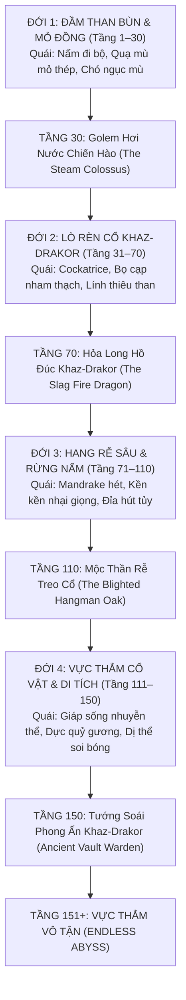

# ⚔️ Hầm Ngục Mỏ Cổ Vô Tận, Cơ Chế Chiến Đấu & Lò Rèn Boris

Thế giới lòng đất của Oakhaven là trụ cột **hành động & sinh tồn cốt lõi** trong trò chơi, kết hợp giữa **ĐI MỎ KHÁM PHÁ (Stardew Valley)** và **HÀNH ĐỘNG DỌN PHÒNG (Soul Knight)**. Toàn bộ tiền vàng tích lũy từ làm nông và kinh doanh tại **Quán Ăn & Nhà Trọ Oakhaven (The Hearth)** đều hướng tới mục tiêu: đầu tư trang bị chiến đấu tại Lò rèn Boris, tôi luyện vũ khí và khai phá 150 tầng mỏ cổ để giải phóng đất đai thung lũng khỏi lời nguyền chiến tranh.

---

## 1. Cấu Trúc Hầm Ngục Thống Nhất (The Infinite Mine-Dungeon)

> **NGUYÊN TẮC CỐT LÕI:** Hầm mỏ và Dungeon **GỘP LÀM 1 THỂ THỐNG NHẤT** mang tên **Hầm Ngục Mỏ Cổ Vô Tận (The Infinite Mine-Dungeon)**. Đây là chiến trường sinh tử thuần túy.

```
               ┌────────────────────────────────────────────────────────┐
               │                  THỊ TRẤN OAKHAVEN                     │
               │   (Nông trại • Quán The Hearth • Lò rèn • Trạm y tế)   │
               └──────────────────────────┬─────────────────────────────┘
                                          │
                                 Cửa Hầm Mỏ Oakhaven
                                          ▼
               ┌────────────────────────────────────────────────────────┐
               │       HẦM NGỤC MỎ CỔ VÔ TẬN (THE INFINITE MINES)       │
               ├────────────────────────────────────────────────────────┤
               │ • TẦNG 1–150 (CHIẾN DỊCH CỐT TRUYỆN QUA 4 ĐỚI ĐỊA CHẤT)│
               │   - Đới 1 (1–30): Đầm Than Bùn & Mỏ Đồng Cũ (Boss 30)  │
               │   - Đới 2 (31–70): Lò Rèn Cổ Khaz-Drakor (Boss 70)     │
               │   - Đới 3 (71–110): Hang Rễ Sâu & Rừng Nấm (Boss 110)  │
               │   - Đới 4 (111–150): Vực Thẳm Cổ Vật & Di Tích (Boss 150)│
               │ • TẦNG 151+ (VỰC THẲM VÔ TẬN - ENDLESS ABYSS HARDCORE) │
               │ • Thang máy cơ giới lưu mốc vĩnh viễn mỗi 5 tầng       │
               │ • Cửa Mỏ: Bàn thờ Tổ Mẫu chọn 1 trong 3 Phước Lành     │
               │ • Mốc 5 tầng: Tích lũy & Đổi Buff dã ngoại (Max 4 slot) │
               └────────────────────────────────────────────────────────┘
```

---

## 2. Dòng Chảy Phòng Kiểu Soul Knight & Khai Khoáng Stardew

### 2.1. Dòng Chảy 1 Phòng Hầm Mỏ (Room Flow)
Mỗi tầng mỏ gồm **3 đến 5 khoang phòng đá kết nối** trên bản đồ ô lưới (Mini-map kiểu Soul Knight):

1. **Khóa phòng tử chiến (`Room Lockdown`):** Bước vào phòng, cửa sau lập tức sập xuống khóa chặt, đèn vách chuyển sang **ĐỎ**. Quái vật tràn ra tấn công theo 2 đợt.
2. **Giao chiến nhịp độ nhanh:** 
   * Người chơi mang theo **2 Slot Vũ Khí** chuyển đổi nhanh bằng phím `Q` (Kiếm chém + Nỏ tầm xa, hoặc Búa đập + Trượng).
   * **Thanh Giáp Hộ Mệnh (Ward Shield):** Hấp thụ 30–50 sát thương đầu tiên; nếu không dính đòn trong 3 giây, Giáp tự hồi đầy, giúp bảo vệ thanh Thể Lực (HP).
3. **Quét sạch phòng (`Room Cleared!`):** Đèn chuyển **XANH LỤC**, cửa mở sang phòng tiếp theo, **Rương Tài Nguyên** trồi lên giữa sàn.
4. **Pha khai khoáng tò mò (Stardew Mining Phase):** Phòng an toàn tuyệt đối, người chơi thong thả vung Cuốc chim đập đá cuội, thu thập than và tìm mạch quặng.

### 2.2. Cơ Chế Đập Đá Ra Quặng & Kép Thoát Tầng (Curiosity-Driven Mining)
* **Xác suất đập từng tảng đá thường:**
  * $60\%$: Đá vụn xây chuồng trại.
  * $20\%$: Than đá đốt lò.
  * $12\%$: Quặng kim loại theo đới (Đồng, Sắt, Vàng, Mithril).
  * $5\%$: Trứng khoáng thạch (**Geode**) mang về Boris đập cổ vật.
  * $3\%$: Làm lộ ra **Bậc Thang Đá** thông tầng.
* **Cơ chế kép thoát tầng (Dual-Trigger):**
  * *Nhánh Đào Đá:* Xác suất rơi thang tăng dần theo số đá đã đập: $3\% + (\text{May Mắn} \times 1\%) + (1 / \text{Số đá còn lại})$ $\rightarrow$ Chống kẹt tầng tuyệt đối.
  * *Nhánh Diệt Quái:* Khi tiêu diệt con quái cuối cùng trên tầng, nếu chưa có thang, **100% Bậc Thang sẽ trồi lên ngay dưới chân quái**!

---

## 3. Hệ Thống Chọn & Đổi Buff Dã Ngoại (Expedition Boons)

Lấy cảm hứng từ hệ thống Perk của *Soul Knight*, người chơi sẽ tự xây dựng một "Dungeon Build" linh hoạt cho từng chuyến thám hiểm:

* **Tại Cửa Mỏ (Tầng 1):** Bàn thờ Tổ Mẫu Amalia xuất hiện **3 Chúc phúc ngẫu nhiên theo ngày** $\rightarrow$ Người chơi chọn 1 Buff khởi đầu (không thể đổi lại trong ngày).
* **Mỗi mốc 5 tầng (Tầng 5, 10, 15, 20...):**
  * Kích hoạt Thang máy mở ra Bàn thờ Tổ Mẫu.
  * Xuất hiện **3 Chúc phúc ngẫu nhiên mới** để tích lũy tối đa **4 Slot Buff**.
  * Khi đã đủ 4 slot, người chơi có thể chọn **ĐỔI (Swap)** 1 buff cũ lấy 1 buff mới phù hợp với đới địa chất tiếp theo (ví dụ: đổi Kháng Bùn Lầy lấy Kháng Lửa Dung Nham).
* **Reset tự nhiên:** Toàn bộ Phước Lành là tạm thời. Khi Rowan trở về mặt đất ngủ qua đêm, các buff sẽ thanh tẩy để hôm sau bắt đầu một hành trình ngẫu nhiên mới.

---

## 4. Cơ Chế Sinh Tồn: Dây Thừng, Mimic, Hố Sụt & Giới Nghiêm

1. **Rương Kho Báu & Cú Lừa Mimic (75% Thật / 25% Mimic):**
   * Trong hầm mỏ, $75\%$ rương là thật; **$25\%$ là Cua Ẩn Sĩ Mimic** bật nắp ngoác miệng cắn nuốt! Người chơi tinh ý có thể quan sát nắp rương thở phập phồng nhẹ trước khi mở. Diệt Mimic luôn rơi ra **Thịt Càng Cua Hoàng Đế** béo ngậy.
   * *Rương Mốc (Tầng 10, 20, 40, 50, 60...):* Luôn là **100% Rương Thật**.
2. **Dây Thừng Thoát Hiểm (Escape Rope):** Chế tạo từ 10 Sợi Gai Dại hoặc mua từ Bác Bram (150g). Đứng yên 3 giây kích hoạt kéo thẳng Rowan lên mặt đất, **bảo toàn 100% quặng và chiến lợi phẩm trong túi** khi cạn máu ở tầng lỡ cỡ.
3. **Ống Thông Gió Rơi Tầng (Ventilation Shafts):** Đập đá thường có $1\%$ xác suất sập hố sụt cũ. Nhảy xuống giúp **rơi cóc 3–8 tầng** nhưng bị mất 15–30 HP.
4. **Giới Nghiêm Mỏ 02:00 Đêm:** Quá 02:00 đêm chưa rời mỏ, Rowan ngất lịm vì kiệt sức $\rightarrow$ Colm kéo cáng về trạm xá, trừ 10% vàng viện phí, hôm sau thức dậy lúc 08:00 sáng.
5. **Hình Phạt Khi Gục Ngã (HP = 0):** Toàn bộ khoáng sản và chiến lợi phẩm thu thập trong chuyến đi đó **bị rơi lại dưới mỏ mất vĩnh viễn** (vũ khí và trang bị trên người vẫn giữ nguyên).

---

## 5. Danh Mục 4 Đới Địa Chất & 4 Warden Boss



* **Tầng 30 — Golem Hơi Nước Chiến Hào (`the_steam_colossus`):** Cỗ xe ủi mỏ răng cưa rỉ máu; dậm chấn động sập trần hang. Điểm yếu: Van xả hơi sau lưng vừa mở sau cú dậm. Rơi **Bánh Răng Khổng Lồ** (nâng cấp Bếp Rowan) và **Muối Khoáng Đáy Lò** (nướng thịt giữ nhiệt 120h).
* **Tầng 70 — Hỏa Long Hồ Đúc (`the_slag_fire_dragon`):** Rồng lửa khổng lồ bơi dưới rãnh xỉ sắt; vảy chuyển đỏ cam trước khi phun 3 cầu lửa. Rơi **Thịt Bắp Đuôi Rồng** (nấu Lẩu Rồng buff x2 Sát thương 8 phút) và **Mỡ Rồng** mở khóa **Đèn Bão Mỡ Rồng** soi sáng x3.
* **Tầng 110 — Mộc Thần Rễ Treo Cổ (`the_blighted_hangman_oak`):** Gốc cổ thụ cắm rễ vào mồ chôn cũ; rễ quấn chân, hoa xả phấn mờ màn hình. Rơi **Lõi Gỗ Thiêng Runic** rèn Trượng Bậc 5 và **Quả Sồi Vàng Cổ Đại** nướng Bánh Tổ Mẫu Amalia.
* **Tầng 150 — Tướng Soái Phong Ấn Khaz-Drakor (`ancient_vault_warden`):** Vị tướng cổ đại nói tiếng người lạnh lùng; 3 Phase chiến đấu tàn khốc. Rơi **Mảnh Trái Tim Cổ Ngữ** hoàn thành cốt truyện Hầm Mỏ và mở cổng **Endless Abyss (Tầng 151+)**.

---

## 6. Hệ Thống Lò Rèn Boris & 4 Cấp Geode

Cửa tiệm Lò rèn Boris phía Đông thị trấn biến đổi khoáng sản thành sức mạnh chiến đấu:

### 1. Tôi Thép Vũ Khí (+1 đến +5)
* Mỗi vũ khí có thể tôi luyện tối đa **5 cấp (+1 đến +5)**. Mỗi cấp $+1$ tăng **$+10\%$ Sát thương** và **$+5\%$ Tốc độ vung đòn**.
* **Nguyên tắc nhân văn:** Tỉ lệ tôi luyện **LUÔN LUÔN 100% THÀNH CÔNG**, không bao giờ xịt hay vỡ đồ.

### 2. Khảm Ấn Ngọc Cổ Ngữ Vĩnh Viễn
* Mỗi vũ khí từ Bậc 2 trở lên sở hữu **1 ổ khảm ngọc**. Đã khảm là **vĩnh viễn, không thể tháo rời** (muốn dùng ngọc khác cần rèn vũ khí mới):
  * 🔴 **Hồng Ngọc (Ruby):** Kích hoạt **Hỏa Thiêu (Burn)** — Đốt cháy kẻ địch trong 4 giây.
  * 🔵 **Lam Ngọc (Sapphire):** Kích hoạt **Hàn Băng (Frostbite)** — Giảm 40% tốc độ di chuyển và đòn đánh của quái.
  * 🟢 **Ngọc Lục Bảo (Emerald):** Kích hoạt **Bào Tử Độc (Poison)** — Phóng đám mây độc tính khi đánh trúng.
  * 💎 **Kim Cương (Diamond):** Kích hoạt **Chí Mạng (Critical)** — Tăng vĩnh viễn $+20\%$ Tỉ lệ đòn chí mạng.

### 3. Đập 4 Cấp Trứng Khoáng Thạch (Geode Cracking)
Boris đập trứng với chi phí **25 vàng/lần**:
* **Geode Thường (Đới 1):** Rơi Thạch anh, Đồng thô, Muối biển tinh thể, Cổ vật mũi tên đá cũ.
* **Geode Băng & Lửa (Đới 2):** Rơi Hồng Ngọc, Thỏi Sắt, Mảnh hóa thạch sinh vật cổ, Bột ớt dung nham.
* **Geode Tinh Thể (Đới 3):** Rơi Lam Ngọc, Ngọc Lục Bảo, Bột gia vị mỏ, Cổ vật huy hiệu chiến binh.
* **Geode Hư Không / Thần Thoại (Đới 4):** Rơi Kim Cương, Mảnh Cầu Vồng (Prismatic Shard), Hạt giống ngầm cổ đại, Thỏi Mithril.

---

## 7. Ẩm Thực Bếp The Hearth Phục Vụ Đi Mỏ Thực Tế

```
[ QUY TẮC ĂN UỐNG ĐI MỎ ]
• Tối đa 2 Buff cùng lúc: 1 Món Ăn Chính (Cơm Bento/Súp) + 1 Đồ Uống (Trà/Nước Ép)
• Thời lượng: 8 phút thời gian thực hoặc trọn vẹn 5 Tầng mỏ
• Ăn món mới cùng nhóm sẽ Ghi Đè, không cộng dồn quá đà
```

* 🍀 **May Mắn Đào Mỏ (+2 Luck):** *Càng Cua Mimic Nướng Muối* $\rightarrow$ Tăng mạnh tỉ lệ rơi quặng hiếm & Geode.
* ⛏️ **Tốc Độ Cuốc Đá (+25% Mining Speed):** *Súp Nấm Đi Bộ Hầm Bơ Tỏi* $\rightarrow$ Vung cuốc nhanh như chớp.
* 👟 **Tốc Độ Di Chuyển (+20% Move Speed):** *Trà Bạc Hà Núi Đá* $\rightarrow$ Chạy nhanh né đòn và lướt qua bẫy chông.
* ⚔️ **Sức Mạnh Tấn Công (+20 ATK):** *Thịt Ức Cockatrice Rán Giòn* $\rightarrow$ Hạ quái nhanh hơn 2 nhịp chém.
* 🛡️ **Phòng Ngự Giáp (+30 DEF):** *Sườn Cừu Rừng Hun Khói Bento* $\rightarrow$ Giảm sát thương khi bị quái cắn lén.
* 🔥 **Kháng Lửa Dung Nham (+60% Lava Resist):** *Đuôi Bọ Cạp Nham Thạch Nướng Đá Nóng*.
* 🩸 **Hồi Phục Khẩn Cấp (+100% HP & Stamina):** *Canh Gà Hầm Củ Mandrake*.
* 👑 **Buff Toàn Diện (Sức Mạnh x2, Tốc Độ +15%, May Mắn +3):** *Lẩu Thịt Đuôi Hỏa Long Đại Bổ*.

---

## 8. Sổ Tay Tiễu Phạt Tiền Đồn (Delvers' Hunt Ledger)
*(Chỉ tiêu 30–50 con tại Bảng Hợp Đồng của Hiệp sĩ Marlo & Bác thợ mỏ Bram)*

1. **Bầy Nấm Đi Bộ & Thực Vật:** Diệt 40 con $\rightarrow$ Thưởng `Bùa Hộ Mệnh Giải Độc` (Giảm 70% thời gian dính độc).
2. **Cua Ẩn Sĩ & Bẫy Mimic:** Diệt 30 con $\rightarrow$ Thưởng `Búa Cạy Càng Vàng` (Tăng 25% sát thương lên quái vỏ cứng).
3. **Kẻ Ăn Xác Bay & Cockatrice:** Diệt 50 con $\rightarrow$ Thưởng `Kính Thợ Mỏ Dạ Quang` (Tăng 20% tầm nhìn bóng tối).
4. **Bọ Cạp Xỉ Than & Chân Khớp:** Diệt 35 con $\rightarrow$ Thưởng `Găng Tay Da Dày` (Kháng bỏng rát dung nham).
5. **Thú Săn Mồi & Chó Ngục:** Diệt 30 con $\rightarrow$ Thưởng `Giày Đinh Thợ Mỏ` (Miễn nhiễm trượt chân & hất tung).
6. **Xác Lính Chiến Hào & Giáp Sống:** Diệt 45 tên $\rightarrow$ Thưởng `Nhẫn Hút Giáp Ảo` (Kết liễu quái hồi $+4$ Giáp Hộ Mệnh).
7. **Trảm Quyết Toàn Bộ 4 Warden Boss (4/4):** Thưởng `Khế Ước Thợ Rèn Boris` (Giảm vĩnh viễn 30% chi phí tôi luyện vũ khí).

---

👉 Xem thêm cơ sở dữ liệu liên quan:
* [Kho Vũ Khí & Trang Bị](/database/weapons)
* [Sổ Quái Vật & Boss](/database/monsters)
* [Khoáng Sản & Đá Quý Mỏ](/wiki/minerals-guide)
* [Cẩm Nang Ẩm Thực & Hồi Thể Lực](/wiki/cooking-recipes-guide)
* [Hướng Dẫn Bàn Chế Tác Thủ Công](/wiki/crafting-guide)
