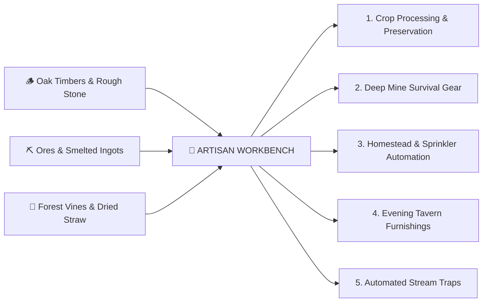

# 🔨 Artisan Workbench & 21 Craftable Objects

As a self-reliant frontier artisan at the crossroads of Oakhaven, Rowan cannot rely solely on blacksmith Boris or tailor Elora for everyday survival gear. Set up right beside your rustic homestead porch, the **Artisan Workbench** is where you hand-saw timbers, weave vines, forge brackets, and concoct 21 essential survival fixtures.

---

## 1. Workbench Mechanics & Blueprint Progression

- **Placement:** Positioned conveniently on your back porch or parlor hearthside. Interacting consumes zero Stamina.
- **Progression (Amalia's Tattered Grimoire):**
  - *Early Game:* Simple fences, cobblestone pavers, wall-mounted torches, herb drying racks, and willow fish traps.
  - *Tattered Page Fragments:* Found in deep-mine treasure chests or decrypted in Clara's town archives to unlock advanced automation (Gold Sprinklers, Oak Smokers, Blast Powders).

---

## 2. Catalog of 20 Craftable Objects Across 5 Disciplines

### A. Crop Processing & Preservation
*Enhance botanical harvests and craft non-perishable sustenance:*

1. **Herb Drying Rack (`craft_drying_rack`):** *(20 Oak Timber + 5 Forest Vines)*
   - Dries harvested tea leaves, mushrooms, and herbs over 24 hours.
   - Upgrades crop quality by $+1$ star tier, locking in natural aromas without spoilage.
2. **Oak Smoker (`craft_oak_smoker`):** *(25 Rough Stone + 15 Oak Timber + 2 Iron Bars)*
   - Smokes fresh stream fish and venison using slow-burning oak shavings.
   - Produces pocket **Expedition Rations** (+40 Stamina), never spoiling on 150-floor mine treks.
3. **Pine Fermentation Cask (`craft_fermentation_cask`):** *(30 Pine Timber + 2 Copper Bars)*
   - Cultivates frost-yeast into sourdough starters; ferments spiced winter apple cider.
4. **Compost Bin (`craft_compost_bin`):** *(25 Oak Timber + 10 Dried Straw)*
   - Recycles pulled weeds and chaff into **Organic Fertilizer** (+20% crop growth speed).
5. **Wildwood Apiary (`craft_fae_apiary`):** *(35 Oak Timber + 1 Oak Resin + 10 Wild Blossoms)*
   - Installed near flower beds to yield pure **Wildflower Honey** every 3 days.

---

### B. Deep Mine Survival Gear
*Consumables and tactical devices for descending into the star-blighted deep:*

6. **Wall Torch (`craft_wall_torch` — Pack of 5):** *(2 Oak Timber + 1 Black Coal)*
   - Permanently anchored to cavern rock walls; never burns out, marking maze crossroads.
7. **Miner's Blast Powder (`craft_blast_powder`):** *(2 Coal + 1 Quartz Crystal + 1 Terracotta Clay)*
   - Shatters stubborn boulders and compact vein clusters across a $3 \times 3$ tile blast zone.
8. **Escape Rope (`craft_escape_rope`):** *(12 Forest Vines)*
   - Emergency escape cord pulling you back to the nearest elevator shaft checkpoint when overwhelmed.
9. **Luminous Beacon (`craft_luminous_beacon`):** *(1 Quartz Shard + 5 Rough Stone)*
   - Deploys a 60-second sanctuary aura repelling darkness fiends, granting safe breathing room to eat.
10. **Magma Tongs (`craft_magma_tongs`):** *(4 Iron Bars)*
    - Heat-treated tongs allowing safe collection of superheated ores on floors 90–120 without burn damage.

---

### C. Homestead Infrastructure & Farm Automation
*Free your labor to focus on deep-mine delvings and evening parlor hospitality:*

11. **Oakhaven Copper Sprinkler (`craft_copper_sprinkler`):** *(1 Copper Bar + 1 Iron Bar)*
    - Automatically waters 4 adjacent cardinal cross tiles at 06:00 every morning.
12. **Oakhaven Iron Sprinkler (`craft_iron_sprinkler`):** *(1 Iron Bar + 1 Copper Bar)*
    - Automatically irrigates a full $3 \times 3$ grid (8 surrounding soil tiles) every dawn.
12b. **Void Sprinkler (`craft_void_sprinkler`):** *(1 Void Ingot + 1 Amethyst)*
    - Automatically irrigates a full $5 \times 5$ grid (24 surrounding soil tiles) every dawn.
13. **Straw Scarecrow (`craft_straw_scarecrow`):** *(20 Straw + 1 Oak Timber + 1 Coal)*
    - Wards off forest crows and thieving birds from planted seeds within an 8-tile radius.
14. **Picket Fence & Gate (`craft_picket_fence` — Pack of 5):** *(2 Oak Timber)*
    - Stops wild weeds from encroaching onto garden plots and provides aesthetic farm pathways.
15. **Cobblestone Path (`craft_cobblestone_path` — Pack of 10):** *(1 Rough Stone)*
    - Grants +15% overland running speed and prevents muddy foot slips during stormy seasons.

---

### D. Evening Tavern Furnishings & Cozy Decor
*Handcrafted woodwork to elevate your parlor's Cozy Rating:*

16. **Rustic 2-Seat Oak Table (`craft_rustic_table`):** *(30 Oak Timber + 1 Iron Bar)*
    - Adds 1 dining table welcoming 2 extra evening patrons, directly boosting nightly gold intake.
17. **Padded Leather Armchair (`craft_leather_armchair`):** *(15 Oak Timber + 2 Tanned Leather)*
    - Deeply cushioned armchair extending patron patience by $+30\%$ and adding $+10$ Cozy Rating.
18. **Oak Showcase Counter (`craft_showcase_counter`):** *(40 Oak Timber + 4 Quartz + 2 Copper Bars)*
    - Preserves up to 12 prepared dishes overnight at $100\%$ hearth freshness.
19. **Corner Cobblestone Hearth (`craft_corner_hearth`):** *(60 Rough Stone + 10 Clay + 5 Coal)*
    - The roaring heart of your tavern: Adds $+50$ Cozy Rating and inspires generous customer tips.

---

### E. Wilderness Harvesting & Automated Trapping

20. **Willow Fish Trap (`craft_willow_fish_trap`):** *(15 Forest Vines + 2 Oak Timber)*
    - Submerged in forest streams or subterranean cavern pools.
    - Automatically catches river chub, crayfish, and cavern eels each dawn without forcing you into repetitive fishing minigames!

---

## 3. Workflow Optimization Tips

> [!TIP]
> **Rowan's Dawn Routine:**
> 1. At 06:00: Sprinklers have already watered all garden plots automatically.
> 2. Run down to the stream to empty 2 **Willow Fish Traps**, collecting stream fish and crayfish.
> 3. Load fish into the **Oak Smoker** for pocket **Expedition Rations**, and grab fresh **Wall Torches** from the workbench.
> 4. Pack 3 **Escape Ropes** and 5 bundles of **Blast Powder** into your satchel, and delve fearlessly into the 150-floor mines!
