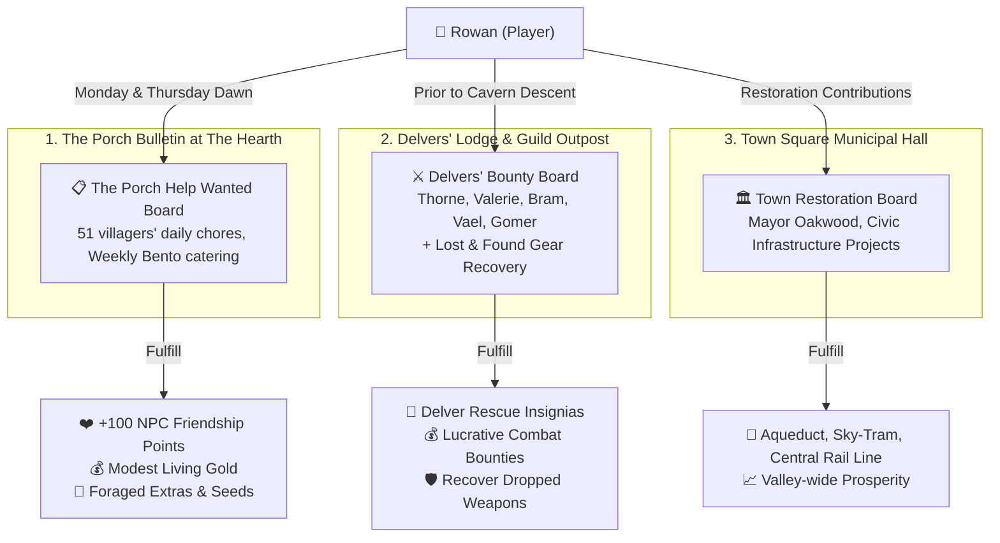

# 📜 Help Wanted & Bounty Commission Guide

The **Help Wanted & Commission System** in *Rowan of Oakhaven* anchors the game's core progression loop, tying together **Village Social Bonds**, **150-Floor Subterranean Delving**, and the culinary economy of **The Hearth Eatery & Tavern**.

---

## 1. The 3 Commission Noticeboards

---

## 2. Noticeboard Breakdown

### A. The Porch Help Wanted Board
* **Location:** Directly outside the front porch of The Hearth Eatery & Tavern.
* **Refresh Schedule:** Dawn 06:00 every Monday and Thursday (2 – 3 new bulletins).
* **Expiration:** **2 – 3 Days** from bulletin posting.
* **Core Function:** Grants **+100 Friendship Points** per completed quest, accelerating the 8-Heart milestone (3,200 points) without gift limits.

| Category | Typical Requester | Example Objective | Rewards |
| :--- | :--- | :--- | :--- |
| **Seasonal Produce** | Elder Maeve, Hazel | 3 Night-Eye Shadow Carrots, 8 Wild Berries | 100 - 150g, **+100 Heart Pts** |
| **Comfort Dishes** | Aurelia, Sylvan | 1 Mandrake & Snow-Maca Poultry Broth | 200 - 300g, **+100 Heart Pts** |
| **Lost & Found** | Clara, Penny, Cora | Lost sketchbook, reading glasses, wooden top | 150 - 200g, **+100 Heart Pts** |
| **Civic Repairs** | Bram, Cedar | 25 Oak Timber, 10 River Cobblestones | 250 - 350g, **+100 Heart Pts** |

---

### B. Delvers' Guild Bounty Board & Lost & Found Counter
* **Location:** Outpost station preceding the 150-Floor Mine Elevator, overseen by Guildmaster Thorne and Coordinator Valerie.
* **Refresh Schedule:** Dawn 06:00 daily (up to 3 active contracts concurrently).
* **Expiration:** **3 Days** (or indefinite until target Boss/Monster is felled).
* **Unique Currency:** **Delver Rescue Insignias (`item_delver_crest`)**, used to redeem tools/weapons dropped in the deep mine at the Lost & Found counter.

| Contract Type | Target Objectives | Typical Rewards |
| :--- | :--- | :--- |
| **⚔️ Beast Culling** | Slay 15 Crag Spiders (Fl. 20-39) or 10 Magma Imps (Fl. 60-79) | 400 - 600g, **3 - 5 Crests** |
| **⛏️ Ore Extraction** | Mine 20 Lump Coal or 15 Deep Iron Ore for hoist boilers | 300 - 500g, **2 - 4 Crests**, +100 Pts Bram/Boris |
| **🌿 Subterranean Herbs** | Harvest 5 Luminous Cave Fungi for Sylvan's antidotes | 400 - 500g, **4 Crests**, +100 Pts Sylvan |
| **👑 Stratum Warden** | Defeat Floor 30 Steam Colossus, Floor 70 Magma Dragon, Floor 110 Root God, or Floor 150 Sealed Warden | 1,200 - 2,500g, **10 - 20 Crests** |

> [!TIP]
> **What Are Delver's Crests For?**
> Trade with Knight Marlo at the lodge desk to obtain:
> 1. *Delver's Sigil Ring (+15% Attack Speed, +10% Poison Resistance).*
> 2. *Elevator Steam Oil (unlocks express drop cages straight to Floor 50 / 100).*
> 3. *Precision Whetstones to raise weapon Critical Rate at Boris's Forge.*

---

### C. Weekly Hearth Catering & Frontier Bento Orders
* **Location:** Loft R&D drafting desk and Bento Packaging Bench inside The Hearth Eatery & Tavern.
* **Refresh Schedule:** Monday dawn at 06:00 (Deadline: Sunday 23:00).
* **Duration:** **7 Days**.
* **Distinction:** High-volume catering contracts requiring 2-Star to 3-Star dishes or rugged Expedition Bento sets.

| Sample Order | Client | Objectives | Exclusive Rewards |
| :--- | :--- | :--- | :--- |
| **Fleet Banquet** | Captain Garrick | 8 Servings 3-Star Grand Saffron Seafood Paella | 2,400g, +150 Pts, **Garrick's Spiced Rum Recipe** |
| **Mine Rescue Rations** | Captain Thorne & Valerie | 15 Iron Canisters of Cassava & Dark-Rye Hearth Loaf | 3,200g, +150 Pts, **Insulated Pack Blueprint** |
| **Chilled Delver Supply** | Diver Vael | 5 Iron Canisters of Piping-hot Creamy Mushroom & Turnip Soup | 1,100g, +120 Pts, **5x Subterranean Glacial Fish Scales** |
| **Autumn Pie Gala** | Oakhaven Villagers | 20 Hearth-Baked Apple Fig Pies | 3,500g, +200 Village Pts, **Oak Showcase Counter** |

---

## 3. Expedition Bento Packaging & The Freshness Bonus System

### A. Bento Box Tiers & Freshness Extension
To safely transport prepared meals into deep mine shafts or distant frontier checkpoints without crushing or quality loss, Bento packing specifically **extends the duration of the Piping-Hot Freshness Bonus**:
* **Tier 1 - Rough Pine Box:** Crafted with *4 Softwood + 1 Braided Twine*. Holds rice balls, dried hardtack, steamed greens. **Extends Freshness Bonus to 48 Hours (2 Days)**.
* **Tier 2 - Rustproof Iron Canister:** Crafted with *1 Iron Bar + 1 Copper Bar + 1 Wax Seal*. Holds thick stews, pot roasts, pan-seared fish. Shock-resistant against mine hazards, **extends Freshness Bonus to 72 Hours (3 Days)**.
* **Tier 3 - Lacquered Thermal Tiffin:** Crafted with *1 Iron Canister + 2 Sheep Wool + 1 Ironwood Oil (`item_ironwood_oil`)*. Holds a complete 3-course banquet for aristocrats (such as Valen de Montfort) or deep-delve expeditions. **Extends Freshness Bonus to 120 Hours (5 Days)**.

### B. The Freshness Bonus (Absolute Zero Food Spoilage)
* **Grounded Post-War Principle:** The game **never implements food rot or spoilage into worthless trash**. In a post-war frontier where every grain counts, throwing away cooked meals is unthinkable.
* **Piping-Hot / Fresh Status (Within 24 Hours unstored, or extended by Bento Box Tiers):**
  * Tavern Service: Patrons praise the hot meal, tipping **+20% bonus gold** and slightly boosting Tavern Cozy Rating.
  * Noticeboard Turn-in: Townsfolk include complimentary foraging extras (spare wild onions, foraging berries, mineral salt pinches).
  * Mine Delving: Grants an instantaneous micro-buff (+5% Movement Speed or +10 Stamina restore).
* **Standard Status (After Bento insulation lapses or past 24 Hours):**
  * Meals cool into standard, hearty rations. **Automatically stacks up to x99** in a single inventory slot (zero inventory bloat).
  * Retains 100% of core combat buffs (ATK, DEF, Speed, Resistances) and sells for full base catalog price.
* **Preserved Provisions:** Smoked ham, cellar-aged cheese, sun-dried marsh eels, scorched hazelnut cookies — dry foods that never cool or lose quality, designed specifically for long 150-floor delve prep.

---

## 4. Layered Quest Ecosystem & Exclusive Unlocks

To eliminate boring fetch quests and provide genuine roleplay immersion, the commission system expands into **5 Focused Archetypes**, where high-difficulty assignments unlock **Secret Achievements**, **Lost Recipes**, **Machinery Blueprints**, **Passive Relics**, and **Cozy Tavern Furniture**:

1. **Routine Errands & Neighborhood Aid:** Daily chores from 51 villagers posted Mondays & Thursdays at The Porch Notice Board. Rewards: Pocket gold (50g - 250g), +100 Friendship Points, seasonal seeds, fresh produce.
2. **Hazard & Frontier Survival:** Rush hot Bento packs to mountain lookouts during blizzards, dive glacial lakes for frost crystals, provide emergency rations for mine cave-ins. Rewards: Cold-weather relics, insulated rucksacks, secret achievements.
3. **Grounded Multi-Stage Narrative Questlines:** 3-stage personal storylines resolving long-standing post-war grudges (Boris & Bram's joint workshop schism, Valen de Montfort's exile evasion, Barnaby's tavern debt recovery). Rewards: Combined forge-carpentry workbench, oak chessboards, Solarian silver dining sets (+Cozy Rating).
4. **Tactical Warden & Cavern Bounties:** Floor 30, 70, 110, 150 Warden hunts with strict tactical constraints (12 Master Parries, no healing flasks, sole reliance on food buffs, under 50% miasma threshold). Rewards: Trophy skulls for the tavern mantle, prestigious player titles.
5. **Ancient Altar Cleansing & Land Reclamation:** Rosemary's seasonal rituals across 4 Ancient Altars. Cook 5-course 3-Star banquets offered at midnight, fighting off restless battle spirits. Rewards: Permanent **Perpetual Herb Garden**, Ancient Bronze Censer (+Max Cozy Rating), Lost Thousand-Year Purifying Tea recipe.

---

### Exemplary High-Tier Commissions & Exclusive Unlocks

| ID & Quest Name | Client | Severe Tactical Constraints | Exclusive Unlocks |
| :--- | :--- | :--- | :--- |
| **Q-HAZ-01: Blizzard Soup Run** | Knight Hester | Deliver 1 Lacquered Tiffin of *Piping-hot Ginger Squash Stew* to the mountain crest between 20:00 - 23:00 in a blizzard without collapsing. | 🏆 Secret Achievement: `ACH_BLIZZARD_RUNNER` 🧿 Relic: *Hester's Threadbare Wool Scarf* (-50% Stamina drain during snowstorms) 🛋️ Decor: *Ancient Campaign Map* (+10 Cozy). |
| **Q-HAZ-02: Glacial Chasm Fumes** | Diver Vael | Dive to Floor 85 submerged caverns for 3 Glacial Crystals while miasma rises; no spare breathing bladders. | 🏆 Secret Achievement: `ACH_DEEP_DIVER` 📜 Blueprint: *Deep-Mine Steam Filter* (5 min miasma immunity) 🛋️ Decor: *Luminescent Glacial Conch* (+12 Cozy). |
| **Q-HAZ-03: Midnight Cave-In Rescue** | Miner Gomer | Rush 15 Tin Boxes of Scallion Grilled Rice Balls to rescue 4 trapped miners on Floor 45 within 24 hours. | 🏆 Secret Achievement: `ACH_MINE_SAVIOR` 📜 Blueprint: *Gomer's Steam Jackhammer* (2x mining speed, -50% Stamina) 💰 800g + 10x Blasting Charges. |
| **Q-LORE-01: Anvil & Timber (Boris & Bram)** | Boris & Bram | Recover lost blueprints from Floor 65; serve *Apple-Cider Toast* to both grumpy veterans at The Hearth simultaneously. | 🏆 Secret Achievement: `ACH_ANVIL_AND_TIMBER` 📜 Blueprint: *Integrated Forge-Carpentry Bench* (-20% crafting costs) 🛋️ Decor: *Veterans' Oak Chess Table* (+15 Cozy). |
| **Q-LORE-02: Shadow of Solaria** | Valen de Montfort | Cook 3-Star *Solarian Beetroot Stew* in a Lacquered Tiffin; sneak into 2nd-floor private suite past 23:00 avoiding guards. | 🏆 Secret Achievement: `ACH_SOLARIA_SHADOW` 📜 Lost Recipe: *Solarian Restorative Broth* (+100 HP, +20% Phys Resist) 🛋️ Decor: *Imperial Silver Cutlery Set* (+20 Cozy, attracts nobles). |
| **Q-LORE-03: The Soldier's Lost Button** | Little Cora | Dredge stream bank for her late father's silver insignia button lost to spring floods; bake Hazelnut Shortbread to comfort her. | 🏆 Secret Achievement: `ACH_PROMISE_BY_STREAM` 🧿 Relic: *Seven-Color River Stone Charm* (+5% permanent Dodge Rate) 🛋️ Decor: *Cora's Crayon River Drawing* (+10% patron tip frequency). |
| **Q-LORE-04: The Permanent Ledger** | Barnaby | Reclaim 1,200g in tab arrears from 3 deadbeat squatters at forest edge; or pay out-of-pocket out of pity. | 🏆 Secret Achievement: `ACH_DEBT_COLLECTOR` 🧿 Relic: *Barnaby's Leatherbound Ledger* (previews tomorrow's market prices) 💰 Barnaby shares 30% collected gold. |
| **Q-HUNT-01: Iron Bulwark vs. Magma Dragon** | Knight Hester | Slay Floor 70 Magma Forge Dragon performing at least 12 timed Master Parries; finish with HP above 80%. | 🏆 Secret Achievement: `ACH_PARRY_MASTER` 🛋️ Decor: *Gilded Basalt Dragon Scale* (+15% delver tips at tavern) ⚔️ Title: *"Oakhaven's Iron Bulwark"*. |
| **Q-HUNT-02: Volcanic Survival Feast** | Guildmaster Thorne | Clear 3 consecutive Smelting Lake floors (61-63) with zero healing potions; survive purely on packed Bento food buffs. | 🏆 Secret Achievement: `ACH_IRON_STOMACH` 📜 Blueprint: *Insulated Expedition Rucksack* (+8 slots, doubles freshness) 🏅 15x Delver Rescue Insignias. |
| **Q-ALTAR-01: Vernal Cleansing Hymn** | Rosemary | Cook 5-course Spring Cleansing Feast (Bok choy stir-fry, Lotus root soup); offer at midnight and vanquish 3 miasma spirit waves. | 🏆 Secret Achievement: `ACH_ASHES_TO_BLOOM` 🌱 Unlock: *Perpetual Grove Field* (grow year-round herbs) 🛋️ Decor: *Ancient Altar Bronze Censer* (+25 Cozy Rating, maximum tier). |

---

## 5. Turn-In Options

Players have two delivery options:

1. **Direct In-Person Hand-In:**
   * Track NPC using the Schedule Matrix.
   * Speak to them and select *"Deliver Commission Items"*.
   * Triggers unique grateful dialogue + **Grants 100% of Friendship Points (+100 Pts)**.
2. **Deposit Drop-Box:**
   * When arriving after curfew or when the NPC is locked in work shifts, deposit items into the board's secure drop-box.
   * Gold and crests are mailed the following dawn; friendship gain is reduced to $+50$ due to lack of face-to-face rapport.

---

## 6. Smart Progression Guard

* **Contextual Gating:** Bulletins never demand resources or monsters beyond the player's current unlocked cavern stratum or tool tier (e.g., iron ore contracts will never appear before Floor 40 is reached).
* **Penalty-Free Expiration:** Missed or expired commissions vanish harmlessly without deducting gold, points, or reputation.

