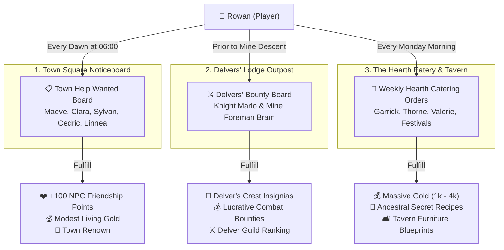

# 📜 Help Wanted & Bounty Commission Guide

The **Help Wanted & Commission System** in *Rowan of Oakhaven* anchors the game's core progression loop, tying together **Village Social Bonds**, **150-Floor Subterranean Delving**, and the culinary economy of **The Hearth Eatery & Tavern**.

---

## 1. The 3 Commission Noticeboards

---

## 2. Noticeboard Breakdown

### A. Town Help Wanted Board
* **Location:** Town Square, flanked by Maeve's Town Hall and Pip's Mailbox Post.
* **Refresh Schedule:** Dawn 06:00 daily (1 – 2 new postings generated).
* **Expiration:** **2 Days** from bulletin posting.
* **Core Function:** Grants **+100 Friendship Points** per completed quest, bypassing weekly gift limits (1/day, 2/week) and accelerating the 8-Heart milestone (3,200 points).

| Category | Typical Requester | Example Objective | Rewards |
| :--- | :--- | :--- | :--- |
| **Seasonal Produce** | Maeve, Linnea | 3 Spring Carrots, 5 Wild Berries | 100 - 150g, **+100 Heart Pts** |
| **Comfort Dishes** | Sylvan, Lyra | 1 Piping-hot Herbal Chicken Stew | 200 - 300g, **+100 Heart Pts** |
| **Lost & Found** | Clara, Penny, Finn | Lost sketchbook, reading glasses, wooden top | 150 - 200g, **+100 Heart Pts** |
| **Civic Repairs** | Cedric, Elora | 25 Oak Timber, 10 River Cobblestones | 250 - 350g, **+100 Heart Pts** |

---

### B. Delvers' Lodge Bounty Board
* **Location:** Outpost station preceding the 150-Floor Mine Elevator, overseen by Knight Marlo and Bram.
* **Refresh Schedule:** Dawn 06:00 daily (up to 3 active contracts concurrently).
* **Expiration:** **3 Days** (or indefinite until target Boss/Monster is felled).
* **Unique Currency:** **Delver's Crests (`item_delver_crest`)**.

| Contract Type | Target Objectives | Typical Rewards |
| :--- | :--- | :--- |
| **⚔️ Beast Culling** | Slay 15 Crag Spiders (Fl. 20-39) or 10 Magma Imps (Fl. 60-79) | 400 - 600g, **3 - 5 Crests** |
| **⛏️ Ore Extraction** | Mine 20 Lump Coal or 15 Deep Iron Ore for hoist boilers | 300 - 500g, **2 - 4 Crests**, +100 Pts Bram/Boris |
| **🌿 Subterranean Herbs** | Harvest 5 Luminous Cave Fungi for Sylvan's antidotes | 400 - 500g, **4 Crests**, +100 Pts Sylvan |
| **👑 Stratum Warden** | Defeat Floor 40 Blighted Treant or Floor 80 Scarab Warden | 1,200 - 2,500g, **10 - 20 Crests** |

> [!TIP]
> **What Are Delver's Crests For?**
> Trade with Knight Marlo at the lodge desk to obtain:
> 1. *Delver's Sigil Ring (+15% Attack Speed, +10% Poison Resistance).*
> 2. *Elevator Steam Oil (unlocks express drop cages straight to Floor 50 / 100).*
> 3. *Precision Whetstones to raise weapon Critical Rate at Boris's Forge.*

---

### C. Weekly Hearth Catering Orders
* **Location:** Loft R&D drafting desk inside The Hearth Eatery & Tavern.
* **Refresh Schedule:** Monday dawn at 06:00 (Deadline: Sunday 23:00).
* **Duration:** **7 Days**.
* **Distinction:** High-volume catering contracts requiring 2-Star to 3-Star dishes.

| Sample Order | Client | Objectives | Exclusive Rewards |
| :--- | :--- | :--- | :--- |
| **Fleet Banquet** | Captain Garrick | 8 Servings 3-Star Saffron Seafood Paella | 2,400g, +150 Pts, **Garrick's Spiced Rum Recipe** |
| **Mine Rescue Rations** | Captain Thorne & Valerie | 15 Portions Dense Rye & Smoked Bacon | 3,200g, +150 Pts, **Insulated Pack Blueprint** |
| **Autumn Pie Gala** | Oakhaven Villagers | 20 Golden Cinnamon Pumpkin Pies | 3,500g, +200 Village Pts, **Gilded Display Counter** |

---

## 3. Turn-In Options

Players have two delivery options:

1. **Direct In-Person Hand-In:**
   * Track NPC using the Schedule Matrix.
   * Speak to them and select *"Deliver Commission Items"*.
   * Triggers unique grateful dialogue + **Grants 100% of Friendship Points (+100 Pts)**.
2. **Deposit Drop-Box:**
   * When arriving after curfew or when the NPC is locked in work shifts, deposit items into the board's secure drop-box.
   * Gold and crests are mailed the following dawn; friendship gain is reduced to $+50$ due to lack of face-to-face rapport.

---

## 4. Smart Progression Guard

* **Contextual Gating:** Bulletins never demand resources or monsters beyond the player's current unlocked cavern stratum or tool tier (e.g., iron ore contracts will never appear before Floor 40 is reached).
* **Penalty-Free Expiration:** Missed or expired commissions vanish harmlessly without deducting gold, points, or reputation.
