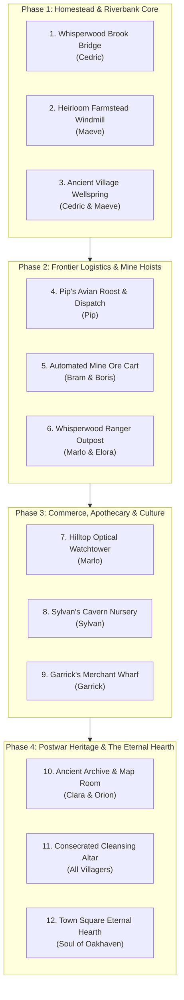

# 🏛️ Master Town Restoration Guide (Oakhaven Rebuilding Plan)

Oakhaven was once a vulnerable frontier outpost that bore the deepest scars of wartime devastation. Shrapnel littered the pine forests, bridges collapsed into raging floodwaters, the grain windmill seized up, farmlands were tainted with subterranean Blight, and the central public hearth lay frozen in ashes for over a decade.

Rowan's calling is not merely entrepreneurial wealth, but to **work alongside neighbors to rebuild roofs, clear blocked waterways, and restore 12 landmark structures** across 4 developmental phases.

---

## 1. The 4 Restoration Phases

---

## 2. Master Project Roster & Calibrated Material Budgets

Material requirements have been calibrated to **Solid Medium – Challenging Progression**, necessitating strategic forestry, deep-vein mineral extraction, Boris's forge smelting, and tavern revenue reinvestment:

| No. | Project | Map Zone | Lead Artisan | Calibrated Materials (Medium Tier) | Permanent Unlocks |
| :-: | :--- | :---: | :--- | :--- | :--- |
| **1** | **Whisperwood Brook Bridge** | `riverside` | Cedric | • 120 Mature Oak Timber • 60 River Cobblestone • 25 Boris's Forged Nails • 2,500g | 60% faster transit to trade docks; unlocks otter pearl-foraging shoals. |
| **2** | **Heirloom Windmill** | `farm` | Maeve | • 100 Mature Oak Timber • 35 Smelted Copper Bars • 15 Dwarven Mechanical Cogs • 3,200g | Automated overnight grain-to-flour milling at 1:2 ratio; +30 Cozy Rating. |
| **3** | **Ancient Wellspring** | `village` | Cedric & Maeve | • 100 Dressed Stone Blocks • 40 Malleable Stream Clay • 5 Clear Quartz Crystals • 2,000g | Instant stamina-free can refills; 15% growth speed boost within 5 tiles. |
| **4** | **Pip's Avian Roost** | `farm` | Pip | • 80 Resilient Pine Lumber • 40 Pliant Willow Branches • 15 Clear Quartz Crystals • 2 Lumina Glowstones • 2,800g | Unlocks Avian Expeditions to forage foreign heritage seeds across distant realms. |
| **5** | **Automated Ore Cart** | `mine` | Bram & Boris | • 60 Smelted Iron Bars • 50 Mature Oak Timber • 3 Gravity Floatstones • 30 Anthracite Coal • 4,500g | Ferries excavated cavern ores directly to Boris's forge bin; ends pack clogging. |
| **6** | **Ranger Outpost** | `forest` | Marlo & Elora | • 120 Mature Oak Timber • 20 Waterproof Wool Canvas • 25 Clear Quartz Crystals • 1 Stone Corner Hearth • 3,500g | Wilderness safe haven preventing collapse past midnight; field repair bench. |
| **7** | **Hilltop Watchtower** | `mine` | Marlo | • 150 Dressed Stone Blocks • 50 Smelted Iron Bars • 15 Precision Optical Lenses • 6,000g | 100% accurate 3-day meteorological forecasts; advance storm stranger notice. |
| **8** | **Cavern Nursery** | `village` | Sylvan | • 80 Decayed Humus Logs • 50 Rich Forest Compost • 25 Luminous Cavern Shrooms • 10 Prism Jelly Drops • 5,000g | Surface cloning of deep cavern bioluminescent fungi; 50% medicine discount. |
| **9** | **Garrick's Wharf** | `riverside` | Garrick | • 160 Mature Oak Timber • 50 Smelted Copper Bars • 30 Braided Hemp Ropes • 20 Smelted Iron Bars • 7,500g | Docks 3-masted caravel flagships every Sunday dawn; doubles exotic spices. |
| **10** | **Archive & Map Room** | `village` | Clara & Orion | • 140 Mature Oak Timber • 30 Treated Heavy Leather • 15 Luminous Glow Inks • 20 Clear Quartz Crystals • 8,000g | Decrypts deep-cavern blueprints for Royal-tier forging; restores village school. |
| **11** | **Consecrated Altar** | `farm` | The Valley | • 100 Blight Purification Salts • 25 Pure Mana Stones • 10 Ancient Altar Dusts • 12,000g | Restores 40 poisoned eastern plots into Sacred Arable Land (100% 3-Star crops). |
| **12** | **Eternal Hearth** | `village` | All Citizens | • 200 Anthracite Coal • 60 Smelted Gold Bars • 1 Eternal Flame Core • 15,000g | Kindles perpetual warmth; +25% friendship gain with all Oakhaven villagers permanently. |

---

## 3. Construction Lifecycle & Celebration Banquets

1. **Incremental Donation Ledger:**
   * Each site features an on-site Donation Ledger. Players deposit batches at their own pace; the UI tracks progress from $0\% \rightarrow 100\%$.
2. **24-Hour Construction Staging:**
   * Reaching $100\%$ erects scaffolding and striped canvas (`State: Under Construction`).
   * NPCs actively assemble on site with sawing, hammering, and masonry animations.
3. **Celebration Banquet at The Hearth Eatery & Tavern:**
   * Dawn unveils the gleaming restored landmark.
   * At 19:00, the entire village gathers inside Rowan's tavern for a celebratory feast featuring a bespoke dish and heartfelt cutscene dialogue.
