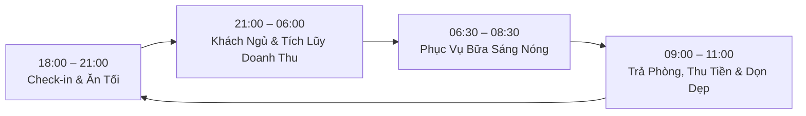

# 🛌 Cẩm Nang Quản Lý Nhà Trọ Oakhaven (The Hearth Inn & Lodging)

Tại Quán Ăn & Nhà Trọ Oakhaven, tầng trệt là nơi bếp lửa rực cháy phục vụ những món ăn ấm lòng, còn **Tầng Gác 2** chính là điểm dừng chân yên bình cho thợ mỏ kiệt sức, thương nhân viễn xứ và những vị khách bí ẩn trú bão tuyết.

---

## 1. Vòng Lặp Vận Hành Nhà Trọ (Daily Lodging Loop)

1. **18:00 – 21:00 (Nhận Phòng):** Khách lữ hành ghé quầy bar nhận chìa khóa, gọi món ăn tối và lên phòng nghỉ.
2. **21:00 – 06:00 (Đêm Nghỉ Ngơi):** Tiền thuê phòng tự động cộng dồn vào quỹ qua đêm.
3. **06:30 – 08:30 (Bữa Sáng Nóng Sốt):** Khách thức dậy theo tiếng chuông điểm, yêu cầu một món ăn sáng nóng ấm trước khi lên đường.
4. **09:00 (Trả Phòng & Thu Tiền Tip):** Khách trả phòng, để lại tiền boa và quà lưu niệm nếu được phục vụ chu đáo (5 sao).
5. **09:00 – 11:00 (Dọn Dẹp - Housekeeping):** Thay ga giường sạch sẽ và châm thêm củi để sẵn sàng đón lượt khách tiếp theo.

---

## 2. Ba Hạng Phòng Trọ & Nâng Cấp Tầng Gác

| Hạng Phòng | Sức Chứa | Đối Tượng Thuê | Giá Thuê Cơ Bản | Điều Kiện Mở Khóa |
| :--- | :---: | :--- | :---: | :--- |
| **Phòng Dorm Thợ Mỏ** | 4 Giường | Thợ mỏ, phu khuân vác, dân phượt | **$40g$ / giường** | Dọn gác xép ban đầu (10 Gỗ + 500g) |
| **Phòng Ấm Cúng Tiêu Chuẩn** | 2 Phòng | Thương nhân, thợ săn, du khách | **$150g$ / phòng** | 30 Gỗ Sồi + 15 Thỏi Sắt + 1,200g |
| **Phòng Thượng Hạng Thương Nhân** | 1 Suite | Thuyền trưởng Garrick, Quý tộc, Khách VIP | **$450g$ / đêm** | 50 Gỗ Cổ Thụ + 10 Thỏi Vàng + 3,500g |

---

## 3. Chỉ Số Ấm Cúng (Inn Cozy Rating)

Mỗi căn phòng có một thang đo mức độ ấm cúng từ $0$ đến $250$ điểm:

* **Cách nâng cao Cozy Rating:**
  * Kê thêm bàn đọc sách gỗ sồi, ghế bành da thuộc Elora.
  * Thắp đèn lồng phát quang **Lumina Glowstone** không sinh khói.
  * Xông tinh dầu **Hoa Oải Hương Ánh Sao (Starlight Lavender)**.
  * Đốt củi đượm lửa trong lò sưởi đá cuội góc phòng vào mùa đông.
* **Lợi ích kinh tế:**
  * Điểm $\ge 80$: Khách tip thêm $+20\%$ tiền vàng.
  * Điểm $\ge 150$: Tỷ lệ lấp đầy phòng đạt $100\%$ mỗi đêm.
  * Khách để lại **Mảnh Bản Đồ Kho Báu Mỏ Sâu** và hạt giống cây trồng độc lạ.

---

## 4. Sự Kiện Đặc Biệt: Vị Khách Bí Ẩn Đêm Bão (Stormbound Strangers)

Khi thời tiết chuyển sang **Bão Tuyết (Blizzard)** hoặc **Mưa Dông Gió Lớn (Heavy Rain)** vào ban đêm, một tiếng gõ cửa dồn dập sẽ vang lên lúc 22:30:

* **Kỵ Sĩ Lưu Vong Valerius:** Đang bị truy lùng từ kinh đô Solaria. Nếu cho tá túc và nấu đĩa bít tết nóng hổi, Valerius sẽ để lại **Bản Vẽ Dao Gạt Đòn Hoàng Gia (`blueprint_royal_parry_dagger`)**.
* **Phù Thủy Ẩn Dật Morrigan:** Ghé trú rét giữa bão tuyết âm độ. Phục vụ bà một thố cháo nấm nóng sốt sẽ nhận được **Công Thức Muối Thanh Tẩy Đất Blight (`item_purification_salt_recipe`)**.
