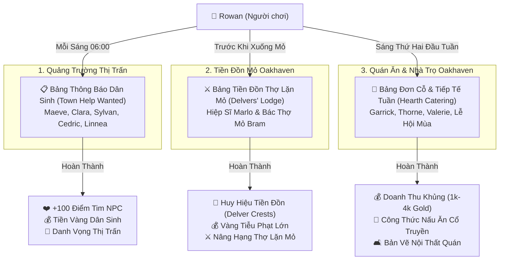

# 📜 Cẩm Nang Hệ Thống Nhiệm Vụ Uỷ Thác & Săn Thưởng (Help Wanted & Bounty Commissions)

Hệ thống **Nhiệm Vụ Uỷ Thác** trong *Rowan of Oakhaven* kết nối 3 trụ cột gameplay chính: **Gắn kết tình cảm thị trấn**, **Chiến đấu hầm mỏ 150 tầng**, và **Kinh tế Quán Ăn & Nhà Trọ Oakhaven**.

---

## 1. Bản Đồ 3 Bảng Uỷ Thác Tại Oakhaven

---

## 2. Chi Tiết Từng Bảng Nhiệm Vụ

### A. Bảng Thông Báo Thị Trấn (Town Help Wanted)
* **Vị trí:** Trước Tòa Thị Chính Maeve và Bưu Điện Cú Pip tại Quảng trường trung tâm.
* **Thời gian làm mới:** 06:00 mỗi sáng (xuất hiện 1 – 2 lá đơn dán mới).
* **Thời hạn:** **2 ngày** kể từ lúc đăng bài.
* **Ý nghĩa cốt lõi:** Là nguồn tích lũy điểm tình cảm khổng lồ (+100 điểm/nhiệm vụ) giúp người chơi tiến tới mốc 8 Tim (3,200 điểm) mà không bị phụ thuộc hoàn toàn vào giới hạn tặng quà (1 quà/ngày, 2 quà/tuần).

| Phân Loại | Người Giao Thường Gặp | Mục Tiêu Mẫu | Phần Thưởng |
| :--- | :--- | :--- | :--- |
| **Nông sản mùa** | Maeve, Linnea | 3 Cà rốt mùa xuân, 5 Quả mọng rừng | 100 - 150g, **+100 Tim** |
| **Món ăn ấm lòng** | Sylvan, Lyra | 1 Súp gà thảo mộc nóng sốt | 200 - 300g, **+100 Tim** |
| **Tìm đồ thất lạc** | Clara, Penny, Finn | Sổ phác thảo, kính lão, con quay | 150 - 200g, **+100 Tim** |
| **Vật tư gia cố** | Cedric, Elora | 20 Gỗ sồi, 10 Đá cuội gia cố bờ kè | 250 - 350g, **+100 Tim** |

---

### B. Bảng Hợp Đồng Tiền Đồn Mỏ (The Delvers' Lodge Bounties)
* **Vị trí:** Trước lồng Thang Máy Mỏ 150 tầng do Hiệp sĩ Marlo và Bram quản lý.
* **Thời gian làm mới:** Hằng ngày lúc 06:00 (tối đa 3 hợp đồng khả dụng cùng lúc).
* **Thời hạn:** **3 ngày** hoặc kéo dài đến khi Boss/Quái bị tiêu diệt.
* **Tiền tệ đặc biệt:** **Huy Hiệu Tiền Đồn (`item_delver_crest`)**.

| Loại Hợp Đồng | Yêu Cầu Mục Tiêu | Phần Thưởng Tiêu Biểu |
| :--- | :--- | :--- |
| **⚔️ Tiễu phạt bầy quái** | Diệt 15 Nhện Đá Cổ (Tầng 20-39) hoặc 10 Quỷ Lửa (Tầng 60-79) | 400 - 600g, **3 - 5 Huy Hiệu** |
| **⛏️ Cung ứng quặng thô** | Đào 20 Than đá hoặc 15 Quặng sắt mỏ sâu cho lò hơi | 300 - 500g, **2 - 4 Huy Hiệu**, +100 Tim Bram/Boris |
| **🌿 Thảo dược vực sâu** | Lặn hồ ngầm hái 5 Nấm phát quang giải độc cho Sylvan | 400 - 500g, **4 Huy Hiệu**, +100 Tim Sylvan |
| **👑 Warden Boss mốc tầng** | Trảm Warden Cổ Thụ Tầng 40, Warden Bọ Hung Tầng 80 | 1,200 - 2,500g, **10 - 20 Huy Hiệu** |

> [!TIP]
> **Huy Hiệu Tiền Đồn Dùng Để Làm Gì?**
> Mang đến quầy của Marlo để đổi:
> 1. *Nhẫn Thợ Lặn Mỏ (+15% Tốc độ đánh, +10% Kháng độc).*
> 2. *Dầu máy thang máy (mở quyền lướt thang máy xuống thẳng tầng 50/100).*
> 3. *Đá mài vũ khí tăng tỷ lệ chí mạng của Lò rèn Boris.*

---

### C. Bảng Đơn Cỗ & Tiếp Tế Tuần Của Quán Ăn (Hearth Catering)
* **Vị trí:** Treo cạnh Bàn Nghiên Cứu & Phát Triển (R&D Desk) tầng gác mái Quán Ăn & Nhà Trọ.
* **Thời gian làm mới:** Sáng Thứ Hai đầu tuần lúc 06:00 (Hạn chót 23:00 Chủ Nhật).
* **Thời hạn:** **7 ngày**.
* **Đặc điểm:** Yêu cầu số lượng lớn các món ăn đạt chuẩn chất lượng 2 - 3 Sao.

| Đơn Hàng Mẫu | Khách Đặt | Mục Tiêu | Phần Thưởng Đặc Quyền |
| :--- | :--- | :--- | :--- |
| **Tiệc Đón Đoàn Buôn** | Thuyền trưởng Garrick | 8 Mâm Cơm Rang Hải Sản Nghệ Tây 3 Sao | 2,400g, +150 Tim, **Công thức Rượu Rum Garrick** |
| **Suất Ăn Cứu Hộ Mỏ** | Đội trưởng Thorne & Valerie | 15 Phần Bánh Mì Đen Kẹp Thịt Xông Khói | 3,200g, +150 Tim, **Bản vẽ Balô Cách Nhiệt** |
| **Hội Chợ Bánh Thu** | Dân làng Oakhaven | 20 Bánh Bí Đỏ Quế Nướng 3 Sao | 3,500g, +200 Tim toàn làng, **Tủ Kính Mạ Vàng** |

---

## 3. Quy Trình Trả Nhiệm Vụ (Turn-In Loop)

Người chơi có 2 phương thức giao nộp:

1. **Giao Tận Tay NPC (Direct Hand-in):**
   * Tìm NPC theo lịch trình sinh hoạt (Schedule Matrix).
   * Tương tác chọn *"Giao vật phẩm uỷ thác"*.
   * Kích hoạt câu thoại cảm ơn đặc trưng + **Nhận đủ 100% Điểm Tình Cảm (+100 Tim)**.
2. **Nộp Vào Hòm Thu Nhận (Drop-box):**
   * Nếu quá nửa đêm hoặc NPC đang trong ca làm việc khép kín, người chơi có thể nhét vật phẩm vào Hòm Giao Hàng cạnh Bảng Tin.
   * Nhận đủ Tiền Vàng và Huy hiệu qua hòm thư sáng hôm sau, nhưng điểm tim chỉ nhận $+50$ (vì không có đối thoại mặt đối mặt).

---

## 4. Quy Tắc Cân Bằng & Chống Kẹt Tiến Trình (Smart Progression Guard)

* **Tự động thích ứng cấp độ:** Hệ thống chỉ rút thẻ nhiệm vụ tương ứng với độ sâu tầng mỏ và cấp công cụ hiện tại của người chơi. Nếu chưa mở tầng 40 mỏ, bảng tin sẽ không bao giờ xuất hiện quái vật hay khoáng thạch tầng 40+.
* **Không phạt hủy bỏ:** Nếu không kịp hoàn thành trong thời hạn, nhiệm vụ sẽ nhẹ nhàng hết hạn và gỡ xuống mà không trừ tiền vàng hay điểm tim của người chơi.
