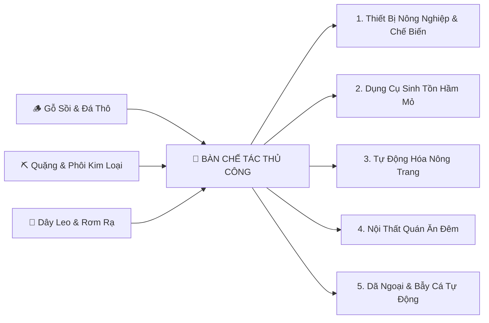

# 🔨 Bàn Chế Tác Thủ Công & 21 Đồ Vật Chế Tạo

Là một thợ thủ công khai hoang tại thị trấn biên viễn Oakhaven, Rowan không thể phụ thuộc hoàn toàn vào thợ rèn Boris hay thợ may Elora cho những nhu yếu phẩm thường nhật. Ngay bên hiên Quán Ăn & Nhà Trọ Oakhaven, chiếc **Bàn Chế Tác Thủ Công (Artisan Workbench)** chính là nơi người chơi tự tay cưa gỗ, đan lát, gõ đinh và pha chế 21 loại trang thiết bị sống còn.

---

## 1. Cơ Chế Bàn Chế Tác & Mở Khóa Bản Vẽ

- **Vị trí đặt:** Đặt cố định tại sân sau hoặc cạnh lò sưởi Quán Ăn & Nhà Trọ. Tương tác trực tiếp không tốn Thể Lực.
- **Tiến trình mở khóa (Sổ Rách Bà Amalia):**
  - *Giai đoạn đầu:* Chế tạo các vật phẩm cơ bản như hàng rào, đuốc cắm vách đá, giàn phơi thảo mộc và lờ bẫy cá.
  - *Mảnh trang sổ rách:* Khám phá rương ngầm đáy mỏ hoặc giải mã cuộn giấy tại thư viện Clara để mở khóa các công nghệ tự động hóa cao cấp (vòi phun hoàng kim, lò hun khói, bộc phá khai khoáng).

---

## 2. Danh Mục 20 Đồ Vật Chế Tác Thuộc 5 Phân Hệ

### A. Phân Hệ Thiết Bị Chế Biến Nông Sản
*Nâng cao phẩm cấp và giá trị nguyên liệu thu hoạch:*

1. **Giàn Phơi Sấy Thảo Mộc (`craft_drying_rack`):** *(20 Gỗ Sồi + 5 Dây Leo)*
   - Sấy khô búp trà, nấm và hoa thảo mộc trong 24h.
   - Nâng cấp phẩm chất thêm $+1$ sao (Star-tier), giữ trọn vẹn hương vị không bao giờ mốc hỏng.
2. **Lò Hun Khói Gỗ Sồi (`craft_oak_smoker`):** *(25 Đá Thô + 15 Gỗ + 2 Phôi Sắt)*
   - Hun khói cá suối và thịt săn bằng dăm gỗ sồi.
   - Cho ra **Lương Khô Bỏ Túi** (+40 Thể lực), không bao giờ ôi thiu trong những chuyến vượt 150 tầng mỏ.
3. **Thùng Lên Men Gỗ Thông (`craft_fermentation_cask`):** *(30 Gỗ Thông + 2 Phôi Đồng)*
   - Lên men bột chua Sourdough cho lò nướng bánh; ủ rượu táo sưởi ấm mùa đông.
4. **Thùng Ủ Phân Hữu Cơ (`craft_compost_bin`):** *(25 Gỗ Thô + 10 Rơm Rạ)*
   - Tái chế cỏ dại, rơm rác thành **Phân Bón Hữu Cơ** (+20% tốc độ lớn hoa màu).
5. **Thùng Ong Rừng Oakhaven (`craft_fae_apiary`):** *(35 Gỗ Sồi + 1 Nhựa Sồi Đen + 10 Hoa Cỏ Ngọt)*
   - Đặt cạnh luống hoa để tự động thu hoạch **Mật Ong Rừng** mỗi 3 ngày.

---

### B. Phân Hệ Dụng Cụ Sinh Tồn Hầm Mỏ
*Vật phẩm hỗ trợ thám hiểm 150 tầng mỏ tối tăm:*

6. **Đuốc Cắm Vách Đá (`craft_wall_torch` — Gói 5 cây):** *(2 Gỗ Sồi + 1 Than Đá)*
   - Cắm cố định lên vách đá hang mỏ; vĩnh viễn không tắt, đánh dấu ngã ba đường mê cung.
7. **Bộc Phá Thợ Mỏ (`craft_blast_powder`):** *(2 Than Đá + 1 Đá Tinh Thể + 1 Đất Sét)*
   - Ném phá tan các tảng đá lớn và quặng cứng trong bán kính $3 \times 3$ ô, gom quặng nhanh chóng.
8. **Dây Thừng Thoát Hiểm (`craft_escape_rope`):** *(12 Dây Leo Rừng)*
   - Rút lui khẩn cấp lên trạm thang máy gần nhất khi cạn kiệt thể lực hoặc bị bầy quái dồn ép.
9. **Cột Mốc Phát Quang (`craft_luminous_beacon`):** *(1 Thạch Anh + 5 Đá Thô)*
   - Dựng kết giới ánh sáng 60s ngăn quái vật bóng tối tiếp cận, tạo khoảng lặng an toàn để hồi phục.
10. **Kẹp Sắt Bắt Quặng Nóng (`craft_magma_tongs`):** *(4 Phôi Sắt)*
    - Thu nhặt quặng nóng chảy ở Tầng 90–120 mà không bị bỏng trừ thể lực.

---

### C. Phân Hệ Hạ Tầng & Tự Động Hóa Nông Trang
*Giải phóng sức lao động để tập trung đi mỏ và mở tiệm:*

11. **Vòi Phun Đồng Oakhaven (`craft_copper_sprinkler`):** *(1 Phôi Đồng + 1 Phôi Sắt)*
    - Tự động tưới nước cho 4 ô đất chữ thập liền kề vào 06:00 mỗi sáng.
12. **Vòi Phun Sắt / Vòi Hoàng Kim (`craft_iron_sprinkler`):** *(1 Phôi Sắt + 1 Phôi Đồng)*
    - Tự động tưới nước trọn vẹn khu vực $3 \times 3$ (8 ô bao quanh) mỗi sáng.
12b. **Vòi Phun Hư Không (`craft_void_sprinkler`):** *(1 Thỏi Void + 1 Thạch Anh Tím)*
    - Tự động tưới nước trọn vẹn khu vực $5 \times 5$ (24 ô bao quanh) mỗi sáng.
13. **Bù Nhìn Rơm Chống Quạ (`craft_straw_scarecrow`):** *(20 Rơm + 1 Gỗ + 1 Than Đá)*
    - Bảo vệ luống hoa màu bán kính 8 ô không bị chim rừng ăn vụng hạt giống mới gieo.
14. **Hàng Rào Gỗ & Cổng Vườn (`craft_picket_fence` — Gói 5 cọc):** *(2 Gỗ Sồi)*
    - Ngăn cỏ dại xâm lấn luống cây và tạo lối đi thẩm mỹ cho nông trang.
15. **Lối Đi Lát Đá Cuội (`craft_cobblestone_path` — Gói 10 phiến):** *(1 Đá Thô)*
    - Tăng 15% tốc độ chạy ngoài trời và giữ sạch lối đi không sình lầy vào mùa mưa.

---

### D. Phân Hệ Nội Thất & Đồ Gỗ Quán Ăn
*Tự tay đóng bàn ghế để nâng chỉ số Cozy Rating:*

16. **Bàn Gỗ Sồi Mộc 2 Chỗ (`craft_rustic_table`):** *(30 Gỗ Sồi + 1 Phôi Sắt)*
    - Kê thêm 1 bàn đón thêm 2 khách/đêm tại quán ăn, tăng trực tiếp doanh thu.
17. **Ghế Bành Da Dày Êm Ái (`craft_leather_armchair`):** *(15 Gỗ + 2 Da Thuộc Elora)*
    - Khách ngồi êm ái tăng $+30\%$ thời gian kiên nhẫn chờ món và cộng $+10$ Cozy Rating.
18. **Tủ Kính Trưng Bày Món Ăn (`craft_showcase_counter`):** *(40 Gỗ + 4 Thạch Anh + 2 Phôi Đồng)*
    - Bảo quản 12 món ăn qua đêm ở chất lượng tươi mới $100\%$.
19. **Lò Sưởi Đá Cuội Góc Quán (`craft_corner_hearth`):** *(60 Đá Thô + 10 Đất Sét + 5 Than)*
    - Trái tim sưởi ấm Quán Ăn & Nhà Trọ: Tăng $+50$ Cozy Rating, kích hoạt khách tip thêm tiền vàng.

---

### E. Phân Hệ Dã Ngoại & Bắt Mồi Tự Động

20. **Lờ Đan Bẫy Cá Suối (`craft_willow_fish_trap`):** *(15 Cành Liễu Gai + 2 Gỗ Sồi)*
    - Đặt cố định tại bờ suối làng hoặc hồ nước ngầm đáy mỏ.
    - Tự động thu hoạch cá mỡ, tôm càng và lươn điện mỗi sớm mà không bắt người chơi phải ngồi lặp lại mini-game câu cá!

---

## 3. Mẹo Tối Ưu Hóa Dòng Chảy Công Việc (Workflow Tips)

> [!TIP]
> **Vòng Lặp Sáng Sớm Của Rowan:**
> 1. Lúc 06:00: Hệ thống vòi phun đã tự tưới xong toàn bộ luống đất.
> 2. Chạy ra bờ suối nhấc 2 cái **Lờ bẫy cá** thu hoạch cá suối và tôm càng.
> 3. Đưa cá vào **Lò Hun Khói Gỗ Sồi** làm **Lương Khô Bỏ Túi**, bổ sung **Đuốc Cắm Vách Đá** từ bàn chế tác.
> 4. Nhét 3 cuộn **Dây Thừng Thoát Hiểm** và 5 gói **Bộc Phá** vào ba lô rồi tự tin bước thẳng vào hang mỏ 150 tầng!
