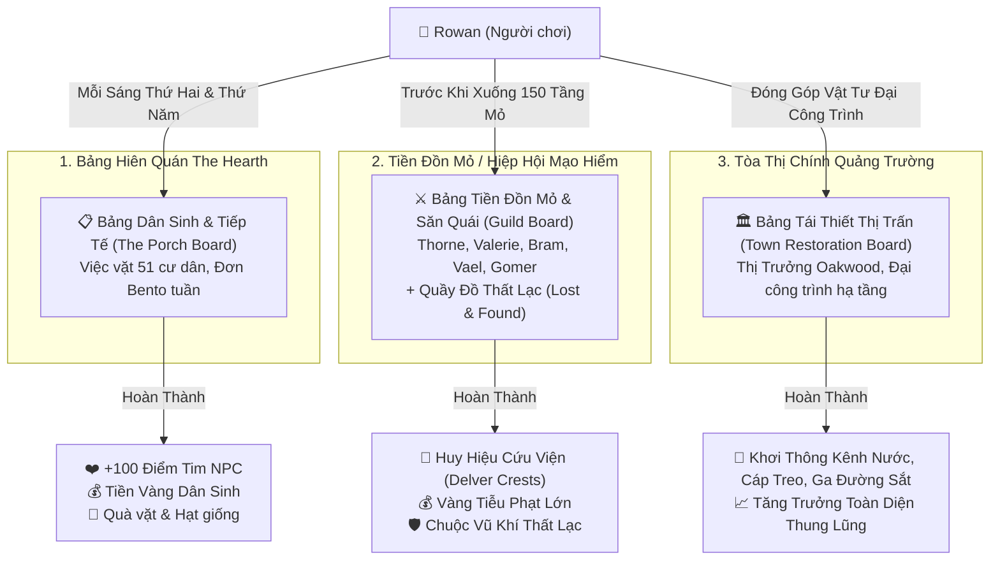

# 📜 Cẩm Nang Hệ Thống Nhiệm Vụ Uỷ Thác & Săn Thưởng (Help Wanted & Bounty Commissions)

Hệ thống **Nhiệm Vụ Uỷ Thác** trong *Rowan of Oakhaven* kết nối 3 trụ cột gameplay chính: **Gắn kết tình cảm thị trấn**, **Chiến đấu hầm mỏ 150 tầng**, và **Kinh tế Quán Ăn & Nhà Trọ Oakhaven**.

---

## 1. Bản Đồ Mạng Lưới 3 Bảng Uỷ Thác Tại Oakhaven

---

## 2. Chi Tiết Từng Bảng Nhiệm Vụ

### A. Bảng Dân Sinh Hiên Quán The Hearth (The Porch Help Wanted)
* **Vị trí:** Ngay trước hiên Quán Ăn & Nhà Trọ The Hearth.
* **Thời gian làm mới:** 06:00 mỗi sáng Thứ Hai và Thứ Năm (xuất hiện 2 – 3 lá đơn mới).
* **Thời hạn:** **2 – 3 ngày** kể từ lúc đăng bài.
* **Ý nghĩa cốt lõi:** Nguồn tích lũy điểm tình cảm khổng lồ (+100 điểm/nhiệm vụ) giúp tiến tới mốc 8 Tim (3,200 điểm) mà không bị phụ thuộc vào giới hạn tặng quà tuần.

| Phân Loại | Người Giao Thường Gặp | Mục Tiêu Mẫu | Phần Thưởng |
| :--- | :--- | :--- | :--- |
| **Nông sản mùa** | Bà Maeve, Hazel | 3 Hắc Cà Rốt Mắt Mèo, 8 Quả Mọng Rừng | 100 - 150g, **+100 Tim** |
| **Món ăn ấm lòng** | Aurelia, Sylvan | 1 Gà Hầm Sâm Mandrake Maca | 200 - 300g, **+100 Tim** |
| **Tìm đồ thất lạc** | Clara, Penny, Cora | Sổ phác thảo, kính lão, con quay | 150 - 200g, **+100 Tim** |
| **Vật tư gia cố** | Bram, Cedar | 25 Gỗ sồi, 10 Đá cuội gia cố bờ kè | 250 - 350g, **+100 Tim** |

---

### B. Bảng Tiền Đồn Mỏ & Hiệp Hội Mạo Hiểm (Adventurer's Guild Bounties & Lost & Found)
* **Vị trí:** Trụ sở Hiệp Hội Mạo Hiểm cạnh thang máy mỏ do Hội Trưởng Thorne và Valerie quản lý.
* **Thời gian làm mới:** Hằng ngày lúc 06:00 (tối đa 3 hợp đồng khả dụng cùng lúc).
* **Thời hạn:** **3 ngày** hoặc kéo dài đến khi Boss/Quái bị tiêu diệt.
* **Tiền tệ đặc biệt:** **Huy Hiệu Cứu Viện (`item_delver_crest`)**. Dùng để chuộc lại vũ khí/công cụ đánh rơi khi gục ngã dưới mỏ tại bàn Lost & Found.

| Loại Hợp Đồng | Yêu Cầu Mục Tiêu | Phần Thưởng Tiêu Biểu |
| :--- | :--- | :--- |
| **⚔️ Tiễu phạt bầy quái** | Diệt 15 Nhện Đá Cổ (Tầng 20-39) hoặc 10 Quỷ Lửa (Tầng 60-79) | 400 - 600g, **3 - 5 Huy Hiệu** |
| **⛏️ Cung ứng quặng thô** | Đào 20 Than đá hoặc 15 Quặng sắt mỏ sâu cho lò hơi | 300 - 500g, **2 - 4 Huy Hiệu**, +100 Tim Bram/Boris |
| **🌿 Thảo dược vực sâu** | Lặn hồ ngầm hái 5 Nấm phát quang giải độc cho Sylvan | 400 - 500g, **4 Huy Hiệu**, +100 Tim Sylvan |
| **👑 Warden Boss mốc tầng** | Trảm Golem Hơi Nước Tầng 30, Hỏa Long Tầng 70, Mộc Thần Tầng 110, Tướng Soái Tầng 150 | 1,200 - 2,500g, **10 - 20 Huy Hiệu** |

> [!TIP]
> **Huy Hiệu Tiền Đồn Dùng Để Làm Gì?**
> Mang đến quầy của Marlo để đổi:
> 1. *Nhẫn Thợ Lặn Mỏ (+15% Tốc độ đánh, +10% Kháng độc).*
> 2. *Dầu máy thang máy (mở quyền lướt thang máy xuống thẳng tầng 50/100).*
> 3. *Đá mài vũ khí tăng tỷ lệ chí mạng của Lò rèn Boris.*

---

### C. Bảng Đơn Cỗ & Tiếp Tế Tuần Của Quán Ăn (Hearth Catering & Frontier Bento)
* **Vị trí:** Treo cạnh Bàn Nghiên Cứu & Phát Triển (R&D Desk) và Quầy đóng gói cơm dã chiến Quán The Hearth.
* **Thời gian làm mới:** Sáng Thứ Hai đầu tuần lúc 06:00 (Hạn chót 23:00 Chủ Nhật).
* **Thời hạn:** **7 ngày**.
* **Đặc điểm:** Yêu cầu số lượng lớn các món ăn đạt chuẩn chất lượng 2 - 3 Sao hoặc các Hộp cơm dã chiến (Bento).

| Đơn Hàng Mẫu | Khách Đặt | Mục Tiêu | Phần Thưởng Đặc Quyền |
| :--- | :--- | :--- | :--- |
| **Tiệc Đón Đoàn Buôn** | Thuyền trưởng Garrick | 8 Mâm Cơm Rang Hải Sản Nghệ Tây 3 Sao | 2,400g, +150 Tim, **Công thức Rượu Rum Garrick** |
| **Suất Ăn Cứu Hộ Mỏ** | Đội trưởng Thorne & Valerie | 15 Hộp Thiếc Bánh Mì Đen Kẹp Thịt Xông Khói | 3,200g, +150 Tim, **Bản vẽ Balô Cách Nhiệt** |
| **Tiếp Tế Thợ Lặn Cóng** | Thợ lặn Vael | 5 Hộp Thiếc Súp Bí Đỏ Gừng Củ Nóng Hổi | 1,100g, +120 Tim, **5x Vảy Cá Băng Tầng Ngầm** |
| **Hội Chợ Bánh Thu** | Dân làng Oakhaven | 20 Bánh Bí Đỏ Quế Nướng 3 Sao | 3,500g, +200 Tim toàn làng, **Tủ Kính Mạ Vàng** |

---

## 3. Hệ Thống Đóng Gói Cơm Hộp Dã Chiến (Expedition Bento) & Quy Chuẩn Độ Tươi

### A. Phân Cấp Hộp Đựng Dã Chiến & Kéo Dài Độ Tươi (Freshness Extension)
Để vận chuyển đồ ăn xuống mỏ sâu hoặc giao hàng cho các toán tuần tra xa xôi mà không bị nát hay giảm chất lượng, hộp Bento có công năng đặc biệt là **kéo dài thời gian Nóng Hổi (Freshness Bonus)**:
* **Hộp Gỗ Thông Thô (Tier 1):** Chế tạo từ *4 Gỗ mềm + 1 Dây bện*. Đựng cơm nắm, bánh mì khô, rau luộc. **Kéo dài trạng thái Nóng Hổi trong 48 Giờ (2 ngày)**.
* **Hộp Thiếc Chống Gỉ (Tier 2):** Chế tạo từ *2 Thỏi Thiếc + 1 Đệm sáp*. Đựng súp đặc, thịt hầm, cá áp chảo. Chống va đập hầm mỏ, **kéo dài trạng thái Nóng Hổi trong 72 Giờ (3 ngày)**.
* **Cặp Lồng Giữ Nhiệt Sơn Mài (Tier 3):** Chế tạo từ *1 Hộp Thiếc + 2 Len Cừu + 1 Dầu Trẩu*. Đựng đại tiệc 3 món cho khách quý tộc (Valen de Montfort) và toán thám hiểm sâu. **Kéo dài trạng thái Nóng Hổi trong 120 Giờ (5 ngày)**.

### B. Quy Chuẩn Độ Tươi & Nóng Hổi (Freshness Bonus - Tuyệt Đối Không Thiu Thối)
* **Quy tắc nhân văn & bối cảnh:** Trò chơi **không áp dụng cơ chế thức ăn thiu thối biến thành rác**. Trong bối cảnh hậu chiến gian khó, từng cọng rau củ khoai đều được trân trọng.
* **Trạng thái Nóng Hổi (Fresh - Trong 24h nếu để ngoài, hoặc kéo dài theo cấp Hộp Bento):**
  * Bán tại quán The Hearth: Nhận tiền boa thêm **+20% tiền vàng**, tăng điểm Cozy.
  * Giao đơn bảng tin: Nhận thêm quà vặt của dân làng (vài củ hành, quả rừng dại, nắm muối khoáng).
  * Ăn khi chiến đấu mỏ: Nhận thêm buff phụ ngắn hạn (+5% Tốc chạy hoặc hồi 10 Stamina tức thì).
* **Trạng thái Tiêu Chuẩn (Standard - Sau khi hết thời gian giữ nhiệt của hộp hoặc sau 24h):**
  * Đồ ăn nguội đi thành đĩa thức ăn bình thường, **tự động gộp xếp chồng (Stack x99)** vào 1 ô túi đồ (không gây phân mảnh rương đồ).
  * Giữ nguyên 100% chỉ số buff chiến đấu (Công, Thủ, Tốc, Kháng nguyên tố) và bán đúng 100% giá niêm yết.
* **Thực Phẩm Bảo Quản (Preserved Provisions):** Thịt xông khói, phô mai ủ hầm, lươn sấy khô, bánh quy hạt dẻ — bản chất khô ráo không bao giờ nguội, chuyên dùng dự trữ thám hiểm mỏ 150 tầng.

---

## 4. Hệ Sinh Thái Nhiệm Vụ Đa Tầng (Layered Quest Ecosystem) & Mở Khóa Độc Bản

Nhằm gia tăng chiều sâu thực chiến và tính nhập vai, hệ thống nhiệm vụ mở rộng thành **5 Phân Loại Trọng Tâm**, nơi các nhiệm vụ độ khó cao trao tặng **Thành Tựu Ẩn**, **Công Thức Thất Truyền**, **Bản Vẽ Cơ Khí**, **Kỷ Vật Ba Lô Thụ Động (Passive Relics)** và **Đồ Trang Trí Nội Thất Tăng Điểm Ấm Cúng (Cozy Rating)** cho quán The Hearth:

1. **Nhánh Thường Nhật & Dân Sinh Xóm Giềng (Routine Errands):** Đơn lặt vặt của 51 cư dân đăng Thứ Hai và Thứ Năm trên Bảng Gỗ Hiên Quán The Hearth. Thù lao: Vàng (50g - 250g), +100 Tim, hạt giống, củ quả tươi.
2. **Nhánh Môi Trường Khắc Nghiệt & Cứu Hộ Dã Ngoại (Hazard & Frontier Survival):** Giao hộp cơm Bento nóng hổi lên đỉnh đèo trong bão tuyết, lặn hồ mỏ băng mò tinh thể, cứu viện sập vách hầm mỏ tầng sâu. Thưởng kỷ vật chống rét, bản vẽ balo cách nhiệt, thành tựu ẩn.
3. **Nhánh Chuỗi Khúc Mắc Lâu Năm & Hóa Giải Quá Khứ (Grounded Multi-Stage Narrative Questlines):** Chuỗi 3 giai đoạn khai thác câu chuyện đời thực của cư dân hậu chiến (Boris & Bram mâu thuẫn xưởng rèn mộc; Valen de Montfort trốn chạy truy lùng Solaria; Lão Barnaby xiết nợ quán trọ...). Thưởng bàn cơ khí liên hoàn, bàn cờ gỗ sồi, bộ đồ ăn hoàng gia (+Cozy).
4. **Nhánh Tiễu Phạt Thợ Săn Tinh Anh & Trảm Warden Kèm Ràng Buộc (Tactical Warden & Cavern Bounties):** Hạ Boss Warden Tầng 30, 70, 110, 150 với điều kiện chiến thuật nghiêm ngặt (Master Parry 12 lần, không dùng bình thuốc Maeve, chỉ dựa vào buff đồ ăn Bento, hoàn thành trước khi miasma đạt 50%). Thưởng đầu lâu quái vật tinh anh trưng bày lò sưởi, danh hiệu hồ sơ độc bản.
5. **Nhánh Đại Lễ Cầu Siêu & Giải Phóng Đất Hoang (Ancient Altar Cleansing & Land Reclamation):** Người Giữ Đền Rosemary chủ trì tại 4 Bàn Thờ Cổ Đại (4 mùa). Nấu mâm đại tiệc 5 món 3 Sao dâng lễ lúc nửa đêm và chống đỡ đợt linh hồn chiến trận. Thưởng mở khóa **Vườn Thảo Dược Vĩnh Cửu Bìa Rừng**, Lư hương đồng cổ đại (+Tối đa Cozy Rating), Công thức Trà Tẩy Trần Ngàn Năm.

---

### Danh Mục Các Nhiệm Vụ Khó Mẫu & Phần Thưởng Độc Quyền

| Mã & Tên Nhiệm Vụ | NPC Giao | Điều Kiện Thử Thách Khắc Nghiệt | Phần Thưởng Độc Quyền Mở Khóa |
| :--- | :--- | :--- | :--- |
| **Q-HAZ-01: Bát Canh Bão Tuyết Lên Đèo** | Hiệp Sĩ Hester | Giao 1 Cặp lồng sơn mài *Súp Bí Đỏ Gừng Củ* lên chòi đèo tuyết lúc 20:00 - 23:00 đêm bão tuyết; không để ngất vì cóng lạnh. | 🏆 Thành tựu ẩn: `ACH_BLIZZARD_RUNNER` *(Người Vượt Bão Tuyết)* 🧿 Kỷ vật: *Khăn Len Cũ Của Hester* (giảm 50% tụt Stamina khi làm việc dưới mưa tuyết) 🛋️ Trang trí: *Bản Đồ Hành Quân Cổ* (+10 Cozy). |
| **Q-HAZ-02: Khí Độc Đáy Hồ Băng** | Thợ Lặn Vael | Lặn đáy hồ mỏ tầng 85 thu thập 3 Băng Tinh Ngàn Năm trong lúc thanh miasma dâng cao; không dùng bình thở dự phòng. | 🏆 Thành tựu ẩn: `ACH_DEEP_DIVER` *(Thợ Lặn Vực Sâu)* 📜 Bản vẽ: *Bộ Lọc Hơi Nước Mỏ Sâu* (miễn nhiễm miasma 5 phút) 🛋️ Trang trí: *Vỏ Ốc Băng Phát Quang* (+12 Cozy). |
| **Q-HAZ-03: Sập Vách Hầm Lò Đêm** | Lão Gomer | Vận chuyển 15 Cơm Nắm Nướng Mỡ Hành (Hộp Thiếc) cứu viện toán thợ mỏ mắc kẹt tầng 45 trong vòng 1 ngày. | 🏆 Thành tựu ẩn: `ACH_MINE_SAVIOR` *(Cứu Tinh Thợ Mỏ)* 📜 Bản vẽ: *Máy Khoan Hơi Nước Cầm Tay Gomer* (đào đá nhanh x2, -50% Stamina) 💰 800g + 10x Thuốc Nổ Bộc Phá. |
| **Q-LORE-01: Lò Rèn & Thước Gỗ (Boris & Bram)** | Boris & Bram | Tìm lại *Bản Vẽ Xưởng Rèn Liên Hoàn Thất Lạc* tại Tầng 65 mỏ; phục vụ món *Bánh Mì Nướng Men Rượu Táo* cho cả hai tại The Hearth. | 🏆 Thành tựu ẩn: `ACH_ANVIL_AND_TIMBER` *(Lò Rèn Cùng Thước Gỗ)* 📜 Bản vẽ: *Bàn Chế Tác Cơ Khí Liên Hoàn* (-20% nguyên liệu rèn/gỗ) 🛋️ Trang trí: *Bàn Cờ Gỗ Sồi Của Hai Lão Già* (+15 Cozy). |
| **Q-LORE-02: Bóng Đêm Hoàng Tộc Solaria** | Valen de Montfort | Nấu *Súp Bổ Máu Củ Dền Thảo Mộc 3 Sao* trong Cặp lồng sơn mài; lén giao lên phòng kín lầu 2 sau 23:00; né tránh lính tuần tra. | 🏆 Thành tựu ẩn: `ACH_SOLARIA_SHADOW` *(Bóng Đêm Solaria)* 📜 Công thức gia truyền: *Súp Bổ Máu Solaria* (Hồi 100 HP, +20% Kháng Vật Lý) 🛋️ Trang trí: *Bộ Dao Nĩa Bạc Hoàng Triều* (+20 Cozy, hút khách sang). |
| **Q-LORE-03: Chiếc Cúc Áo Người Lính Cũ** | Bé Cora | Lặn mò ven suối tìm chiếc Cúc Áo Bạc Quân Đội của cha Cora bị lũ cuốn; làm 1 đĩa Bánh Quy Hạt Phỉ an ủi bé. | 🏆 Thành tựu ẩn: `ACH_PROMISE_BY_STREAM` *(Lời Hứa Bờ Suối)* 🧿 Kỷ vật: *Vòng Đá Cuội Bảy Màu May Mắn* (+5% Tỉ lệ Né đòn vĩnh viễn) 🛋️ Trang trí: *Bức Tranh Bờ Suối Vẽ Tay Của Cora* (+10% khách tip thêm). |
| **Q-LORE-04: Sổ Môn Không Thể Xóa** | Bác Barnaby | Đòi lại 1,200g nợ mua rượu cũ từ 3 khách trọ quịt nợ dạt ra bìa rừng; hoặc tự bù tiền nếu thương hại họ. | 🏆 Thành tựu ẩn: `ACH_DEBT_COLLECTOR` *(Tay Hòm Chìa Khóa)* 🧿 Kỷ vật: *Sổ Ghi Nợ Bọc Da Của Barnaby* (xem trước biến động giá nông sản/quặng ngày mai) 💰 Barnaby chia 30% tiền nợ thu hồi. |
| **Q-HUNT-01: Bức Tường Thép Trước Hỏa Long** | Hiệp Sĩ Hester | Tiêu diệt Hỏa Long Hồ Đúc Tầng 70 với điều kiện thực hiện tối thiểu 12 lần Master Parry chuẩn xác; HP không tụt dưới 80%. | 🏆 Thành tựu ẩn: `ACH_PARRY_MASTER` *(Bậc Thầy Đỡ Đòn)* 🛋️ Trang trí: *Giáp Vảy Hỏa Long Mạ Vàng* (treo tường The Hearth, +15% tip từ thợ mỏ) ⚔️ Danh hiệu: *"Bức Tường Thép Oakhaven"*. |
| **Q-HUNT-02: Bữa Tiệc Sinh Tồn Dung Nham** | Hội Trưởng Thorne | Quét sạch 3 tầng Hồ Luyện Kim (61-63) không dùng bình thuốc Aurelia; chỉ sống sót bằng buff từ Cơm hộp dã chiến mang theo. | 🏆 Thành tựu ẩn: `ACH_IRON_STOMACH` *(Sinh Tồn Ẩm Thực)* 📜 Bản vẽ: *Ba Lô Cách Nhiệt Dã Ngoại* (+8 ô chứa đồ, giữ thức ăn tươi gấp đôi) 🏅 15x Huy Hiệu Cứu Viện. |
| **Q-ALTAR-01: Khúc Ca Cầu Siêu Tiết Xuân Phân** | Rosemary | Nấu mâm đại tiệc 5 món Xuân (Cải thìa xào nấm sao, Canh củ sen tuyết...) dâng Bàn Thờ Cổ lúc nửa đêm; trảm 3 đợt Hồn Ma Miasma. | 🏆 Thành tựu ẩn: `ACH_ASHES_TO_BLOOM` *(Hóa Giải Tro Tàn)* 🌱 Mở khóa: *Vườn Thảo Dược Vĩnh Cửu Bìa Rừng* (trồng thảo mộc quanh năm) 🛋️ Trang trí: *Lư Hương Đồng Bàn Thờ Cổ* (+25 Cozy Rating, max cấp). |

---

## 5. Quy Trình Trả Nhiệm Vụ (Turn-In Loop)

Người chơi có 2 phương thức giao nộp:

1. **Giao Tận Tay NPC (Direct Hand-in):**
   * Tìm NPC theo lịch trình sinh hoạt (Schedule Matrix).
   * Tương tác chọn *"Giao vật phẩm uỷ thác"*.
   * Kích hoạt câu thoại cảm ơn đặc trưng + **Nhận đủ 100% Điểm Tình Cảm (+100 Tim)**.
2. **Nộp Vào Hòm Thu Nhận (Drop-box):**
   * Nếu quá nửa đêm hoặc NPC đang trong ca làm việc khép kín, người chơi có thể nhét vật phẩm vào Hòm Giao Hàng cạnh Bảng Tin.
   * Nhận đủ Tiền Vàng và Huy hiệu qua hòm thư sáng hôm sau, nhưng điểm tim chỉ nhận $+50$ (vì không có đối thoại mặt đối mặt).

---

## 6. Quy Tắc Cân Bằng & Chống Kẹt Tiến Trình (Smart Progression Guard)

* **Tự động thích ứng cấp độ:** Hệ thống chỉ rút thẻ nhiệm vụ tương ứng với độ sâu tầng mỏ và cấp công cụ hiện tại của người chơi. Nếu chưa mở tầng 40 mỏ, bảng tin sẽ không bao giờ xuất hiện quái vật hay khoáng thạch tầng 40+.
* **Không phạt hủy bỏ:** Nếu không kịp hoàn thành trong thời hạn, nhiệm vụ sẽ nhẹ nhàng hết hạn và gỡ xuống mà không trừ tiền vàng hay điểm tim của người chơi.

