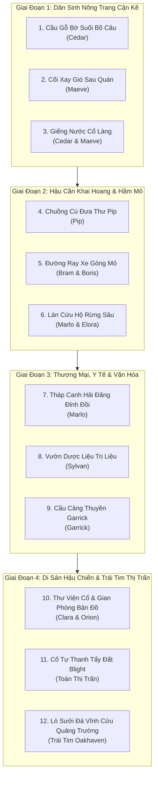

# 🏛️ Cẩm Nang Đại Kế Hoạch Tái Thiết Thị Trấn Oakhaven (Town Restoration Guide)

Thị trấn Oakhaven từng là tiền tuyến gánh chịu nhiều mất mát nặng nề sau cuộc chiến tàn khốc. Rừng sâu vương vãi sắt vụn gỉ sét, các cây cầu huyết mạch bị giật sập, cối xay gió kẹt trục, đất đai nhiễm độc và ngọn lửa sưởi ấm quảng trường đã nguội lạnh suốt một thập kỷ.

Hành trình của Rowan không chỉ là làm giàu, mà là **cùng dân làng từng bước sửa chữa nhà cửa, khơi thông thủy lợi, dựng lại 12 công trình di sản** qua 4 giai đoạn phát triển.

---

## 1. Bản Đồ 4 Giai Đoạn Tái Thiết Oakhaven

---

## 2. Danh Sách Chi Tiết 12 Dự Án & Định Mức Vật Liệu

Các định mức nguyên vật liệu đã được cân bằng ở **Mức Trung Bình – Thử Thách**, đòi hỏi sự kết hợp chặt chẽ giữa đốn củi, khai thác quặng sâu, luyện kim tại lò rèn Boris và tích lũy doanh thu từ Quán Ăn & Nhà Trọ:

| STT | Dự Án | Khu Vực | Người Chủ Trì | Vật Liệu Yêu Cầu (Mức Trung Bình) | Đặc Quyền Mở Khóa Vĩnh Viễn |
| :-: | :--- | :---: | :--- | :--- | :--- |
| **1** | **Cầu Gỗ Bờ Suối Bồ Câu** | `riverside` | Cedar | • 120 Gỗ Sồi Già • 60 Đá Cuội Bờ Suối • 25 Đinh Sắt Boris • 2,500g | Rút ngắn 60% thời gian chạy sang bến thuyền; mở lối bãi rái cá nhặt ngọc trai. |
| **2** | **Cối Xay Gió Sau Quán** | `farm` | Maeve | • 100 Gỗ Sồi Già • 35 Thỏi Đồng Đúc • 15 Bánh Răng Cơ Khí Mỏ • 3,200g | Tự động xay lúa mì qua đêm tỷ lệ $1 \rightarrow 2$ bột mì; cộng $+30$ Cozy Rating. |
| **3** | **Giếng Nước Cổ Làng** | `village` | Cedar & Maeve | • 100 Khối Đá Cắt Thô • 40 Đất Sét Dẻo • 5 Thạch Anh Tinh Thể • 2,000g | Hồi đầy bình tưới tức thì; cây trồng trong bán kính 5 ô tăng $+15\%$ tốc độ lớn. |
| **4** | **Trạm Chuồng Cú Pip** | `farm` | Pip | • 80 Gỗ Thông Dẻo • 40 Cành Liễu Gai • 15 Thạch Anh Tinh Thể • 2 Đèn Lumina • 2,800g | Mở tính năng Phái Cú Viễn Chinh tìm hạt giống hiếm từ các vương quốc khác. |
| **5** | **Đường Ray Xe Gòng Mỏ** | `mine` | Bram & Boris | • 60 Thỏi Sắt Đúc • 50 Tà Vẹt Gỗ Sồi • 3 Đá Trọng Lực Floatstone • 30 Than Đá • 4,500g | Xe gòng tự chuyển toàn bộ quặng mỏ sâu về rương Boris; chấm dứt nghẽn túi đồ. |
| **6** | **Lán Cứu Hộ Rừng Sâu** | `forest` | Marlo & Elora | • 120 Gỗ Sồi Già • 20 Vải Bạt Len Chống Thấm • 25 Thạch Anh Tinh Thể • 1 Lò Sưởi Đá • 3,500g | Trạm nghỉ an toàn không bị ngất xỉu giữa rừng sâu; có bàn chế tác dã chiến. |
| **7** | **Tháp Canh Đỉnh Đồi** | `mine` | Marlo | • 150 Khối Đá Cắt Thô • 50 Thỏi Sắt Đúc • 15 Thấu Kính Quang Học • 6,000g | Hệ thống dự báo thời tiết chuẩn xác trước 3 ngày; chủ động đón Khách Đêm Bão. |
| **8** | **Vườn Dược Liệu Sylvan** | `village` | Sylvan | • 80 Gỗ Mục Nuôi Nấm • 50 Mùn Rừng Phì Nhiêu • 25 Nấm Huỳnh Quang Mỏ • 10 Thạch Đổi Màu • 5,000g | Tự nhân giống Nấm Phát Quang trên mặt đất; Sylvan bán thuốc giảm giá $50\%$. |
| **9** | **Cầu Cảng Bến Garrick** | `riverside` | Garrick | • 160 Cột Gỗ Sồi Dày • 50 Thỏi Đồng Đúc • 30 Dây Thừng Gai • 20 Thỏi Sắt • 7,500g | Đoàn buôn Garrick mang caravel 3 cột buồm cập bến Chủ Nhật; gấp đôi hàng ngoại. |
| **10** | **Thư Viện & Phòng Bản Đồ** | `village` | Clara & Orion | • 140 Gỗ Sồi Già • 30 Da Thuộc Cứng Elora • 15 Mực Dạ Quang Thạch Anh • 20 Thạch Anh • 8,000g | Giải mã bản vẽ cổ nhặt dưới mỏ sâu để rèn vũ khí Hoàng Gia; mở lại lớp học làng. |
| **11** | **Cổ Tự Thanh Tẩy Blight** | `farm` | Toàn Thị Trấn | • 100 Muối Thanh Tẩy Morrigan • 25 Ma Thạch Thuần Khiết • 10 Bụi Tế Đàn Cổ • 12,000g | Hoàn nguyên 40 ô đất nông trang bị nhiễm độc thành Thửa Đất Thần Thoại 3 Sao. |
| **12** | **Lò Sưởi Đá Vĩnh Cửu** | `village` | Cư Dân Oakhaven | • 200 Than Đá Sâu Khối Đặc • 60 Thỏi Vàng Đúc • 1 Lõi Lửa Dung Nham Boss 70 • 15,000g | Ngọn lửa sưởi ấm vĩnh cửu; toàn bộ cư dân Oakhaven nhận buff An Lòng (+25% thân thiết). |

---

## 3. Quy Trình Thi Công & Tương Tác Trong Game

1. **Đóng góp linh hoạt theo từng đợt:**
   * Mỗi công trình có một **Hòm Quyên Góp (Donation Ledger)** đặt tại hiện trường.
   * Người chơi có thể nộp trước 20 gỗ sồi hôm nay, mai nộp tiếp 5 thỏi sắt. Thanh tiến độ hiển thị từ $0\% \rightarrow 100\%$.
2. **Tiến độ thi công 24 giờ:**
   * Khi cán mốc $100\%$, giàn giáo gỗ sồi và bạt che mưa sẽ mọc lên (`State: Under Construction`).
   * Các NPC liên quan sẽ xuất hiện với hoạt ảnh cưa gỗ, đập đe, phụ hồ cùng nhau.
3. **Đêm Tiệc Khánh Thành Tại Quán Ăn Oakhaven:**
   * Sáng hôm sau, công trình chính thức hoàn tất rực rỡ.
   * Buổi tối lúc 19:00, toàn bộ dân làng kéo sang Quán Ăn ăn mừng, thưởng thức món ăn kỷ niệm do Rowan nấu và trao tặng những lời cảm ơn chân thành từ đáy lòng.

---

## 4. Hệ Sinh Thái 12 Cụm Cửa Hàng NPC & Gold Sink (Quỹ Tái Thiết `72,000g`)

Bên cạnh `72,000g` đầu tư vào 12 công trình di sản, các cư dân chuyên môn tại Oakhaven vận hành mạng lưới cửa hàng riêng nhằm tránh dư thừa vàng ở giữa–cuối game. **Rowan vẫn giữ độc quyền nấu 55 món ăn & chế tạo máy tự động hóa**; NPC chỉ bán nguyên liệu chuyên ngành, vật tư nâng cấp, dịch vụ và 6 vật phẩm tiêu hao chiến đấu:

| Cụm Thương Nhân | Địa Điểm & Mở Khóa | Mặt Hàng / Dịch Vụ Chính |
| :--- | :--- | :--- |
| **1. Maeve & Kael** | Nông Trại & Vườn Ươm | Hạt giống 4 mùa, cây giống gỗ/quả, phân bón hữu cơ; Kael 4 Tim mở hạt trái mùa. |
| **2. Hazel & Tilly** | Đồng Cỏ Phía Nam | Trứng, Sữa, Bơ, Kem (giá ~1.8x–2x cho lối chơi ít chuồng), Lông cừu, Vải bạt Len, Dây gai. |
| **3. Boris & Rowena** | Lò Rèn & Chòi Than | *Boris:* Đinh sắt, Dầu thiết mộc, Quặng cơ bản, Nâng cấp công cụ/vũ khí; *Rowena (2T):* Củi khô, Than rừng cháy x3. |
| **4. Cedar & Cô Mae** | Xưởng Mộc & Sảnh Quán (Thu–Đông) | *Cedar:* Gỗ, Đá cắt, Đất sét, Xây nâng cấp phòng trọ; *Mae:* Chăn ga, thảm len & nội thất nâng Cozy Rating. |
| **5. Thợ May Elora** | Rừng Thầm Thì / Tiệm Tối | Da thuộc cứng, Trang phục chống rét tầng băng, **Mở rộng ô Ba lô** (Gold Sink lớn). |
| **6. Garrick & Silas** | Cầu Cảng (sau sửa) & The Hearth (T5–T7) | *Garrick:* Gia vị ngoại (`Nghệ tây`, `Quế`, `Vani`, `Xì dầu`, `Dầu ô-liu`, `Hải sản`); *Silas:* Hạt lạ & phô mai/nấm tuần. |
| **7. Lão Gomer** | Lán Cửa Mỏ (2 Tim) | Bom mỏ tự chế (giới hạn tuần), Bộc phá phá đá, Đuốc vách đá. |
| **8. Tad, Vael & Lapis** | Đầm Lầy, Hồ Băng & Hồ Ngầm | *Tad:* Lờ đan, Mồi câu; *Vael (2T):* Ủng lội nước chống trượt; *Lapis:* Đổi khoáng biển/ngọc trai lấy món ăn nóng. |
| **9. Chú Bramble** | Chợ Đêm Thứ Bảy | Đèn Đá Phát Sáng, đồ trang trí Cozy, hàng xoay vòng ngẫu nhiên cuối tuần. |
| **10. Hester & Valerius** | Áp Mái Quán & Võ Đường | *Hester:* Sửa độ bền & gia cố giáp (+DEF); *Valerius:* Sách kỹ năng Parry & bao tay cận chiến. |
| **11. Clara & 5 NPC Thuốc** | Thư Viện, Trạm Xá, Đầm Lầy, Hội, Rừng | *Clara:* Bản vẽ cổ, Mực dạ quang; *Aurelia, Morrigan, Valen, Thorne, Fern:* 6 món tiêu hao chiến đấu & 3 gói 5-Buff. |
| **12. Goblin Grib & Khí Cầu** | Tầng 65 Mỏ & Đỉnh Đồi (Đông 28) | *Grib:* Chợ Đen bán Quặng Iridium/Void (giới hạn tuần, giá cao), Chìa rương cổ, Hạt tầng sâu; *Zephyr:* Hạt Thần Thoại. |
